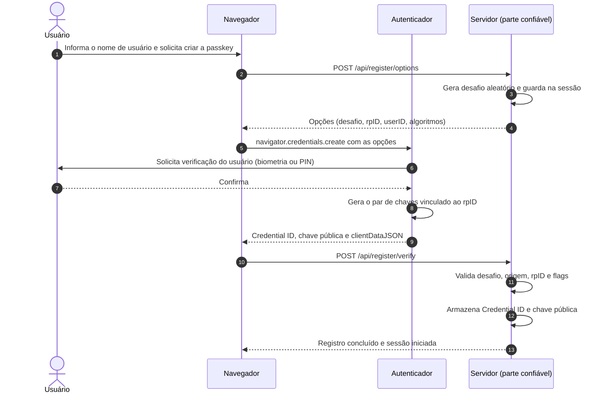
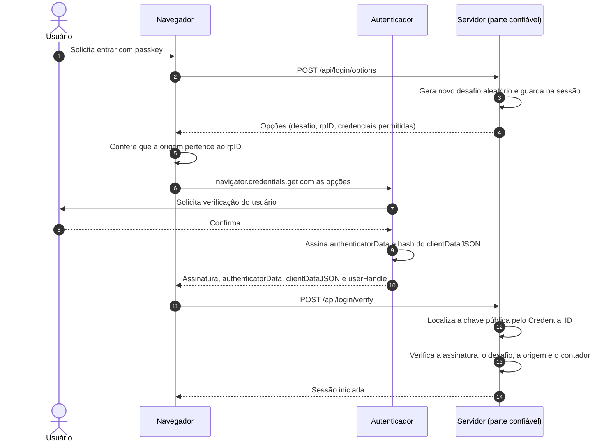
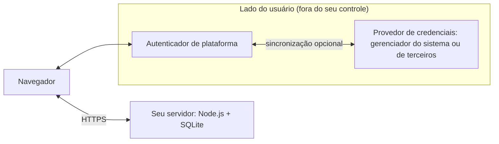

# Passkeys (WebAuthn/FIDO2): projeto de referência

Aplicação web de exemplo que implementa **login sem senha com passkeys**, escrita em Node.js e TypeScript. O objetivo é servir de base de estudo para quem quer entender como a autenticação por chaves criptográficas funciona na prática.

> Parte do TCC *Guia de Implementação para Mecanismos de Autenticação sem Senha* (UTFPR, Dois Vizinhos).

## O que o projeto faz

- Cria uma conta e registra uma passkey.
- Faz login com passkey, informando o nome de usuário ou **sem informá-lo**.
- Lista e remove passkeys (a última não pode ser removida).
- Encerra a sessão.

Não fazem parte deste projeto a política de verificação biométrica e a recuperação de acesso por TOTP, que ficam nos outros guias do repositório.

## Como funciona, em resumo

Em vez de uma senha, o usuário tem um **par de chaves**. A chave privada fica no dispositivo e nunca é enviada. O servidor guarda só a **chave pública** e, a cada login, envia um **desafio** aleatório que o dispositivo assina. Se a assinatura confere, o usuário está autenticado.

| Termo | O que é |
|---|---|
| **RP ID** | Domínio ao qual a passkey fica vinculada (aqui, `localhost`). Impede o uso em sites falsos |
| **Credential ID** | Identificador da passkey, gerado pelo autenticador |
| **User handle** | Identificador aleatório do usuário (32 bytes), sem relação com dados pessoais |
| **Desafio** | Valor aleatório de uso único que o autenticador assina |
| **Credencial detectável** | Passkey que o dispositivo lista sozinho, permitindo login sem digitar o usuário |

## Fluxos

### Registro



### Autenticação



Pontos para observar:

- **Resistência a phishing:** na etapa 5 do login, quem compara a origem da página com o RP ID é o navegador, não o usuário. Em um site falso, o autenticador simplesmente não responde.
- **O que o servidor confere no final:** o desafio emitido, a origem esperada, o RP ID, os indicadores de presença e verificação do usuário e o algoritmo da chave.

## O que é necessário

Nenhuma etapa exige hardware dedicado, conta em nuvem ou serviço pago. O servidor é seu e a verificação das assinaturas é feita localmente pela biblioteca.



| Item | Versão | Observação |
|---|---|---|
| **Node.js** | 22.13 ou superior | Exigido pelo SimpleWebAuthn v14 e pelo módulo `node:sqlite` |
| **npm** | Vem com o Node.js | |
| **Git** | Qualquer versão recente | |
| **Navegador** | Chrome ou Edge atuais | Têm autenticador virtual, para testar sem hardware |

Confira a versão do Node.js com `node -v`. Em versões anteriores à 22.13, o servidor falha ao importar `node:sqlite`.

## Estrutura de pastas

```text
passkeys/
├── package.json            # dependências e scripts
├── tsconfig.json           # configuração do TypeScript
├── .env.example            # variáveis de ambiente (modelo)
├── Dockerfile              # execução em contêiner (opcional)
├── docker-compose.yml
├── src/
│   ├── server.ts           # ponto de entrada: Express, sessão e rotas
│   ├── config.ts           # leitura e validação da configuração
│   ├── webauthn.ts         # constantes WebAuthn compartilhadas
│   ├── validation.ts       # validação do nome de usuário
│   ├── http.ts             # resposta de erro tipada
│   ├── session.ts          # desafio de uso único e sessão
│   ├── db.ts               # persistência em SQLite
│   ├── types.d.ts          # tipos da sessão
│   └── routes/
│       ├── registration.ts # cerimônia de registro
│       ├── authentication.ts # cerimônia de autenticação
│       └── account.ts      # perfil, logout e remoção de passkeys
├── public/
│   ├── index.html          # interface
│   ├── styles.css
│   └── app.js              # lado cliente (WebAuthn no navegador)
└── test/                   # testes automatizados
```

A biblioteca SimpleWebAuthn divide o protocolo em duas metades, e o projeto segue essa divisão:

| Lado | Pacote | Responsabilidade |
|---|---|---|
| Servidor | `@simplewebauthn/server` | Gerar as opções (com o desafio) e verificar as respostas |
| Navegador | `@simplewebauthn/browser` | Chamar a API WebAuthn do navegador e enviar o resultado ao servidor |

Cabe à aplicação guardar as chaves públicas, manter o desafio entre as duas etapas de cada fluxo e gerir a sessão.

## Como rodar

```bash
git clone <URL-DO-REPOSITORIO>
cd <repositorio>/passkeys

npm install
cp .env.example .env      # no Windows (PowerShell): Copy-Item .env.example .env
npm run dev
```

Acesse **http://localhost:3000**. Os valores padrão do `.env` já funcionam em ambiente local, e o `localhost` é tratado pelos navegadores como contexto seguro, então não é preciso HTTPS.

Outros comandos:

```bash
npm run typecheck   # verifica os tipos
npm test            # testes automatizados
```

### Configuração (`.env`)

| Variável | Padrão | Para que serve |
|---|---|---|
| `PORT` | `3000` | Porta do servidor |
| `ORIGIN` | `http://localhost:3000` | Endereço completo (com esquema e porta) que o navegador usa. Deve ser idêntico à barra de endereço |
| `RP_ID` | `localhost` | Domínio ao qual as passkeys ficam vinculadas, sem esquema e sem porta |
| `RP_NAME` | `Guia de Passkeys (TCC)` | Nome exibido nos diálogos do sistema |
| `USER_VERIFICATION` | `preferred` | `required`, `preferred` ou `discouraged`: se o servidor exige biometria ou PIN |
| `SESSION_SECRET` | (vazio) | Segredo da sessão. **Obrigatório em produção** |
| `DB_PATH` | `./data/passkeys.db` | Arquivo do banco SQLite |
| `TRUST_PROXY` | `0` | Use `1` quando houver túnel ou proxy HTTPS na frente do servidor |

### Docker (opcional)

Executa a aplicação sem instalar o Node.js. Exige o arquivo `package-lock.json` (gerado pelo `npm install`) e `SESSION_SECRET` definido no `.env`.

```bash
docker compose up --build
```

## Como testar

### Com o autenticador virtual (sem hardware)

1. Abra a página no Chrome ou Edge e as ferramentas do desenvolvedor (`F12`).
2. Abra o painel **WebAuthn** (menu de três pontos, *Mais ferramentas*, *WebAuthn*).
3. Marque **Enable virtual authenticator environment** e adicione um autenticador com protocolo **ctap2**, transporte **internal** e as opções **Supports resident keys** e **Supports user verification** ativadas.
4. Na página, informe um nome de usuário e clique em **Criar passkey**.
5. Clique em **Sair** e depois em **Entrar com passkey**, deixando o nome em branco para testar o login sem usuário.

### Com um autenticador real

No próprio computador, o sistema operacional exibe o diálogo de biometria ou PIN ao criar a passkey.

### A partir de outro dispositivo (por exemplo, um celular)

O WebAuthn exige HTTPS fora de `localhost`, e o RP ID precisa coincidir com o domínio acessado. Uma opção gratuita é um túnel HTTPS. Com o túnel fornecendo, por exemplo, `https://exemplo.trycloudflare.com`, ajuste o `.env` e reinicie o servidor:

```bash
ORIGIN=https://exemplo.trycloudflare.com
RP_ID=exemplo.trycloudflare.com
TRUST_PROXY=1
```

Passkeys criadas em `localhost` não valem nesse domínio, e em túneis gratuitos o endereço pode mudar a cada execução, invalidando as passkeys anteriores.

### Resultados esperados

| Verificação | Resultado esperado |
|---|---|
| Registro de usuário novo | Mensagem de sucesso e sessão iniciada |
| Segundo registro com o mesmo autenticador e a mesma conta | Erro informando que o autenticador já possui passkey |
| Login sem informar nome de usuário | O autenticador lista a passkey e o login é concluído |
| Reuso do mesmo desafio (repetir a requisição de verificação) | Falha: o desafio é de uso único |
| Acesso a partir de domínio diferente do `RP_ID` | O navegador recusa a operação (`SecurityError`) |
| Remoção da única passkey | Recusada pelo servidor |
| Conteúdo do banco (`data/passkeys.db`) | Apenas Credential ID, chave pública, contador e metadados, sem nenhum segredo reutilizável |

## Decisões de projeto

- **Desafio guardado na sessão do servidor**, com uso único e validade de 5 minutos.
- **User handle aleatório**, desvinculado do nome de usuário, por privacidade.
- **Algoritmos fixados** (EdDSA, ES256 e RS256), para que as credenciais não variem conforme a versão do Node.js.
- **Credenciais detectáveis**, para permitir login sem digitar o usuário.
- **Sem atestação** (`attestation: "none"`), por privacidade e para não depender de serviços externos.
- **A última passkey não pode ser removida**, para evitar o bloqueio da conta.

## Limitações e uso em produção

O projeto é uma referência didática e **não está pronto para produção**. Antes de usá-lo em um sistema real, considere:

- **Sessões em armazenamento persistente.** As sessões ficam em memória e se perdem ao reiniciar o servidor.
- **Limite de tentativas** (*rate limiting*) nas rotas da API.
- **HTTPS obrigatório** e cookies `secure`.
- **Proteção CSRF dedicada.** A defesa atual é mínima.
- **Recuperação de acesso.** Não há "esqueci minha senha". O guia de tokens de software mostra uma alternativa.
- **Enumeração de contas.** O registro revela se um nome de usuário já existe.
- **Sessão depois do login.** A passkey protege o login, não a sessão. Use expiração curta e peça nova autenticação em operações sensíveis.
- **Chaves de segurança físicas** usam o mesmo protocolo, mas não foram testadas em hardware.

## Problemas comuns

| Sintoma | Causa provável | Solução |
|---|---|---|
| `ERR_UNKNOWN_BUILTIN_MODULE: node:sqlite` | Node.js desatualizado | Atualize para 22.13 ou superior |
| Aviso `ExperimentalWarning: SQLite is an experimental feature` | O módulo `node:sqlite` ainda é experimental | Esperado; não impede a execução |
| `SecurityError` ao criar ou usar a passkey | `RP_ID` diferente do domínio acessado, ou HTTP fora de `localhost` | Alinhe `ORIGIN`, `RP_ID` e a URL; use HTTPS |
| "Não foi possível verificar o registro" | `ORIGIN` diferente da URL do navegador (porta, esquema ou domínio) | Ajuste `ORIGIN` exatamente como na barra de endereço |
| Cookie de sessão não é gravado atrás de um túnel | Proxy HTTPS sem `trust proxy` | Defina `TRUST_PROXY=1` |
| "Desafio ausente ou expirado" | Servidor reiniciado, cookies bloqueados ou demora superior a 5 minutos | Repita a operação |
| O seletor de passkeys não aparece | Autenticador virtual não configurado ou sem suporte a *resident keys* | Revise a configuração do autenticador virtual |
| A passkey deixou de funcionar após mudar o domínio | O RP ID faz parte da credencial | Registre novamente no novo domínio |
| `npm ci` falha no Docker | Falta o `package-lock.json` | Execute `npm install` e versione o arquivo |

## Referências

- W3C. *Web Authentication: An API for accessing Public Key Credentials*.
- FIDO Alliance. *Client to Authenticator Protocol (CTAP)* e materiais sobre passkeys.
- SimpleWebAuthn. Documentação e notas de versão da v14. https://simplewebauthn.dev