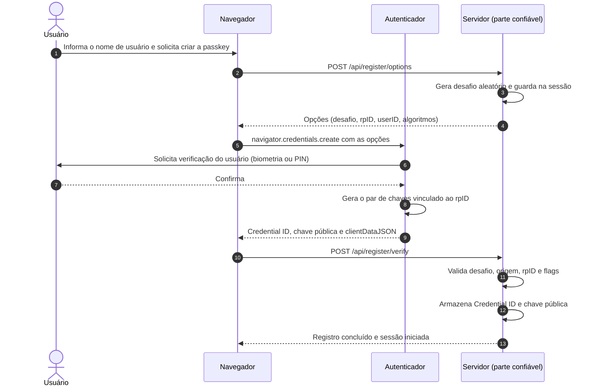
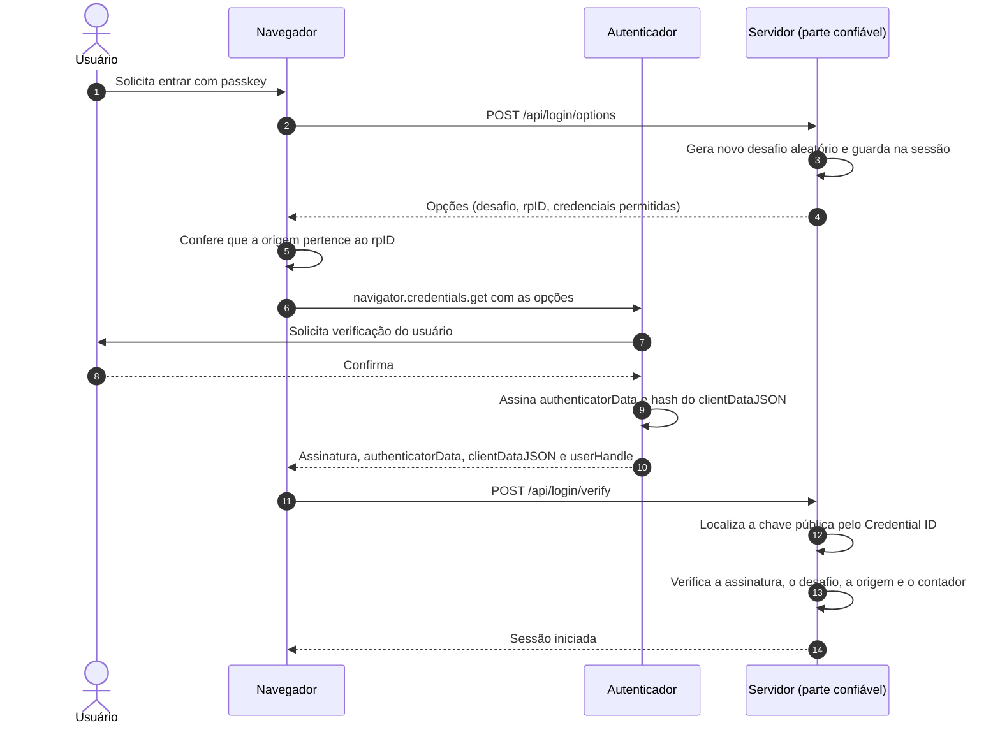
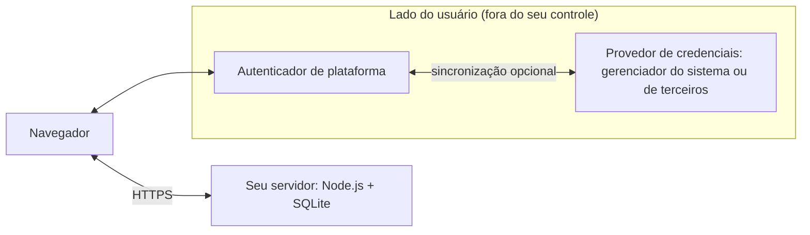

# Guia de Uso 1 — Chaves Criptográficas e Passkeys (WebAuthn/FIDO2)

> Parte do Trabalho de Conclusão de Curso *Investigação de Protocolos de Passwordless Authentication: uma proposta de guia* (UTFPR, Dois Vizinhos).

## Sumário

1. [Introdução](#1-introdução)
2. [Fundamentação teórica](#2-fundamentação-teórica)
3. [Pré-requisitos e instalação](#3-pré-requisitos-e-instalação)
4. [Visão geral do projeto](#4-visão-geral-do-projeto)
5. [Implementação passo a passo](#5-implementação-passo-a-passo)
6. [Execução e testes](#6-execução-e-testes)
7. [Análise de segurança da implementação](#7-análise-de-segurança-da-implementação)
8. [Limitações e caminho para produção](#8-limitações-e-caminho-para-produção)
9. [Solução de problemas](#9-solução-de-problemas)
10. [Referências](#10-referências)

---

## 1. Introdução

Este guia descreve o funcionamento e a implementação de autenticação com **passkeys**, baseadas em criptografia assimétrica e nos padrões FIDO2 (WebAuthn e CTAP). O leitor encontrará (i) a fundamentação teórica do mecanismo, (ii) a instalação do ambiente a partir do zero, (iii) a construção, etapa por etapa, de uma aplicação de referência em Node.js e TypeScript, e (iv) a análise das garantias e limitações da solução produzida.

O código completo está disponível neste repositório, na pasta `passkeys/`. O guia reproduz cada arquivo na ordem em que deve ser criado, de modo que o leitor possa tanto construir o projeto do zero quanto apenas clonar e executar.

**Escopo.** A aplicação implementa registro de conta, login (com ou sem informar nome de usuário), listagem e remoção de passkeys e encerramento de sessão. Biometria local (verificação do usuário) e recuperação de acesso por TOTP são tratadas nos guias seguintes, mas o parâmetro de verificação do usuário já está parametrizado aqui (seção 5.3).

**Premissa de reprodutibilidade.** Nenhuma etapa exige hardware dedicado, conta em serviço de nuvem ou assinatura paga. O teste pode ser feito com o autenticador virtual do navegador (seção 6.2) ou com o próprio computador ou celular do leitor.

---

## 2. Fundamentação teórica

### 2.1 Criptografia assimétrica e autenticação por desafio-resposta

Em um sistema baseado em senhas, cliente e servidor compartilham um segredo: o servidor armazena uma derivação da senha e o cliente a apresenta a cada autenticação. Esse modelo de **segredo compartilhado** implica que o comprometimento do servidor, a captura da senha em trânsito ou a sua entrega a um site fraudulento permitem a personificação do usuário [Weir et al. 2010; Yusop et al. 2025].

A criptografia assimétrica permite um modelo distinto. O usuário possui um par de chaves matematicamente relacionadas: a **chave privada**, que nunca deixa o dispositivo, e a **chave pública**, que pode ser divulgada sem prejuízo. Para provar sua identidade, o usuário não apresenta um segredo, e sim uma **assinatura digital** sobre um dado fornecido pelo servidor. O servidor verifica a assinatura com a chave pública previamente registrada. Esse esquema é denominado **desafio-resposta** (*challenge-response*): como o dado assinado (o desafio) é aleatório e de uso único, uma assinatura capturada não pode ser reutilizada em outra tentativa (resistência a *replay*).

A consequência prática é que o banco de dados do servidor passa a conter apenas chaves públicas, cujo vazamento não permite autenticar-se. Esta é a diferença estrutural em relação a senhas, e a razão pela qual o mecanismo foi selecionado para este trabalho (seção 4.3 do texto principal).

### 2.2 O ecossistema FIDO2: WebAuthn e CTAP

O **FIDO2** é um conjunto de especificações da FIDO Alliance e do W3C composto por dois protocolos complementares:

- **WebAuthn** (*Web Authentication*), padrão do W3C, define a API JavaScript (`navigator.credentials.create()` e `navigator.credentials.get()`) pela qual aplicações web solicitam a criação e o uso de credenciais, e os formatos de dados trocados com o servidor.
- **CTAP** (*Client to Authenticator Protocol*), da FIDO Alliance, define a comunicação entre o cliente (navegador ou sistema operacional) e autenticadores externos, como chaves de segurança USB, NFC ou Bluetooth, e o telefone em fluxos entre dispositivos.

Quatro atores participam das cerimônias:

| Ator | Descrição | Neste projeto |
|---|---|---|
| **Usuário** | Pessoa que se autentica e realiza o gesto de consentimento | O leitor |
| **Parte confiável** (*Relying Party*, RP) | Serviço que deseja autenticar o usuário; possui um identificador (**RP ID**) igual ao seu domínio | Servidor Node.js + SQLite |
| **Cliente** (*client*) | Navegador ou sistema operacional que intermedeia a comunicação e aplica as verificações de origem | Chrome, Edge, Firefox, Safari |
| **Autenticador** | Componente que gera e guarda as chaves privadas e produz as assinaturas | Autenticador de plataforma do dispositivo (ou virtual, nos testes) |

O autenticador de plataforma está embutido no dispositivo (por exemplo, Windows Hello, Touch ID/Face ID, desbloqueio do Android), enquanto o autenticador de roaming é um dispositivo externo (chave de segurança). Este guia foca no primeiro, mas o código é o mesmo para ambos.

### 2.3 Estrutura de uma credencial

Cada credencial associa, no autenticador e no servidor, os seguintes elementos:

- **Credential ID**: identificador opaco da credencial, gerado pelo autenticador.
- **Par de chaves**: gerado no registro, **exclusivo para o par (usuário, RP ID)**. A chave privada permanece no autenticador.
- **RP ID**: domínio ao qual a credencial é vinculada. É esse vínculo que confere resistência a phishing (seção 2.7).
- **User handle**: identificador do usuário, definido pelo servidor (até 64 bytes), recomendado como valor aleatório, sem relação com dados pessoais. Neste projeto, 32 bytes aleatórios.
- **Contador de assinaturas**: valor incrementado pelo autenticador a cada uso, usado para detectar clonagem. Muitos autenticadores de passkeys sincronizáveis retornam sempre zero, de modo que a verificação do contador só é aplicável quando ele é utilizado.
- **Credencial detectável** (*discoverable credential*, ou *resident key*): armazena o user handle no autenticador, permitindo que o login ocorra **sem que o usuário informe um nome**, pois o autenticador apresenta as credenciais disponíveis para aquele RP ID.

### 2.4 Cerimônia de registro

No registro, o autenticador cria um novo par de chaves e o servidor armazena a chave pública.



Na etapa 11, o servidor verifica que: (a) o **desafio** devolvido no `clientDataJSON` é o que foi emitido; (b) a **origem** declarada pelo navegador é a esperada; (c) o *hash* do **RP ID** em `authenticatorData` corresponde ao do servidor; (d) o *flag* de **presença do usuário** (UP) está ativo e, se exigido, o de **verificação do usuário** (UV); e (e) o algoritmo da chave está entre os aceitos. Opcionalmente, verificaria a **atestação** (*attestation*), que prova o modelo do autenticador. Este projeto solicita `attestation: "none"`, pois a atestação só é necessária quando a aplicação precisa restringir fabricantes (cenários regulados) e introduz dependência do serviço de metadados da FIDO Alliance.

### 2.5 Cerimônia de autenticação



A etapa 5 é a base da resistência a phishing: o navegador, e não o usuário, compara a origem da página com o RP ID. Em um site fraudulento, essa conferência falha e o autenticador não responde, independentemente de o usuário ter sido enganado.

### 2.6 Passkeys: credenciais sincronizáveis e vinculadas ao dispositivo

O termo **passkey** designa, na terminologia da FIDO Alliance, credenciais FIDO que substituem senhas, tipicamente **detectáveis** e, em muitas implementações, **sincronizáveis** entre os dispositivos do usuário por um provedor de credenciais (por exemplo, o gerenciador de chaves do sistema operacional ou de um aplicativo de terceiros). Distinguem-se, portanto:

| Tipo | Onde reside a chave privada | Vantagem | Risco |
|---|---|---|---|
| **Sincronizável** (*multi-device*) | No autenticador e em cópia criptografada no provedor de credenciais | Sobrevive à perda do dispositivo; usável em vários aparelhos | Segurança passa a depender também do provedor e da conta que o protege |
| **Vinculada ao dispositivo** (*single-device*) | Apenas no autenticador (por exemplo, uma chave de segurança) | Maior controle sobre onde a chave existe | Perda do dispositivo exige recuperação alternativa |

O autenticador informa essa condição por dois *flags* em `authenticatorData`: **BE** (*backup eligibility*, a credencial pode ser copiada) e **BS** (*backup state*, ela de fato está copiada). O servidor não escolhe o tipo, apenas o observa. A biblioteca utilizada expõe esses valores como `credentialDeviceType` (`singleDevice` ou `multiDevice`) e `credentialBackedUp`, que a aplicação de referência armazena e exibe.

### 2.7 Propriedades de segurança

A tabela relaciona as propriedades do mecanismo às categorias de ataque identificadas na revisão sistemática de Yusop et al. (2025):

| Categoria de ataque | Como o mecanismo responde | Garantia |
|---|---|---|
| Engenharia social / phishing | Credencial vinculada ao RP ID; o navegador verifica a origem. Não há segredo digitável a ser entregue | Forte |
| Roubo de credenciais, *credential stuffing*, força bruta e dicionário | Não há senha a adivinhar ou reutilizar; cada par de chaves é exclusivo por serviço | Forte |
| Vazamento do banco de dados do servidor | O servidor guarda apenas chaves públicas | Forte |
| *Replay* da autenticação | Desafio aleatório, de uso único e com expiração | Forte |
| *Man-in-the-middle* na cerimônia | A assinatura cobre o desafio e a origem; HTTPS é obrigatório pelo navegador (exceto `localhost`) | Forte, condicionada ao HTTPS |
| Sequestro de sessão **após** o login | **Não mitigado** pelo mecanismo: protege a etapa de autenticação, não o *cookie* de sessão | Nenhuma; exige controles de sessão |
| Malware no dispositivo do usuário | Limitado: o malware pode agir como o usuário na sessão aberta | Parcial |

A última linha explicita um limite frequentemente omitido: passkeys eliminam a senha como vetor, mas não tornam a sessão resultante invulnerável. Estudos como o FIDOnuous, analisado na revisão, propõem autenticação contínua justamente para esse fim [Yusop et al. 2025].

### 2.8 Limitações do mecanismo

- **Recuperação de acesso.** Não há "esqueci minha senha". A recuperação depende de outras credenciais cadastradas, do provedor de sincronização ou de um mecanismo alternativo, ponto citado de forma recorrente na literatura revisada [Yusop et al. 2025]. O guia de tokens de software aborda uma contingência.
- **Dependência do ecossistema.** A experiência de sincronização varia entre fornecedores de plataforma e a portabilidade entre provedores ainda é limitada [CITAR].
- **Compreensão do usuário.** Estudos de usabilidade indicam equívocos sobre o que é armazenado no dispositivo e sobre biometria [Yusop et al. 2025].
- **Atestação e confiança no autenticador.** Com `attestation: "none"`, o servidor confia na declaração do autenticador, sem validar fabricante ou modelo.
- **Enumeração de contas.** Informar que um nome de usuário já existe revela sua existência (ver seção 8).

### 2.9 Tecnologias de terceiros: quando são necessárias

Um ponto frequente de dúvida é se o uso de passkeys obriga a contratar serviços de grandes fornecedores (Google, Amazon, Apple, Microsoft). **Não obriga.** O servidor da parte confiável é próprio, e a verificação das assinaturas é feita localmente pela biblioteca. Os fornecedores participam apenas em papéis que se dividem em três grupos.



| Tecnologia de terceiros | Papel | É necessária para este projeto? |
|---|---|---|
| **Provedor de credenciais** (por exemplo, o gerenciador de chaves da Apple, do Google ou da Microsoft, ou aplicativos de terceiros) | Armazena e sincroniza as passkeys **no lado do usuário**. Para a parte confiável, é transparente: o servidor só recebe a chave pública e a assinatura | Não é contratada pelo desenvolvedor. Já faz parte do dispositivo do usuário |
| **Transporte híbrido** (QR Code + Bluetooth) | Permite usar a passkey do celular em outro computador. Usa Bluetooth para verificar proximidade e um túnel de comunicação mantido por fornecedores de plataforma | Não. É implementado pelo navegador e pelo sistema operacional, sem código da aplicação |
| **FIDO Metadata Service (MDS)** | Fornece metadados de autenticadores, usados para validar atestação | Não. Dispensado com `attestation: "none"` |
| **Hospedagem e HTTPS** (AWS, Google Cloud, outra, ou um túnel como Cloudflare Tunnel e ngrok) | Necessários apenas para expor o serviço a **outros dispositivos**, pois o WebAuthn exige HTTPS fora de `localhost` | Opcional: só para testar em um celular real ou publicar. Qualquer provedor serve, bastando ajustar `ORIGIN` e `RP_ID` |
| **Aplicativos nativos** (Android e iOS) | Exigem associação entre aplicativo e domínio (Digital Asset Links no Android; arquivo `apple-app-site-association` no iOS) | Não, pois o projeto é web |

Em síntese: o desenvolvedor controla o servidor e o domínio; o usuário e seu dispositivo provêm o autenticador e a sincronização.

---

## 3. Pré-requisitos e instalação

### 3.1 Software necessário

| Item | Versão | Observação |
|---|---|---|
| **Node.js** | **22.13 ou superior** (LTS) | A versão 14 do SimpleWebAuthn exige Node 22+; o módulo `node:sqlite` é usado sem *flags* a partir da 22.13 |
| **npm** | Instalado com o Node.js | |
| **Git** | Qualquer versão recente | Para versionar e publicar no GitHub |
| **Navegador** | Chrome ou Edge atuais (recomendado para testes) | O autenticador virtual está nas ferramentas do desenvolvedor do Chrome/Edge |
| **Editor** | Visual Studio Code (sugerido) | Opcional |

### 3.2 Instalação do Node.js

A forma mais simples de gerenciar versões é um gerenciador de versões.

- **Linux ou macOS (nvm):** instale o `nvm` seguindo as instruções oficiais e execute:

```bash
nvm install 22
nvm use 22
```

- **Windows:** use o instalador oficial LTS em nodejs.org ou o `nvm-windows`.

Confirme a instalação:

```bash
node -v    # deve exibir v22.13.0 ou superior
npm -v
git --version
```

> Se `node -v` exibir uma versão inferior à 22.13, o servidor falhará ao importar `node:sqlite`. Atualize antes de prosseguir.

---

## 4. Visão geral do projeto

### 4.1 Estrutura de arquivos

```text
passkeys/
├── package.json            # dependências e scripts
├── tsconfig.json           # configuração do TypeScript
├── .env.example            # variáveis de ambiente (modelo)
├── .gitignore
├── Dockerfile              # execução em contêiner (opcional)
├── docker-compose.yml
├── src/
│   ├── server.ts           # ponto de entrada: Express, sessão e rotas
│   ├── config.ts           # leitura e validação da configuração
│   ├── webauthn.ts         # constantes WebAuthn compartilhadas
│   ├── validation.ts       # validação do nome de usuário
│   ├── http.ts             # resposta de erro tipada
│   ├── session.ts          # desafio de uso único e sessão
│   ├── db.ts               # persistência em SQLite
│   ├── types.d.ts          # tipos da sessão
│   └── routes/
│       ├── registration.ts # cerimônia de registro
│       ├── authentication.ts # cerimônia de autenticação
│       └── account.ts      # perfil, logout e remoção de passkeys
├── public/
│   ├── index.html          # interface
│   ├── styles.css
│   └── app.js              # lado cliente (WebAuthn no navegador)
└── test/                   # testes automatizados
```

### 4.2 Divisão de responsabilidades

O SimpleWebAuthn divide o protocolo em duas metades, e o projeto reflete essa divisão:

| Lado | Pacote | Responsabilidade |
|---|---|---|
| Servidor | `@simplewebauthn/server` | Gerar opções (com desafio) e verificar respostas (assinatura, origem, RP ID, flags) |
| Navegador | `@simplewebauthn/browser` | Chamar a API WebAuthn do navegador e serializar o resultado para JSON |

A aplicação fica responsável por **persistir** as chaves públicas, **guardar o desafio** entre as duas etapas de cada cerimônia e **gerir a sessão**. A biblioteca é deliberadamente agnóstica quanto a isso.

### 4.3 Decisões de projeto

1. **Desafio na sessão do servidor, com uso único e validade de 5 minutos** (seção 5.5).
2. **User handle aleatório**, desvinculado do nome de usuário (seção 5.7).
3. **Lista de algoritmos fixada** em `[-8, -7, -257]` (EdDSA, ES256 e RS256). Na versão 14 do SimpleWebAuthn, a lista padrão pode incluir um algoritmo pós-quântico quando o runtime o suporta, o que tornaria o formato das novas credenciais dependente da versão do Node.js. Fixar a lista elimina essa variação e é aplicado na geração das opções e na verificação [CITAR: notas de versão do SimpleWebAuthn v14].
4. **Credenciais detectáveis** (`residentKey: "required"`), para permitir login sem nome de usuário.
5. **`attestation: "none"`**, por privacidade e para evitar dependências externas.
6. **Impedimento de remover a última passkey**, para evitar o bloqueio da conta.

---

## 5. Implementação passo a passo

### 5.1 Criar o projeto e instalar as dependências

```bash
mkdir passkeys
cd passkeys
git init
```

Crie o arquivo `package.json` com o conteúdo abaixo (ele fixa o tipo de módulo ES, a versão mínima do Node.js, os scripts e as dependências):

`package.json`

```json
{
  "name": "guia-passkeys",
  "version": "1.0.0",
  "description": "Implementação de referência de autenticação com passkeys (WebAuthn/FIDO2) em Node.js e TypeScript",
  "private": true,
  "type": "module",
  "license": "MIT",
  "engines": {
    "node": ">=22.13.0"
  },
  "scripts": {
    "dev": "node --env-file-if-exists=.env --import tsx --watch src/server.ts",
    "build": "tsc",
    "start": "node --env-file-if-exists=.env dist/server.js",
    "typecheck": "tsc --noEmit",
    "test": "node --import tsx --test test/*.test.ts"
  },
  "dependencies": {
    "@simplewebauthn/browser": "^14.0.0",
    "@simplewebauthn/server": "^14.0.2",
    "express": "^5.1.0",
    "express-session": "^1.18.1"
  },
  "devDependencies": {
    "@types/express": "^5.0.0",
    "@types/express-session": "^1.18.0",
    "@types/node": "^22.13.0",
    "tsx": "^4.19.0",
    "typescript": "^5.6.0"
  }
}
```

Instale as dependências. O comando resolve as versões, cria a pasta `node_modules` e gera o arquivo `package-lock.json`, que **deve ser versionado** para que outros leitores obtenham exatamente as mesmas versões:

```bash
npm install
```

Dependências de execução:

- `@simplewebauthn/server` e `@simplewebauthn/browser`: implementação do protocolo (versão 14; segundo as notas de versão, a 14.0.2 corrige duas vulnerabilidades de severidade moderada do pacote de servidor, de modo que o projeto exige ao menos essa versão **[CITAR: avisos de segurança do projeto]**).
- `express` (versão 5, que encaminha automaticamente erros de funções assíncronas ao tratador de erros) e `express-session`: servidor HTTP e sessão.

Dependências de desenvolvimento: `typescript`, `tsx` (executa TypeScript diretamente) e as definições de tipos.

> **Atenção a materiais antigos.** Muitos tutoriais utilizam versões anteriores do SimpleWebAuthn. A API mudou em versões anteriores (por exemplo, o parâmetro `authenticator` foi substituído por `credential` na verificação da autenticação), e a versão 14 alterou o tipo de `transports` para `string[]`. Siga este guia e a documentação oficial atual.

### 5.2 Configurar o TypeScript

Crie `tsconfig.json`:

`tsconfig.json`

```json
{
  "compilerOptions": {
    "target": "ES2022",
    "module": "NodeNext",
    "moduleResolution": "NodeNext",
    "outDir": "dist",
    "rootDir": "src",
    "strict": true,
    "esModuleInterop": true,
    "skipLibCheck": true,
    "forceConsistentCasingInFileNames": true
  },
  "include": ["src"]
}
```

Pontos relevantes: `module` e `moduleResolution` em `NodeNext` fazem o compilador seguir as regras de módulos ES do Node.js (por isso os *imports* relativos terminam em `.js`, mesmo nos arquivos `.ts`), e `strict` ativa a verificação rigorosa de tipos.

Crie também `.gitignore` (evita versionar dependências, saída de compilação, o banco de dados local e o arquivo `.env`):

`.gitignore`

```text
node_modules/
dist/
data/
.env
*.log
```

### 5.3 Configuração por variáveis de ambiente

Crie `.env.example` (modelo versionado) e copie-o para `.env` (arquivo local, não versionado):

`.env.example`

```bash
# Porta local do servidor
PORT=3000

# Origem completa (esquema + domínio + porta) em que o navegador acessa a aplicação.
# Em desenvolvimento local, use http://localhost:3000
ORIGIN=http://localhost:3000

# Identificador da parte confiável (RP ID): deve ser o domínio (ou um sufixo registrável dele).
# Se omitido, é derivado de ORIGIN. NÃO inclua esquema nem porta.
RP_ID=localhost

# Nome exibido ao usuário nos diálogos do sistema
RP_NAME=Guia de Passkeys (TCC)

# required | preferred | discouraged
USER_VERIFICATION=preferred

# Obrigatório em produção. Gere com: node -e "console.log(require('crypto').randomBytes(32).toString('hex'))"
SESSION_SECRET=

# Caminho do arquivo SQLite
DB_PATH=./data/passkeys.db

# Defina como 1 quando houver proxy/túnel HTTPS na frente do servidor (Cloudflare Tunnel, ngrok, etc.)
TRUST_PROXY=0
```

```bash
cp .env.example .env      # no Windows (PowerShell): Copy-Item .env.example .env
```

Os três parâmetros que governam o WebAuthn:

- **`ORIGIN`**: origem completa (esquema, domínio e porta) a partir da qual o navegador acessa a aplicação. O servidor a compara com a origem declarada pelo navegador na cerimônia.
- **`RP_ID`**: domínio ao qual as credenciais ficam vinculadas, **sem esquema e sem porta**. Deve ser igual ao domínio da origem ou a um sufixo registrável dele. **Credenciais criadas para um RP ID não funcionam em outro.**
- **`USER_VERIFICATION`**: `required`, `preferred` ou `discouraged`. Define se o servidor exige que o autenticador verifique o usuário (biometria ou PIN). Esse parâmetro é o elo com o guia de biometria.

Em seguida, crie `src/config.ts`, que lê e valida esses valores:

`src/config.ts`

```ts
export type UserVerification = 'required' | 'preferred' | 'discouraged';

function parseUserVerification(value: string): UserVerification {
  if (value === 'required' || value === 'preferred' || value === 'discouraged') {
    return value;
  }
  throw new Error(
    `USER_VERIFICATION inválido: "${value}". Use required, preferred ou discouraged.`,
  );
}

const origin = new URL(process.env.ORIGIN ?? 'http://localhost:3000');
const isProduction = process.env.NODE_ENV === 'production';

if (isProduction && !process.env.SESSION_SECRET) {
  throw new Error('Defina SESSION_SECRET em produção.');
}

export const config = {
  port: Number(process.env.PORT ?? 3000),
  rpName: process.env.RP_NAME ?? 'Guia de Passkeys (TCC)',
  // O RP ID é o domínio ao qual a credencial fica vinculada (sem esquema e sem porta).
  rpID: process.env.RP_ID || origin.hostname,
  // A origem esperada é comparada com a origem declarada pelo navegador na cerimônia.
  origin: origin.origin,
  userVerification: parseUserVerification(process.env.USER_VERIFICATION ?? 'preferred'),
  sessionSecret: process.env.SESSION_SECRET || 'segredo-apenas-para-desenvolvimento',
  dbPath: process.env.DB_PATH ?? './data/passkeys.db',
  secureCookies: origin.protocol === 'https:',
  trustProxy: process.env.TRUST_PROXY === '1',
} as const;
```

Observações: a validação de `USER_VERIFICATION` evita erros silenciosos; em produção, a ausência de `SESSION_SECRET` interrompe a inicialização; e `secureCookies` é derivado do esquema de `ORIGIN`.

### 5.4 Constantes e utilitários auxiliares

`src/webauthn.ts` centraliza a lista de algoritmos aceitos (decisão 3 da seção 4.3):

`src/webauthn.ts`

```ts
/**
 * Algoritmos de chave pública aceitos (identificadores COSE):
 *   -8   = EdDSA
 *   -7   = ES256 (ECDSA com P-256 e SHA-256)
 *   -257 = RS256 (RSASSA-PKCS1-v1_5 com SHA-256)
 *
 * Na versão 14 do SimpleWebAuthn, a lista padrão passou a depender do runtime
 * (algoritmos pós-quânticos podem ser preferidos quando disponíveis). Fixar a
 * lista torna o comportamento independente da versão do Node.js utilizada e é
 * usado tanto na geração das opções quanto na verificação da resposta.
 */
export const SUPPORTED_ALGORITHM_IDS = [-8, -7, -257];
```

`src/validation.ts` normaliza o nome de usuário (minúsculas, caracteres restritos). A restrição reduz ambiguidades visuais entre contas e evita que entradas arbitrárias cheguem ao banco:

`src/validation.ts`

```ts
const USERNAME_PATTERN = /^[a-z0-9._@-]{3,64}$/;

/** Normaliza e valida o nome de usuário. Retorna null se for inválido. */
export function normalizeUsername(input: unknown): string | null {
  if (typeof input !== 'string') return null;
  const normalized = input.trim().toLowerCase();
  return USERNAME_PATTERN.test(normalized) ? normalized : null;
}
```

`src/http.ts` envia respostas de erro em JSON. Os tipos do Express 5 declaram que um *handler* devolve `void | Promise<void>`; por isso um `return res.status(...).json(...)`, que devolve o objeto `Response`, é recusado pelo compilador. O utilitário devolve `void`, o que permite o padrão `if (condição) return fail(res, 400, 'mensagem');` usado nas rotas:

`src/http.ts`

```ts
import type { Response } from 'express';

/**
 * Envia uma resposta de erro JSON e devolve `void`.
 *
 * Os tipos do Express 5 declaram que um handler devolve `void | Promise<void>`.
 * Por isso os handlers não podem fazer `return res.status(...).json(...)`, que
 * devolveria o objeto `Response`. Com este utilitário, o padrão
 * `if (condição) return fail(res, 400, 'mensagem');` é aceito pelo compilador.
 */
export function fail(res: Response, status: number, error: string, code?: string): void {
  res.status(status).json(code ? { error, code } : { error });
}
```

### 5.5 Persistência: banco SQLite

`src/db.ts` define duas tabelas: `users` (identificada pelo *user handle*) e `credentials` (identificada pelo *credential ID*, com a chave pública binária, o contador, os transportes e a informação de sincronização).

`src/db.ts`

```ts
import { DatabaseSync } from 'node:sqlite';
import { mkdirSync } from 'node:fs';
import { dirname } from 'node:path';

export interface User {
  id: string; // user handle (base64url, 32 bytes aleatórios)
  username: string;
  createdAt: string;
}

export interface StoredCredential {
  id: string; // credential ID (base64url)
  userId: string;
  publicKey: Uint8Array; // chave pública no formato COSE
  counter: number;
  transports: string[];
  deviceType: 'singleDevice' | 'multiDevice';
  backedUp: boolean;
  createdAt: string;
  lastUsedAt: string | null;
}

export type NewCredential = Omit<StoredCredential, 'createdAt' | 'lastUsedAt'>;

type Row = Record<string, unknown>;

const SCHEMA = `
  CREATE TABLE IF NOT EXISTS users (
    id         TEXT PRIMARY KEY,
    username   TEXT NOT NULL UNIQUE COLLATE NOCASE,
    created_at TEXT NOT NULL DEFAULT (datetime('now'))
  );

  CREATE TABLE IF NOT EXISTS credentials (
    id           TEXT PRIMARY KEY,
    user_id      TEXT NOT NULL REFERENCES users(id) ON DELETE CASCADE,
    public_key   BLOB NOT NULL,
    counter      INTEGER NOT NULL DEFAULT 0,
    transports   TEXT NOT NULL DEFAULT '[]',
    device_type  TEXT NOT NULL,
    backed_up    INTEGER NOT NULL DEFAULT 0,
    created_at   TEXT NOT NULL DEFAULT (datetime('now')),
    last_used_at TEXT
  );

  CREATE INDEX IF NOT EXISTS idx_credentials_user ON credentials(user_id);
`;

function toUser(row: Row): User {
  return {
    id: row.id as string,
    username: row.username as string,
    createdAt: row.created_at as string,
  };
}

function toCredential(row: Row): StoredCredential {
  return {
    id: row.id as string,
    userId: row.user_id as string,
    publicKey: new Uint8Array(row.public_key as Uint8Array),
    counter: Number(row.counter),
    transports: JSON.parse(row.transports as string) as string[],
    deviceType: row.device_type as StoredCredential['deviceType'],
    backedUp: Number(row.backed_up) === 1,
    createdAt: row.created_at as string,
    lastUsedAt: (row.last_used_at as string | null) ?? null,
  };
}

export class Store {
  private db: DatabaseSync;

  constructor(path: string) {
    if (path !== ':memory:') {
      mkdirSync(dirname(path), { recursive: true });
    }
    this.db = new DatabaseSync(path);
    this.db.exec('PRAGMA foreign_keys = ON');
    this.db.exec(SCHEMA);
  }

  createUser(id: string, username: string): User {
    this.db.prepare('INSERT INTO users (id, username) VALUES (?, ?)').run(id, username);
    return this.getUserById(id)!;
  }

  getUserById(id: string): User | undefined {
    const row = this.db.prepare('SELECT * FROM users WHERE id = ?').get(id) as Row | undefined;
    return row ? toUser(row) : undefined;
  }

  getUserByUsername(username: string): User | undefined {
    const row = this.db
      .prepare('SELECT * FROM users WHERE username = ?')
      .get(username) as Row | undefined;
    return row ? toUser(row) : undefined;
  }

  addCredential(c: NewCredential): void {
    this.db
      .prepare(
        `INSERT INTO credentials
           (id, user_id, public_key, counter, transports, device_type, backed_up)
         VALUES (?, ?, ?, ?, ?, ?, ?)`,
      )
      .run(
        c.id,
        c.userId,
        c.publicKey,
        c.counter,
        JSON.stringify(c.transports),
        c.deviceType,
        c.backedUp ? 1 : 0,
      );
  }

  getCredentialById(id: string): StoredCredential | undefined {
    const row = this.db.prepare('SELECT * FROM credentials WHERE id = ?').get(id) as
      | Row
      | undefined;
    return row ? toCredential(row) : undefined;
  }

  listCredentials(userId: string): StoredCredential[] {
    const rows = this.db
      .prepare('SELECT * FROM credentials WHERE user_id = ? ORDER BY created_at, id')
      .all(userId) as Row[];
    return rows.map(toCredential);
  }

  updateCredentialUsage(id: string, counter: number, backedUp: boolean): void {
    this.db
      .prepare(
        `UPDATE credentials
            SET counter = ?, backed_up = ?, last_used_at = datetime('now')
          WHERE id = ?`,
      )
      .run(counter, backedUp ? 1 : 0, id);
  }

  deleteCredential(id: string, userId: string): boolean {
    const result = this.db
      .prepare('DELETE FROM credentials WHERE id = ? AND user_id = ?')
      .run(id, userId);
    return Number(result.changes) > 0;
  }
}
```

Decisões relevantes:

- Usa-se o módulo nativo `node:sqlite`, o que evita dependências com compilação de código nativo e simplifica a reprodução.
- A chave pública é armazenada como `BLOB`, exatamente como entregue pela biblioteca (formato COSE). Um teste automatizado confirma que os bytes não são alterados no armazenamento.
- `ON DELETE CASCADE` com `PRAGMA foreign_keys = ON` garante a integridade referencial.
- Todas as consultas são **parametrizadas** (`?`), o que previne injeção de SQL.
- O banco guarda **apenas chaves públicas**: não há segredo a proteger em caso de vazamento (seção 2.7).

### 5.6 Sessão e desafio de uso único

Primeiro, a declaração de tipos (`src/types.d.ts`) informa ao TypeScript os campos adicionais da sessão:

`src/types.d.ts`

```ts
import 'express-session';

declare module 'express-session' {
  interface SessionData {
    /** Identificador do usuário autenticado. */
    userId?: string;
    /** Desafio de uma cerimônia WebAuthn em andamento (uso único). */
    challenge?: {
      value: string;
      purpose: 'registration' | 'authentication';
      pendingUser?: { id: string; username: string };
      expiresAt: number;
    };
  }
}
```

Em seguida, `src/session.ts`:

`src/session.ts`

```ts
import type { Request } from 'express';

const CHALLENGE_TTL_MS = 5 * 60 * 1000; // 5 minutos

export type ChallengePurpose = 'registration' | 'authentication';

/** Guarda o desafio da cerimônia na sessão do servidor. */
export function storeChallenge(
  req: Request,
  purpose: ChallengePurpose,
  value: string,
  pendingUser?: { id: string; username: string },
): void {
  req.session.challenge = {
    value,
    purpose,
    pendingUser,
    expiresAt: Date.now() + CHALLENGE_TTL_MS,
  };
}

/**
 * Recupera e INVALIDA o desafio (uso único). Retorna null se ausente,
 * expirado ou emitido para outra finalidade.
 */
export function consumeChallenge(req: Request, purpose: ChallengePurpose) {
  const challenge = req.session.challenge;
  delete req.session.challenge;
  if (!challenge) return null;
  if (challenge.purpose !== purpose) return null;
  if (challenge.expiresAt < Date.now()) return null;
  return challenge;
}

/** Inicia a sessão autenticada, regenerando o identificador (evita session fixation). */
export function loginSession(req: Request, userId: string): Promise<void> {
  return new Promise((resolve, reject) => {
    req.session.regenerate((err) => {
      if (err) return reject(err);
      req.session.userId = userId;
      req.session.save((saveErr) => (saveErr ? reject(saveErr) : resolve()));
    });
  });
}

export function logoutSession(req: Request): Promise<void> {
  return new Promise((resolve, reject) => {
    req.session.destroy((err) => (err ? reject(err) : resolve()));
  });
}
```

O desafio é o elemento que garante a **atualidade** da autenticação. Por isso: (i) é gerado pela biblioteca com entropia criptográfica; (ii) fica **somente no servidor**, na sessão do usuário; (iii) é **removido assim que consultado**, mesmo que a verificação falhe, de modo que não possa ser reutilizado; (iv) **expira em 5 minutos**; e (v) está associado a uma finalidade (registro ou autenticação). A função `loginSession` **regenera o identificador da sessão** ao autenticar, prevenindo a fixação de sessão (*session fixation*).

### 5.7 Rota de registro

`src/routes/registration.ts` implementa as duas etapas da cerimônia de registro (seção 2.4):

`src/routes/registration.ts`

```ts
import { Router } from 'express';
import { randomBytes } from 'node:crypto';
import {
  generateRegistrationOptions,
  verifyRegistrationResponse,
} from '@simplewebauthn/server';
import { config } from '../config.js';
import type { Store } from '../db.js';
import { fail } from '../http.js';
import { consumeChallenge, loginSession, storeChallenge } from '../session.js';
import { normalizeUsername } from '../validation.js';
import { SUPPORTED_ALGORITHM_IDS } from '../webauthn.js';

export function registrationRouter(store: Store): Router {
  const router = Router();

  // Etapa 1 do registro: o servidor gera as opções (inclui o desafio aleatório).
  router.post('/options', async (req, res) => {
    let user: { id: string; username: string };

    if (req.session.userId) {
      // Usuário já autenticado: adicionando mais uma passkey à própria conta.
      const current = store.getUserById(req.session.userId);
      if (!current) return fail(res, 401, 'Sessão inválida.');
      user = { id: current.id, username: current.username };
    } else {
      const username = normalizeUsername(req.body?.username);
      if (!username) {
        return fail(res, 400, 'Nome de usuário inválido (3 a 64 caracteres: letras, números, . _ @ -).');
      }
      if (store.getUserByUsername(username)) {
        return fail(res, 409, 'Nome de usuário indisponível. Se a conta é sua, entre primeiro e depois adicione outra passkey.');
      }
      // O user handle é aleatório e NÃO deriva do nome de usuário (privacidade).
      user = { id: randomBytes(32).toString('base64url'), username };
    }

    const existing = store.listCredentials(user.id);

    const options = await generateRegistrationOptions({
      rpName: config.rpName,
      rpID: config.rpID,
      userName: user.username,
      userDisplayName: user.username,
      userID: new Uint8Array(Buffer.from(user.id, 'base64url')),
      // 'none': não solicitamos atestação do fabricante (maior privacidade, sem dependências externas).
      attestationType: 'none',
      // Evita registrar duas vezes o mesmo autenticador na mesma conta.
      excludeCredentials: existing.map((c) => ({ id: c.id, transports: c.transports })),
      authenticatorSelection: {
        // 'required' => credencial detectável (discoverable), base do login sem nome de usuário.
        residentKey: 'required',
        userVerification: config.userVerification,
      },
      supportedAlgorithmIDs: SUPPORTED_ALGORITHM_IDS,
    });

    storeChallenge(req, 'registration', options.challenge, user);
    res.json(options);
  });

  // Etapa 2 do registro: o servidor verifica a resposta do autenticador.
  router.post('/verify', async (req, res) => {
    const pending = consumeChallenge(req, 'registration');
    if (!pending?.pendingUser) {
      return fail(res, 400, 'Desafio ausente ou expirado. Reinicie o registro.');
    }
    const user = pending.pendingUser;

    if (req.session.userId && req.session.userId !== user.id) {
      return fail(res, 403, 'Sessão incompatível com o registro em andamento.');
    }

    let verification;
    try {
      verification = await verifyRegistrationResponse({
        response: req.body,
        expectedChallenge: pending.value,
        expectedOrigin: config.origin,
        expectedRPID: config.rpID,
        requireUserVerification: config.userVerification === 'required',
        supportedAlgorithmIDs: SUPPORTED_ALGORITHM_IDS,
      });
    } catch (error) {
      console.warn('[registro] verificação falhou:', (error as Error).message);
      return fail(res, 400, 'Não foi possível verificar o registro.');
    }

    if (!verification.verified || !verification.registrationInfo) {
      return fail(res, 400, 'Registro não verificado.');
    }

    const { credential, credentialDeviceType, credentialBackedUp } = verification.registrationInfo;

    if (!store.getUserById(user.id)) {
      try {
        store.createUser(user.id, user.username);
      } catch {
        return fail(res, 409, 'Nome de usuário indisponível.');
      }
    }

    store.addCredential({
      id: credential.id,
      userId: user.id,
      publicKey: credential.publicKey,
      counter: credential.counter,
      transports: credential.transports ?? [],
      deviceType: credentialDeviceType,
      backedUp: credentialBackedUp,
    });

    await loginSession(req, user.id);
    res.json({
      verified: true,
      username: user.username,
      credential: { deviceType: credentialDeviceType, backedUp: credentialBackedUp },
    });
  });

  return router;
}
```

Pontos de atenção:

- **`/options`**: o usuário já autenticado adiciona uma passkey à própria conta; caso contrário, cria-se uma conta nova, mas o registro no banco só ocorre **após a verificação** bem-sucedida, evitando contas órfãs.
- **`userID`**: 32 bytes aleatórios, convertidos para `Uint8Array` e armazenados em base64url.
- **`excludeCredentials`**: impede o registro duplicado do mesmo autenticador.
- **`residentKey: "required"`**: torna a credencial detectável.
- **`/verify`**: a biblioteca valida desafio, origem, RP ID e *flags*. O código só trata os resultados e armazena `credential.id`, `credential.publicKey` e `credential.counter`.
- **`requireUserVerification`** é derivado da configuração. Como a biblioteca exige UV por padrão, o valor é informado explicitamente para que a política escolhida em `USER_VERIFICATION` seja a efetivamente aplicada.
- Mensagens de erro ao cliente são genéricas; os detalhes ficam apenas no registro do servidor.

### 5.8 Rota de autenticação

`src/routes/authentication.ts` implementa a cerimônia da seção 2.5:

`src/routes/authentication.ts`

```ts
import { Router } from 'express';
import {
  generateAuthenticationOptions,
  verifyAuthenticationResponse,
} from '@simplewebauthn/server';
import { config } from '../config.js';
import type { Store } from '../db.js';
import { fail } from '../http.js';
import { consumeChallenge, loginSession, storeChallenge } from '../session.js';
import { normalizeUsername } from '../validation.js';

export function authenticationRouter(store: Store): Router {
  const router = Router();

  // Etapa 1 do login: o servidor gera um novo desafio.
  router.post('/options', async (req, res) => {
    // O nome de usuário é opcional. Sem ele, o autenticador exibe as passkeys
    // detectáveis (discoverable) disponíveis para este domínio.
    const username = normalizeUsername(req.body?.username);
    const user = username ? store.getUserByUsername(username) : undefined;

    const options = await generateAuthenticationOptions({
      rpID: config.rpID,
      userVerification: config.userVerification,
      // Usuário inexistente => lista vazia, mesma resposta do fluxo sem nome de usuário
      // (não revela se o nome existe nesta etapa).
      allowCredentials: user
        ? store.listCredentials(user.id).map((c) => ({ id: c.id, transports: c.transports }))
        : undefined,
    });

    storeChallenge(req, 'authentication', options.challenge);
    res.json(options);
  });

  // Etapa 2 do login: o servidor verifica a assinatura sobre o desafio.
  router.post('/verify', async (req, res) => {
    const pending = consumeChallenge(req, 'authentication');
    if (!pending) {
      return fail(res, 400, 'Desafio ausente ou expirado. Reinicie o login.');
    }

    const credentialId: unknown = req.body?.id;
    const stored = typeof credentialId === 'string' ? store.getCredentialById(credentialId) : undefined;
    if (!stored) {
      return fail(res, 401, 'Falha na autenticação.');
    }

    // Em credenciais detectáveis, o authenticator devolve o user handle: deve coincidir.
    const userHandle: unknown = req.body?.response?.userHandle;
    if (typeof userHandle === 'string' && userHandle !== stored.userId) {
      return fail(res, 401, 'Falha na autenticação.');
    }

    let verification;
    try {
      verification = await verifyAuthenticationResponse({
        response: req.body,
        expectedChallenge: pending.value,
        expectedOrigin: config.origin,
        expectedRPID: config.rpID,
        credential: {
          id: stored.id,
          publicKey: stored.publicKey,
          counter: stored.counter,
          transports: stored.transports,
        },
        requireUserVerification: config.userVerification === 'required',
      });
    } catch (error) {
      console.warn('[login] verificação falhou:', (error as Error).message);
      return fail(res, 401, 'Falha na autenticação.');
    }

    if (!verification.verified) {
      return fail(res, 401, 'Falha na autenticação.');
    }

    const { newCounter, credentialBackedUp } = verification.authenticationInfo;
    store.updateCredentialUsage(stored.id, newCounter, credentialBackedUp);

    const user = store.getUserById(stored.userId);
    if (!user) return fail(res, 401, 'Falha na autenticação.');

    await loginSession(req, user.id);
    res.json({ verified: true, username: user.username });
  });

  return router;
}
```

Pontos de atenção:

- **Nome de usuário opcional.** Com ele, `allowCredentials` restringe as credenciais; sem ele (ou com nome inexistente), a lista é vazia e o autenticador apresenta as credenciais detectáveis do domínio. Assim, a resposta de `/options` não revela se o nome existe.
- **Busca pela credencial** com o `id` devolvido pelo autenticador. Se não existir, a resposta é a mesma falha genérica.
- **Conferência do `userHandle`**: em credenciais detectáveis, o valor devolvido deve coincidir com o do usuário dono da credencial.
- **Verificação**: a biblioteca confere a assinatura com a chave pública armazenada, o desafio, a origem, o RP ID, os *flags* e a regressão do contador.
- **Atualização do contador** e da condição de sincronização após o sucesso.
- Todas as falhas retornam a **mesma mensagem genérica**, o que reduz a informação disponível a um atacante.

### 5.9 Rotas de conta

`src/routes/account.ts` expõe o perfil, o encerramento de sessão e a remoção de passkeys:

`src/routes/account.ts`

```ts
import { Router } from 'express';
import type { Store } from '../db.js';
import { fail } from '../http.js';
import { logoutSession } from '../session.js';

export function accountRouter(store: Store): Router {
  const router = Router();

  router.get('/me', (req, res) => {
    const user = req.session.userId ? store.getUserById(req.session.userId) : undefined;
    if (!user) {
      res.json({ authenticated: false });
      return;
    }

    res.json({
      authenticated: true,
      username: user.username,
      credentials: store.listCredentials(user.id).map((c) => ({
        id: c.id,
        deviceType: c.deviceType,
        backedUp: c.backedUp,
        transports: c.transports,
        counter: c.counter,
        createdAt: c.createdAt,
        lastUsedAt: c.lastUsedAt,
      })),
    });
  });

  router.post('/logout', async (req, res) => {
    await logoutSession(req);
    res.clearCookie('sid');
    res.json({ ok: true });
  });

  router.delete('/credentials/:id', (req, res) => {
    if (!req.session.userId) return fail(res, 401, 'Não autenticado.');

    const credentials = store.listCredentials(req.session.userId);
    // Impede o bloqueio da conta: a última passkey não pode ser removida.
    if (credentials.length <= 1) {
      return fail(res, 409, 'Não é possível remover a única passkey da conta. Registre outra antes.');
    }
    const removed = store.deleteCredential(req.params.id, req.session.userId);
    if (!removed) return fail(res, 404, 'Credencial não encontrada.');
    res.json({ ok: true });
  });

  return router;
}
```

A regra que impede a remoção da última passkey é uma decisão de usabilidade e segurança: sem outra credencial ou método de recuperação, o usuário perderia o acesso. Esse é exatamente o problema de recuperação discutido na seção 2.8.

### 5.10 Servidor Express

`src/server.ts` reúne os componentes:

`src/server.ts`

```ts
import express from 'express';
import type { NextFunction, Request, Response } from 'express';
import session from 'express-session';
import path from 'node:path';
import { config } from './config.js';
import { Store } from './db.js';
import { accountRouter } from './routes/account.js';
import { authenticationRouter } from './routes/authentication.js';
import { registrationRouter } from './routes/registration.js';

// Raiz do projeto (funciona tanto em src/ quanto em dist/).
const root = path.resolve(import.meta.dirname, '..');

const store = new Store(config.dbPath);
const app = express();

app.disable('x-powered-by');
if (config.trustProxy) app.set('trust proxy', 1);

// Cabeçalhos de segurança mínimos (a página só carrega recursos da própria origem).
app.use((_req, res, next) => {
  res.setHeader('Content-Security-Policy', "default-src 'self'; frame-ancestors 'none'");
  res.setHeader('X-Content-Type-Options', 'nosniff');
  res.setHeader('Referrer-Policy', 'no-referrer');
  next();
});

app.use(express.json({ limit: '100kb' }));

// ATENÇÃO: o armazenamento de sessão padrão (memória) serve apenas para demonstração.
app.use(
  session({
    name: 'sid',
    secret: config.sessionSecret,
    resave: false,
    saveUninitialized: false,
    cookie: {
      httpOnly: true,
      sameSite: 'lax',
      secure: config.secureCookies,
      maxAge: 8 * 60 * 60 * 1000,
    },
  }),
);

app.use('/api/register', registrationRouter(store));
app.use('/api/login', authenticationRouter(store));
app.use('/api', accountRouter(store));

// Front-end estático e o bundle do @simplewebauthn/browser servido localmente.
app.use('/vendor', express.static(path.join(root, 'node_modules/@simplewebauthn/browser/dist/bundle')));
app.use(express.static(path.join(root, 'public')));

app.use((err: Error, _req: Request, res: Response, _next: NextFunction) => {
  console.error('[erro]', err);
  res.status(500).json({ error: 'Erro interno do servidor.' });
});

app.listen(config.port, () => {
  console.log(`Servidor em ${config.origin} (RP ID: ${config.rpID}, porta ${config.port})`);
});
```

Comentários sobre as escolhas:

- **Cabeçalhos de segurança**: a política `default-src 'self'` impede que a página carregue *scripts* de terceiros. Por isso a biblioteca de navegador é servida **localmente** (rota `/vendor`), a partir de `node_modules`, e não por uma rede de distribuição de conteúdo.
- **Cookie de sessão**: `httpOnly` (inacessível a JavaScript), `sameSite: 'lax'` (mitiga requisições forjadas entre sites) e `secure` quando a origem usa HTTPS.
- **`express.json`**: apenas requisições `application/json` são interpretadas, o que, combinado ao `sameSite`, reduz o risco de CSRF (ver seção 8).
- **`trust proxy`**: necessário quando há túnel HTTPS na frente do servidor, para que o cookie `secure` seja emitido corretamente.

### 5.11 Interface (lado cliente)

`public/index.html` contém a estrutura da página. Não há *scripts* embutidos, em conformidade com a política de segurança de conteúdo:

`public/index.html`

```html
<!doctype html>
<html lang="pt-BR">
<head>
  <meta charset="utf-8">
  <meta name="viewport" content="width=device-width, initial-scale=1">
  <title>Guia de Passkeys — Implementação de referência</title>
  <link rel="stylesheet" href="/styles.css">
</head>
<body>
  <main>
    <h1>Passkeys (WebAuthn / FIDO2)</h1>
    <p class="lead">Implementação de referência do TCC — autenticação sem senha.</p>

    <p id="unsupported" class="alert" hidden>
      Este navegador não suporta WebAuthn. Use uma versão recente do Chrome, Edge, Firefox ou Safari.
    </p>

    <section id="guest">
      <h2>1. Criar conta com passkey</h2>
      <label for="reg-username">Nome de usuário</label>
      <input id="reg-username" type="text" autocomplete="username webauthn" placeholder="ex.: camila">
      <button id="btn-register" type="button">Criar passkey</button>

      <h2>2. Entrar com passkey</h2>
      <p class="hint">Opcional: informe o nome de usuário. Se deixar em branco, o sistema lista as passkeys disponíveis neste domínio.</p>
      <label for="login-username">Nome de usuário (opcional)</label>
      <input id="login-username" type="text" autocomplete="username webauthn">
      <button id="btn-login" type="button">Entrar com passkey</button>
    </section>

    <section id="account" hidden>
      <h2>Sessão autenticada</h2>
      <p>Usuário: <strong id="who"></strong></p>
      <h3>Passkeys cadastradas</h3>
      <ul id="credentials"></ul>
      <button id="btn-add" type="button">Adicionar outra passkey</button>
      <button id="btn-logout" type="button" class="secondary">Sair</button>
    </section>

    <p id="status" role="status" aria-live="polite"></p>

    <h3>Registro das etapas</h3>
    <div id="log" class="log"></div>
  </main>

  <script src="/vendor/index.umd.min.js"></script>
  <script src="/app.js"></script>
</body>
</html>
```

`public/styles.css` (estilos mínimos):

`public/styles.css`

```css
:root { color-scheme: light dark; --accent: #0b6e4f; --border: #8884; }
* { box-sizing: border-box; }
body { margin: 0; font: 16px/1.5 system-ui, sans-serif; }
main { max-width: 40rem; margin: 2rem auto; padding: 0 1rem; }
h1 { margin-bottom: .25rem; }
.lead, .hint { opacity: .75; margin-top: 0; }
label { display: block; margin: .75rem 0 .25rem; font-weight: 600; }
input { width: 100%; padding: .6rem; border: 1px solid var(--border); border-radius: .4rem; font: inherit; background: transparent; color: inherit; }
button { margin: .75rem .5rem .75rem 0; padding: .6rem 1rem; border: 0; border-radius: .4rem; background: var(--accent); color: #fff; font: inherit; cursor: pointer; }
button.secondary { background: transparent; color: inherit; border: 1px solid var(--border); }
button:disabled { opacity: .5; cursor: progress; }
ul { padding-left: 1.2rem; }
li { margin: .4rem 0; }
.alert { padding: .75rem; border: 1px solid #c33; border-radius: .4rem; }
#status { min-height: 1.5rem; font-weight: 600; }
#status.error { color: #c33; }
#status.ok { color: var(--accent); }
.log { font: .85rem/1.4 ui-monospace, monospace; max-height: 14rem; overflow: auto; padding: .5rem; border: 1px solid var(--border); border-radius: .4rem; }
```

`public/app.js` executa o lado do navegador. As funções `startRegistration` e `startAuthentication` encapsulam `navigator.credentials.create()` e `.get()` e convertem os dados binários para JSON:

`public/app.js`

```javascript
// O bundle UMD de @simplewebauthn/browser expõe o objeto global SimpleWebAuthnBrowser.
const { startRegistration, startAuthentication, browserSupportsWebAuthn } = SimpleWebAuthnBrowser;

const $ = (id) => document.getElementById(id);

function log(message) {
  const line = document.createElement('div');
  line.textContent = `[${new Date().toLocaleTimeString()}] ${message}`;
  $('log').prepend(line);
}

function setStatus(message, kind = '') {
  const el = $('status');
  el.textContent = message; // textContent evita injeção de HTML
  el.className = kind;
}

async function api(path, method = 'GET', body) {
  const response = await fetch(path, {
    method,
    credentials: 'same-origin',
    headers: body ? { 'Content-Type': 'application/json' } : undefined,
    body: body ? JSON.stringify(body) : undefined,
  });
  const data = await response.json().catch(() => ({}));
  if (!response.ok) throw new Error(data.error || `Erro HTTP ${response.status}`);
  return data;
}

function explain(error) {
  switch (error.name) {
    case 'NotAllowedError':
      return 'Operação cancelada, expirada ou negada no autenticador.';
    case 'InvalidStateError':
      return 'Este autenticador já possui uma passkey para esta conta.';
    case 'SecurityError':
      return 'Origem ou RP ID incompatível. Verifique ORIGIN, RP_ID e o uso de HTTPS.';
    default:
      return error.message;
  }
}

async function run(button, task) {
  button.disabled = true;
  try {
    await task();
  } catch (error) {
    log(`Falha: ${error.name}: ${error.message}`);
    setStatus(explain(error), 'error');
  } finally {
    button.disabled = false;
  }
}

async function register() {
  const username = $('reg-username').value;
  log('Registro: solicitando opções ao servidor (desafio aleatório)');
  const optionsJSON = await api('/api/register/options', 'POST', { username });

  log('Registro: o autenticador cria o par de chaves (verificação do usuário no dispositivo)');
  const attestation = await startRegistration({ optionsJSON });

  log('Registro: enviando a chave pública e a resposta assinada ao servidor');
  const result = await api('/api/register/verify', 'POST', attestation);
  log(`Registro verificado (${result.credential.deviceType}, sincronizada: ${result.credential.backedUp})`);
  setStatus('Passkey criada e sessão iniciada.', 'ok');
  await refresh();
}

async function login() {
  const username = $('login-username').value;
  log('Login: solicitando novo desafio ao servidor');
  const optionsJSON = await api('/api/login/options', 'POST', { username });

  log('Login: o autenticador assina o desafio com a chave privada');
  const assertion = await startAuthentication({ optionsJSON });

  log('Login: enviando a assinatura para verificação');
  const result = await api('/api/login/verify', 'POST', assertion);
  log(`Login verificado para ${result.username}`);
  setStatus('Autenticado com sucesso.', 'ok');
  await refresh();
}

async function refresh() {
  const me = await api('/api/me');
  $('guest').hidden = me.authenticated;
  $('account').hidden = !me.authenticated;
  if (!me.authenticated) return;

  $('who').textContent = me.username;
  const list = $('credentials');
  list.replaceChildren();
  for (const credential of me.credentials) {
    const item = document.createElement('li');
    const kind = credential.deviceType === 'multiDevice' ? 'sincronizável' : 'vinculada ao dispositivo';
    const used = credential.lastUsedAt ?? 'nunca usada';
    item.textContent = `${credential.id.slice(0, 12)}… — ${kind}; contador ${credential.counter}; último uso: ${used} `;
    const remove = document.createElement('button');
    remove.type = 'button';
    remove.className = 'secondary';
    remove.textContent = 'Remover';
    remove.addEventListener('click', () =>
      run(remove, async () => {
        await api(`/api/credentials/${encodeURIComponent(credential.id)}`, 'DELETE');
        log('Passkey removida');
        await refresh();
      }),
    );
    item.append(remove);
    list.append(item);
  }
}

if (!browserSupportsWebAuthn()) {
  $('unsupported').hidden = false;
  $('btn-register').disabled = true;
  $('btn-login').disabled = true;
}

$('btn-register').addEventListener('click', (e) => run(e.currentTarget, register));
$('btn-login').addEventListener('click', (e) => run(e.currentTarget, login));
$('btn-add').addEventListener('click', (e) => run(e.currentTarget, register));
$('btn-logout').addEventListener('click', (e) =>
  run(e.currentTarget, async () => {
    await api('/api/logout', 'POST');
    log('Sessão encerrada');
    setStatus('');
    await refresh();
  }),
);

refresh().catch((error) => setStatus(error.message, 'error'));
```

Observações:

- Os textos dinâmicos são inseridos com `textContent`, e não com `innerHTML`, para prevenir **XSS**, já que o nome de usuário é uma entrada controlada pelo usuário.
- O painel de registro (`log`) mostra cada etapa das cerimônias, com finalidade didática.
- `explain()` traduz os erros mais comuns do WebAuthn em mensagens compreensíveis.

### 5.12 Testes automatizados

Os testes cobrem a camada de dados, o ciclo de vida do desafio e a validação de entradas, que independem do navegador.

`test/store.test.ts`:

`test/store.test.ts`

```ts
import { test } from 'node:test';
import assert from 'node:assert/strict';
import { Store } from '../src/db.js';

function newStore() {
  return new Store(':memory:');
}

const credentialBase = {
  userId: 'user-1',
  publicKey: new Uint8Array([1, 2, 3, 250, 255]),
  counter: 0,
  transports: ['internal', 'hybrid'],
  deviceType: 'multiDevice' as const,
  backedUp: true,
};

test('cria e recupera usuário (busca sem diferenciar maiúsculas)', () => {
  const store = newStore();
  store.createUser('user-1', 'camila');
  assert.equal(store.getUserByUsername('CAMILA')?.id, 'user-1');
  assert.equal(store.getUserById('user-1')?.username, 'camila');
  assert.equal(store.getUserById('inexistente'), undefined);
});

test('nome de usuário é único', () => {
  const store = newStore();
  store.createUser('user-1', 'camila');
  assert.throws(() => store.createUser('user-2', 'Camila'));
});

test('persiste a chave pública binária sem alterações', () => {
  const store = newStore();
  store.createUser('user-1', 'camila');
  store.addCredential({ ...credentialBase, id: 'cred-1' });
  const stored = store.getCredentialById('cred-1')!;
  assert.deepEqual(Array.from(stored.publicKey), [1, 2, 3, 250, 255]);
  assert.deepEqual(stored.transports, ['internal', 'hybrid']);
  assert.equal(stored.backedUp, true);
  assert.equal(stored.deviceType, 'multiDevice');
  assert.equal(stored.lastUsedAt, null);
});

test('atualiza contador e data de último uso', () => {
  const store = newStore();
  store.createUser('user-1', 'camila');
  store.addCredential({ ...credentialBase, id: 'cred-1' });
  store.updateCredentialUsage('cred-1', 7, false);
  const stored = store.getCredentialById('cred-1')!;
  assert.equal(stored.counter, 7);
  assert.equal(stored.backedUp, false);
  assert.notEqual(stored.lastUsedAt, null);
});

test('credencial exige usuário existente (integridade referencial)', () => {
  const store = newStore();
  assert.throws(() => store.addCredential({ ...credentialBase, id: 'cred-1' }));
});

test('remoção só vale para o dono da credencial', () => {
  const store = newStore();
  store.createUser('user-1', 'camila');
  store.createUser('user-2', 'outra');
  store.addCredential({ ...credentialBase, id: 'cred-1' });
  assert.equal(store.deleteCredential('cred-1', 'user-2'), false);
  assert.equal(store.deleteCredential('cred-1', 'user-1'), true);
  assert.equal(store.listCredentials('user-1').length, 0);
});
```

`test/session.test.ts`:

`test/session.test.ts`

```ts
import { test } from 'node:test';
import assert from 'node:assert/strict';
import type { Request } from 'express';
import { consumeChallenge, storeChallenge } from '../src/session.js';
import { normalizeUsername } from '../src/validation.js';

function fakeRequest() {
  return { session: {} } as unknown as Request;
}

test('o desafio é de uso único', () => {
  const req = fakeRequest();
  storeChallenge(req, 'authentication', 'abc');
  assert.equal(consumeChallenge(req, 'authentication')?.value, 'abc');
  assert.equal(consumeChallenge(req, 'authentication'), null);
});

test('o desafio não vale para outra finalidade', () => {
  const req = fakeRequest();
  storeChallenge(req, 'registration', 'abc', { id: 'u', username: 'camila' });
  assert.equal(consumeChallenge(req, 'authentication'), null);
  // Mesmo erro de finalidade consome o desafio: nova tentativa exige novo desafio.
  assert.equal(consumeChallenge(req, 'registration'), null);
});

test('o desafio expira', () => {
  const req = fakeRequest();
  storeChallenge(req, 'authentication', 'abc');
  req.session.challenge!.expiresAt = Date.now() - 1;
  assert.equal(consumeChallenge(req, 'authentication'), null);
});

test('normaliza e valida nomes de usuário', () => {
  assert.equal(normalizeUsername('  Camila.B  '), 'camila.b');
  assert.equal(normalizeUsername('ab'), null);
  assert.equal(normalizeUsername('com espaço'), null);
  assert.equal(normalizeUsername('<script>'), null);
  assert.equal(normalizeUsername(42), null);
});
```

Execução:

```bash
npm test
```

> **O que estes testes não cobrem.** Eles não executam a cerimônia WebAuthn completa, que exige um autenticador (real ou virtual). Esse fluxo é validado manualmente na seção 6.

### 5.13 Execução em contêiner (opcional)

`Dockerfile` e `docker-compose.yml` permitem executar a aplicação sem instalar o Node.js. O contêiner requer `package-lock.json` (gerado na seção 5.1):

`Dockerfile`

```dockerfile
FROM node:22-slim
WORKDIR /app

# Requer package-lock.json (gerado por "npm install" e versionado no repositório).
COPY package.json package-lock.json ./
RUN npm ci

COPY tsconfig.json ./
COPY src ./src
COPY public ./public
RUN npm run build && npm prune --omit=dev

ENV NODE_ENV=production
EXPOSE 3000
CMD ["node", "dist/server.js"]
```

`docker-compose.yml`

```yaml
services:
  passkeys:
    build: .
    ports:
      - "${PORT:-3000}:3000"
    environment:
      PORT: "3000"
      ORIGIN: "${ORIGIN:-http://localhost:3000}"
      RP_ID: "${RP_ID:-localhost}"
      RP_NAME: "${RP_NAME:-Guia de Passkeys (TCC)}"
      USER_VERIFICATION: "${USER_VERIFICATION:-preferred}"
      SESSION_SECRET: "${SESSION_SECRET:?Defina SESSION_SECRET no arquivo .env}"
      DB_PATH: "/data/passkeys.db"
      TRUST_PROXY: "${TRUST_PROXY:-0}"
    volumes:
      - ./data:/data
```

---

## 6. Execução e testes

### 6.1 Iniciar a aplicação

```bash
npm run typecheck     # verifica os tipos
npm test              # testes automatizados
npm run dev           # inicia o servidor com recarga automática
```

Acesse `http://localhost:3000`. O `localhost` é tratado pelos navegadores como contexto seguro, de modo que o WebAuthn funciona sem HTTPS.

### 6.2 Teste com o autenticador virtual (sem hardware)

1. Abra a página no Chrome ou Edge e as ferramentas do desenvolvedor (`F12`).
2. Abra o painel **WebAuthn** (menu de três pontos > *Mais ferramentas* > *WebAuthn*). A posição e o rótulo podem variar conforme a versão do navegador.
3. Marque **Enable virtual authenticator environment** e adicione um autenticador com: protocolo **ctap2**, transporte **internal**, e as opções **Supports resident keys** e **Supports user verification** ativadas.
4. Na página, informe um nome de usuário e clique em **Criar passkey**.
5. Observe a credencial criada no painel do autenticador virtual e o painel de registro da página.
6. Clique em **Sair** e depois em **Entrar com passkey**, deixando o nome de usuário em branco para testar o login detectável.

### 6.3 Teste com um autenticador real

No próprio computador, ao clicar em **Criar passkey**, o sistema operacional exibe o diálogo de verificação (biometria ou PIN). Em celulares, acesse o servidor por HTTPS (seção 6.4).

### 6.4 Teste a partir de outro dispositivo

O WebAuthn exige HTTPS fora de `localhost`, e o RP ID deve coincidir com o domínio acessado. Uma forma gratuita é usar um túnel HTTPS. Com o túnel fornecendo, por exemplo, `https://exemplo.trycloudflare.com`, ajuste o `.env`:

```bash
ORIGIN=https://exemplo.trycloudflare.com
RP_ID=exemplo.trycloudflare.com
TRUST_PROXY=1
```

Reinicie o servidor e acesse a URL pelo celular. Passkeys criadas em `localhost` **não valem** nesse domínio, pois o RP ID é diferente. Em serviços de túnel gratuitos o domínio pode mudar a cada execução, invalidando as credenciais anteriores.

### 6.5 Inspecionar o banco de dados

Após registrar uma passkey, confirme que o servidor guarda apenas dados públicos:

```bash
node -e "const { DatabaseSync } = require('node:sqlite'); const db = new DatabaseSync('data/passkeys.db'); console.log(db.prepare('SELECT id, user_id, length(public_key) AS bytes_chave, counter, device_type, backed_up FROM credentials').all())"
```

### 6.6 Resultados esperados

| Verificação | Resultado esperado |
|---|---|
| Registro de usuário novo | Mensagem de sucesso e sessão iniciada |
| Segundo registro com o mesmo autenticador e a mesma conta | Erro informando que o autenticador já possui passkey (`excludeCredentials`) |
| Login sem informar nome de usuário | O autenticador lista a passkey e o login é concluído |
| Reuso do mesmo desafio (repetir a requisição de verificação) | Falha: o desafio é de uso único |
| Acesso a partir de domínio diferente do `RP_ID` | O navegador recusa a operação (`SecurityError`) |
| Remoção da única passkey | Recusada pelo servidor |
| Banco de dados | Apenas Credential ID, chave pública, contador e metadados; nenhum segredo reutilizável |

---

## 7. Análise de segurança da implementação

| Decisão de implementação | Ameaça tratada |
|---|---|
| Credencial vinculada ao RP ID e verificação de origem (`expectedOrigin`, `expectedRPID`) | Phishing e sites fraudulentos |
| Desafio aleatório, de uso único, com expiração e finalidade | *Replay* e reutilização de respostas |
| Banco com apenas chaves públicas | Vazamento do banco de dados |
| Falhas de login com mensagem genérica; `/options` independente da existência do usuário | Enumeração de usuários e *oracle* de informações |
| Conferência do `userHandle` | Associação indevida de credenciais a usuários |
| Regeneração do ID de sessão após o login | Fixação de sessão |
| Cookie `httpOnly`, `sameSite=lax`, `secure` sob HTTPS | Roubo do cookie por *script* e requisições forjadas |
| `textContent` e política de segurança de conteúdo | XSS |
| Consultas parametrizadas | Injeção de SQL |
| Lista de algoritmos fixada | Variação de comportamento entre ambientes e uso de algoritmos não previstos |
| Bloqueio da remoção da última passkey | Perda de acesso à conta |
| Limite de tamanho do corpo (`100kb`) | Requisições abusivas |

Esta análise é **qualitativa**. Não substitui testes de penetração nem revisão formal.

---

## 8. Limitações e caminho para produção

A implementação é de **referência didática**. Para uso real, considere:

1. **Armazenamento de sessão persistente.** O armazenamento em memória do `express-session` perde as sessões ao reiniciar e não escala para múltiplas instâncias. Use um armazenamento externo.
2. **Limitação de tentativas** (*rate limiting*) nas rotas `/api/*`, para conter abuso e enumeração.
3. **HTTPS obrigatório** e *cookies* `secure`; considerar o prefixo `__Host-` no nome do cookie.
4. **Proteção CSRF dedicada**, caso a aplicação passe a aceitar outros tipos de conteúdo ou *cookies* de outro site. A defesa atual (JSON + `sameSite`) é mínima.
5. **Enumeração de contas no registro.** A resposta 409 revela que um nome existe. Alternativas: fluxo de registro por e-mail verificado ou mensagens indistintas.
6. **Recuperação de acesso.** Não implementada. O guia de tokens de software apresenta um mecanismo de contingência; em produção, também são comuns verificação de identidade, e-mail verificado e múltiplas passkeys obrigatórias.
7. **Atestação**, apenas se houver requisito regulatório de restringir autenticadores.
8. **Preenchimento automático (*conditional UI*)**, que sugere a passkey no campo de usuário, e a **API de sinalização** (*Signal API*) do navegador, que informa o provedor de credenciais sobre remoções de passkeys; ambas disponíveis na biblioteca em suas versões recentes, e não utilizadas aqui para manter o escopo enxuto [CITAR: documentação do SimpleWebAuthn].
9. **Autenticação pós-login.** Como visto na seção 2.7, o mecanismo não protege a sessão. Considere expiração curta e reautenticação para operações sensíveis.
10. **Aspectos legais.** Passkeys não armazenam dados biométricos no servidor, o que reduz a exposição a obrigações da LGPD relativas a dados sensíveis; o tratamento do nome de usuário e de metadados continua sujeito à lei [CITAR: Lei nº 13.709/2018].
11. **Compatibilidade com chaves de segurança físicas.** O código é o mesmo, porém **não foi validado em hardware** neste trabalho.

---

## 9. Solução de problemas

| Sintoma | Causa provável | Solução |
|---|---|---|
| `ERR_UNKNOWN_BUILTIN_MODULE: node:sqlite` | Node.js desatualizado | Atualize para 22.13 ou superior |
| Aviso `ExperimentalWarning: SQLite is an experimental feature` | O módulo `node:sqlite` ainda é marcado como experimental | Esperado; não impede a execução. Para eliminá-lo em produção, substitua por outro driver na camada `db.ts` |
| `SecurityError` ao criar ou usar a passkey | `RP_ID` não corresponde ao domínio acessado, ou acesso por HTTP fora de `localhost` | Alinhe `ORIGIN`, `RP_ID` e a URL; use HTTPS |
| "Não foi possível verificar o registro" e o log do servidor cita origem | `ORIGIN` diferente da URL do navegador (porta, esquema ou domínio) | Ajuste `ORIGIN` exatamente como na barra de endereço |
| Cookie de sessão não é gravado por trás de um túnel | Proxy HTTPS sem `trust proxy` | Defina `TRUST_PROXY=1` |
| "Desafio ausente ou expirado" | Sessão perdida (servidor reiniciado, cookies bloqueados) ou demora superior a 5 minutos | Repita a operação |
| O seletor de passkeys não aparece | Autenticador virtual não configurado ou sem suporte a *resident keys* | Revise a seção 6.2 |
| `npm ci` falha no Docker | Falta `package-lock.json` | Execute `npm install` e versione o arquivo |
| Erro `TS2769` ou `TS2345` em *handlers*, com `Response` não atribuível a `void` | Retorno de `res.json()` em *handlers* do Express 5 | Use `fail()` ou `res.json(...); return;` |
| Passkey criada deixou de funcionar após mudar o domínio | O RP ID é parte da credencial | Registre novamente no novo domínio |

---

## 10. Referências

> Completar no formato exigido pela instituição. Fontes primárias sugeridas:

- W3C. *Web Authentication: An API for accessing Public Key Credentials*. **[CITAR: nível e data da especificação consultada]**
- FIDO Alliance. *Client to Authenticator Protocol (CTAP)*. **[CITAR: versão consultada]**
- FIDO Alliance. Materiais sobre passkeys. **[CITAR]**
- SimpleWebAuthn. Documentação e notas de versão da v14. https://simplewebauthn.dev — **[CITAR: data de acesso: 20/10/2026]**
- Yusop, M. I. M. et al. (2025). Advancing passwordless authentication: a systematic review of methods, challenges, and future directions for secure user identity. *IEEE Access*, 13:13919–13943.
- Stallings, W. and Brown, L. (2018). *Computer Security: Principles and Practice*. Pearson, 4. ed.
- Weir, M. et al. (2010). Testing metrics for password creation policies by attacking large sets of revealed passwords. *ACM CCS*, p. 162–175.
- Brasil. Lei nº 13.709, de 14 de agosto de 2018 (LGPD).
