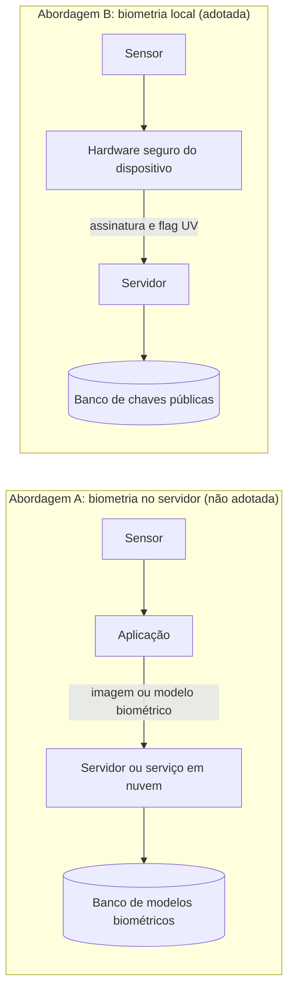
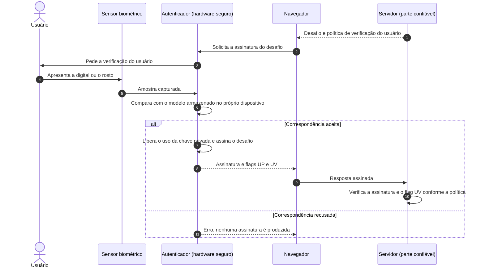
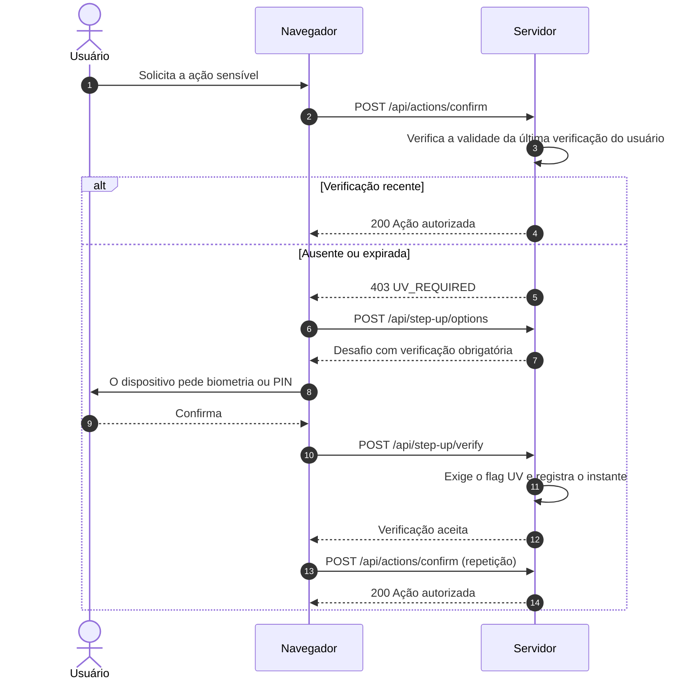

# Biometria local (WebAuthn com verificação do usuário): projeto de referência

Aplicação web de exemplo que mostra como usar a **biometria do dispositivo** (digital, rosto ou PIN) para autenticar e para confirmar ações sensíveis, escrita em Node.js e TypeScript. O objetivo é servir de base de estudo para quem quer entender o que o servidor realmente controla quando a biometria é feita no aparelho do usuário.

> Parte do TCC *Guia de Implementação para Mecanismos de Autenticação sem Senha* (UTFPR, Dois Vizinhos).
> Este projeto complementa o de [passkeys](../passkeys/README.md) e usa a mesma base técnica (WebAuthn). Os fluxos de registro e de login são os mesmos de lá, por isso aqui aparecem apenas as partes novas.

## O que o projeto faz

- Cadastra o dispositivo do usuário (autenticador de plataforma) e faz login.
- Aplica uma **política de verificação do usuário** (`required`, `preferred` ou `discouraged`).
- Exige **nova verificação** (biometria ou PIN) para executar uma ação sensível (*step-up*).
- Registra, em uma trilha de eventos, se cada operação teve verificação do usuário.
- Oferece um **modo laboratório**, só para demonstração local, que permite trocar a política pela interface.

## Ideia central

Em uma aplicação web, **o desenvolvedor não implementa biometria**. Quem captura e compara a digital ou o rosto é o sensor, junto com o sistema operacional e um componente de hardware seguro. O dado biométrico nunca chega ao servidor.

O que o desenvolvedor controla é a **política de verificação do usuário**: quando exigir o gesto biométrico e como interpretar a resposta do dispositivo.

| Conceito | O que significa |
|---|---|
| **UP** (*user presence*) | Houve um gesto de presença, como tocar em um botão |
| **UV** (*user verification*) | O dispositivo verificou o usuário por um método local: biometria, PIN ou padrão |
| **Política de UV** | Pedido feito ao dispositivo: `required` (exige), `preferred` (pede, mas aceita sem) ou `discouraged` (prefere dispensar) |
| ***Step-up*** | Pedir nova verificação antes de uma operação de risco, mesmo com a sessão aberta |

Três pontos que o projeto demonstra:

1. **Pedir não é garantir.** A política enviada ao navegador é só um pedido. A garantia vem de o **servidor conferir o indicador UV** da resposta.
2. **O servidor não sabe qual método foi usado.** UV verdadeiro vale para biometria, PIN ou padrão de desbloqueio. Do ponto de vista do servidor, é uma "verificação local do usuário".
3. **UV verdadeiro não prova quem é o titular da conta**, apenas que alguém desbloqueou o aparelho. A segurança depende do bloqueio de tela do dispositivo.

## Diagramas

### Onde a biometria é comparada



Na abordagem B, o servidor guarda apenas chaves públicas e o resultado (verdadeiro ou falso) da verificação. Um vazamento do banco não expõe nenhuma característica biológica, que não pode ser trocada como uma senha.

### Como a verificação do usuário acontece



As etapas 4 a 6 acontecem inteiramente no dispositivo. O servidor recebe só a assinatura e os indicadores.

### Confirmação de ação sensível (*step-up*)



O login pode usar uma política mais branda (`preferred`), enquanto as ações críticas exigem sempre verificação.

## O que é necessário

Nenhuma etapa exige sensor biométrico, hardware dedicado, conta em nuvem ou serviço pago. O comportamento pode ser reproduzido com o autenticador virtual do navegador.

| Item | Versão | Observação |
|---|---|---|
| **Node.js** | 22.13 ou superior | Exigido pelo SimpleWebAuthn v14 e pelo módulo `node:sqlite` |
| **npm** | Vem com o Node.js | |
| **Git** | Qualquer versão recente | |
| **Navegador** | Chrome ou Edge atuais | Têm autenticador virtual, que simula um dispositivo com e sem biometria |
| **Sensor biométrico** | Opcional | Só para o teste com biometria real |

Confira a versão do Node.js com `node -v`.

## Estrutura de pastas

```text
biometria/
├── package.json, tsconfig.json, .env.example, .gitignore, Dockerfile, docker-compose.yml
├── src/
│   ├── server.ts            # ponto de entrada
│   ├── config.ts            # configuração e validação
│   ├── policy.ts            # política de UV vigente
│   ├── webauthn.ts          # política, algoritmos e regra de verificação
│   ├── validation.ts        # nome de usuário
│   ├── http.ts              # resposta de erro tipada
│   ├── session.ts           # desafio de uso único, login e logout
│   ├── middleware.ts        # autenticação e verificação recente (step-up)
│   ├── db.ts                # SQLite: usuários, credenciais, eventos
│   ├── types.d.ts           # tipos da sessão
│   └── routes/
│       ├── registration.ts  # cadastro do dispositivo
│       ├── authentication.ts# login
│       ├── stepup.ts        # nova verificação (step-up)
│       ├── actions.ts       # ação sensível
│       ├── account.ts       # perfil, eventos, logout, remoção
│       └── lab.ts           # configuração e modo laboratório
├── public/                  # index.html, styles.css, app.js
└── test/                    # testes automatizados
```

Diferenças em relação ao projeto de passkeys:

| Aspecto | Passkeys | Biometria |
|---|---|---|
| Foco | Credencial e protocolo | Política de verificação do usuário (UV) |
| Tipo de autenticador | Qualquer | De plataforma (`authenticatorAttachment: "platform"`) |
| Política de UV | Parâmetro único | Fixada no desafio e aplicada na emissão e na verificação |
| Resultado de UV | Não utilizado | Guardado por credencial e por evento |
| Operações sensíveis | Inexistentes | *Step-up* com janela de validade |
| Trilha de eventos | Inexistente | Tabela `events` com o indicador UV de cada operação |

## Como rodar

```bash
git clone <URL-DO-REPOSITORIO>
cd <repositorio>/biometria

npm install
cp .env.example .env      # no Windows (PowerShell): Copy-Item .env.example .env
npm run dev
```

Acesse **http://localhost:3000**. O `localhost` é tratado pelos navegadores como contexto seguro, então não é preciso HTTPS.

Outros comandos:

```bash
npm run typecheck   # verifica os tipos
npm test            # testes automatizados
```

### Configuração (`.env`)

| Variável | Padrão | Para que serve |
|---|---|---|
| `PORT` | `3000` | Porta do servidor |
| `ORIGIN` | `http://localhost:3000` | Endereço completo que o navegador usa. Deve ser idêntico à barra de endereço |
| `RP_ID` | `localhost` | Domínio ao qual as credenciais ficam vinculadas, sem esquema e sem porta |
| `RP_NAME` | `Guia de Biometria (TCC)` | Nome exibido nos diálogos do sistema |
| `USER_VERIFICATION` | `required` | Política inicial: `required`, `preferred` ou `discouraged` |
| `STEP_UP_WINDOW_SECONDS` | `300` | Por quanto tempo uma verificação autoriza ações sensíveis |
| `LAB_MODE` | `0` | `1` habilita a troca de política pela interface. **Só para demonstração local; proibido em produção** |
| `SESSION_SECRET` | (vazio) | Segredo da sessão. **Obrigatório em produção** |
| `DB_PATH` | `./data/biometria.db` | Arquivo do banco SQLite |
| `TRUST_PROXY` | `0` | Use `1` quando houver túnel ou proxy HTTPS na frente do servidor |

### Docker (opcional)

Executa a aplicação sem instalar o Node.js. Exige o `package-lock.json` (gerado pelo `npm install`) e `SESSION_SECRET` no `.env`.

```bash
docker compose up --build
```

No Docker, o modo laboratório fica sempre desligado. Para os testes de política e de *step-up* abaixo, rode com `npm run dev` e `LAB_MODE=1`.

## Como testar

### 1. Preparar o autenticador virtual

1. Abra a página no Chrome ou Edge e as ferramentas do desenvolvedor (`F12`).
2. Abra o painel **WebAuthn** (menu de três pontos, *Mais ferramentas*, *WebAuthn*) e marque **Enable virtual authenticator environment**.
3. Crie dois autenticadores, **mantendo apenas um ativo por vez**:

| Autenticador | Protocolo | Transporte | Resident keys | User verification |
|---|---|---|---|---|
| **A (com UV)** | ctap2 | internal | marcado | marcado |
| **B (sem UV)** | ctap2 | internal | marcado | desmarcado |

O A simula um dispositivo com biometria e o B, um dispositivo sem capacidade de verificar o usuário. Na seção "Ambiente" da página, "Autenticador de plataforma disponível" deve indicar **sim**.

### 2. Testar as políticas

Com `LAB_MODE=1`, use o seletor de laboratório para trocar a política e **crie um nome de usuário novo a cada teste** (ou apague a pasta `data/`).

| # | Política | Autenticador ativo | Resultado esperado |
|---|---|---|---|
| 1 | `required` | A (com UV) | Cadastro aceito; evento com UV = Sim |
| 2 | `required` | B (sem UV) | Cadastro **recusado**, com mensagem de erro |
| 3 | `preferred` | A (com UV) | Cadastro aceito; UV = Sim |
| 4 | `preferred` | B (sem UV) | Cadastro aceito; UV = Não |
| 5 | `discouraged` | A (com UV) | Cadastro aceito; UV normalmente Não (pode variar entre navegadores) |

Os testes 2 e 4 mostram a diferença central: `required` recusa o autenticador sem UV, e `preferred` o aceita e apenas registra a ausência.

### 3. Testar o *step-up*

**Cenário 1: a ação é bloqueada sem verificação recente.** Com política `preferred` e autenticador B, cadastre um usuário (UV = Não) e clique em **Executar ação sensível**. O servidor responde `UV_REQUIRED`, o autenticador B não consegue verificar o usuário e a ação **não é executada**.

**Cenário 2: o *step-up* libera a ação.**

1. Defina `STEP_UP_WINDOW_SECONDS=15` no `.env` e reinicie o servidor.
2. Com política `required` e autenticador A, cadastre um usuário e execute a ação logo em seguida: ela é autorizada sem *step-up*, porque o cadastro com UV já conta como verificação recente.
3. Aguarde mais de 15 segundos e execute a ação de novo: o servidor pede o *step-up* e, depois da verificação, autoriza. A trilha de eventos mostra `step_up` e `sensitive_action`.

### 4. Testar com biometria real (opcional)

Em um computador ou celular com leitor de digital, reconhecimento facial ou PIN, desative o autenticador virtual e cadastre um novo usuário. Faça um cadastro com a **biometria** e outro com o **PIN do dispositivo**: os dois registram UV = Sim, o que mostra que o servidor não distingue os métodos.

Para testar em celular, é preciso HTTPS por túnel e ajustar `ORIGIN`, `RP_ID` e `TRUST_PROXY=1`, como descrito no README do projeto de passkeys.

### Resultados esperados

| Verificação | Resultado esperado |
|---|---|
| Política `required` com autenticador sem UV | Recusado |
| Política `preferred` com autenticador sem UV | Aceito, UV = Não |
| Ação sensível sem verificação recente | `403 UV_REQUIRED` e *step-up* |
| Ação sensível com verificação recente | Autorizada sem nova solicitação |
| Biometria e PIN no dispositivo real | Ambos resultam em UV = Sim |
| Repetir a requisição `step-up/verify` | `400`: o desafio é de uso único |
| Acessar por `http://127.0.0.1:3000` e tentar cadastrar | `SecurityError` (RP ID incompatível) |
| Remover a única credencial | Recusado |
| Chamar `POST /api/lab/policy` com `LAB_MODE=0` | `404` |
| Conteúdo do banco (`data/biometria.db`) | Chaves públicas, contadores e indicadores UV; **nenhum dado biométrico** |

## Decisões de projeto

- **Autenticador de plataforma**, coerente com a biometria local. Chaves de segurança externas e o celular por QR Code ficam fora do cadastro.
- **Política aplicada em dois momentos e fixada no desafio:** a política vigente na emissão é a mesma aplicada na verificação.
- **Resultado de UV registrado** na credencial e na trilha de eventos, o que gera evidência auditável.
- **Janela de verificação recente** para ações sensíveis. Um login com UV já conta como verificação recente, e um login sem UV não conta.
- ***Step-up* sempre obrigatório,** independentemente da política global.
- **Modo laboratório desligado por padrão e proibido em produção:** a política é decisão do servidor, nunca do cliente.
- Mantidos os critérios do projeto de passkeys: algoritmos fixados, sem atestação, credenciais detectáveis, desafio de uso único e proteção contra a remoção da última credencial.

## Limitações e uso em produção

O projeto é uma referência didática e **não está pronto para produção**. Antes de usá-lo em um sistema real, considere:

- **UV não distingue biometria de PIN.** Se o requisito for biometria estrita, nenhuma configuração do WebAuthn a garante.
- **Dependência do dispositivo.** Falso aceite, detecção de vivacidade e cadastro de novas biometrias são do sistema operacional.
- **Acessibilidade.** Ofereça alternativa para quem não tem biometria utilizável.
- **Recuperação de acesso.** Não implementada. O guia de tokens de software mostra uma alternativa.
- **Autenticador de plataforma apenas.** Para aceitar outros, remova `authenticatorAttachment` e reavalie as garantias.
- **Sessões em memória**, incluindo o instante da última verificação. Use armazenamento persistente.
- **Limite de tentativas, proteção CSRF e HTTPS obrigatório**, como no projeto de passkeys.
- **LGPD.** A biometria local reduz a exposição, mas o nome de usuário, os metadados e a trilha de eventos continuam sujeitos à lei.
- **Chaves de segurança físicas** usam o mesmo protocolo, mas não foram testadas em hardware.

## Problemas comuns

| Sintoma | Causa provável | Solução |
|---|---|---|
| `ERR_UNKNOWN_BUILTIN_MODULE: node:sqlite` | Node.js desatualizado | Atualize para 22.13 ou superior |
| Aviso `ExperimentalWarning: SQLite is an experimental feature` | O módulo `node:sqlite` ainda é experimental | Esperado; não impede a execução |
| Cadastro recusado com política `required` | O autenticador não verifica o usuário | Use o autenticador A (com UV) ou um dispositivo com biometria ou PIN |
| `SecurityError` | `RP_ID` ou `ORIGIN` incompatíveis, ou HTTP fora de `localhost` | Alinhe `ORIGIN`, `RP_ID` e a URL; use HTTPS |
| O seletor de laboratório não aparece | `LAB_MODE` não está em `1` | Defina `LAB_MODE=1` e reinicie (não funciona no Docker) |
| "Autenticador de plataforma disponível: não" | Sem autenticador virtual ativo ou dispositivo sem biometria ou PIN | Ative o autenticador virtual |
| Ação sensível sempre pede *step-up* | Janela muito curta, ou o login foi feito sem UV | Aumente `STEP_UP_WINDOW_SECONDS` ou use a política `required` |
| Cookie de sessão não é gravado atrás de um túnel | Proxy HTTPS sem `trust proxy` | Defina `TRUST_PROXY=1` |
| `npm ci` falha no Docker | Falta o `package-lock.json` | Execute `npm install` e versione o arquivo |

## Referências

- W3C. *Web Authentication: An API for accessing Public Key Credentials*.
- FIDO Alliance. Especificações e programa de certificação de componentes biométricos.
- NIST. *SP 800-63B: Digital Identity Guidelines, Authentication and Lifecycle Management*.
- SimpleWebAuthn. Documentação e notas de versão da v14. https://simplewebauthn.dev