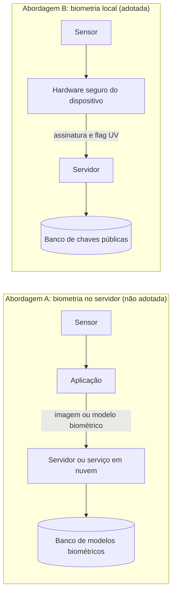
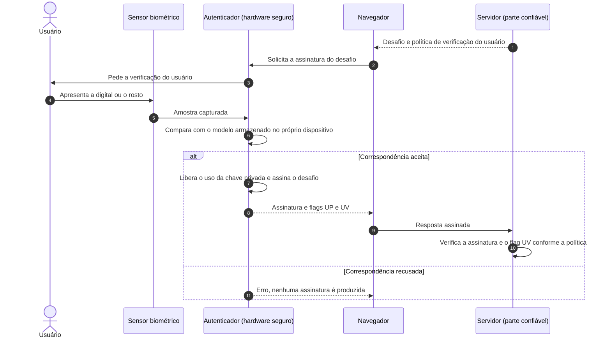
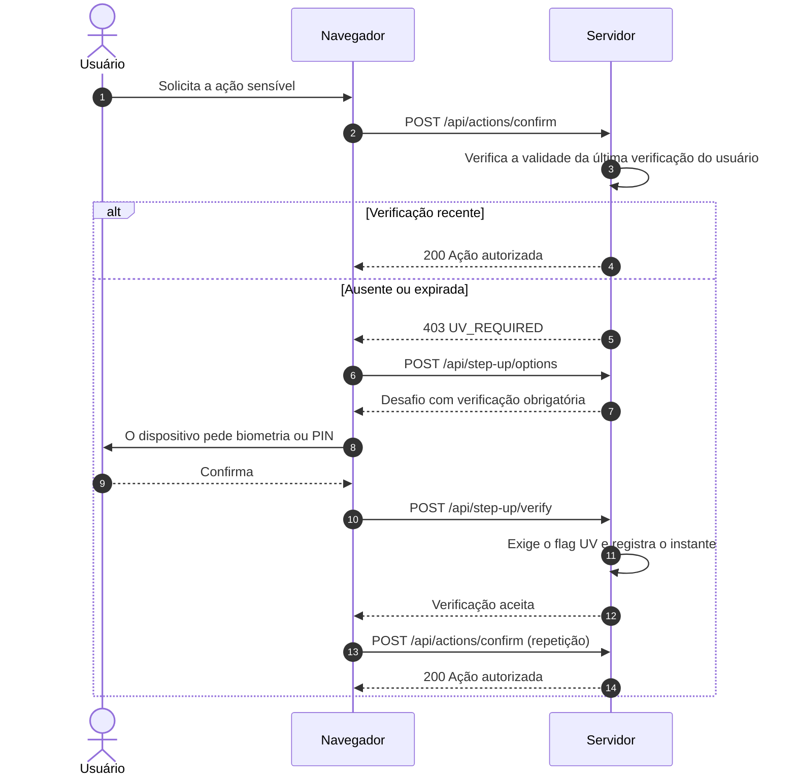

# Guia de Uso 2 — Biometria Local (WebAuthn com verificação do usuário)

> Parte do Trabalho de Conclusão de Curso *Investigação de Protocolos de Passwordless Authentication: uma proposta de guia* (UTFPR, Dois Vizinhos).

## Sumário

1. [Introdução](#1-introdução)
2. [Fundamentação teórica](#2-fundamentação-teórica)
3. [Pré-requisitos e instalação](#3-pré-requisitos-e-instalação)
4. [Visão geral do projeto](#4-visão-geral-do-projeto)
5. [Implementação passo a passo](#5-implementação-passo-a-passo)
6. [Execução e testes](#6-execução-e-testes)
7. [Análise de segurança da implementação](#7-análise-de-segurança-da-implementação)
8. [Limitações e caminho para produção](#8-limitações-e-caminho-para-produção)
9. [Solução de problemas](#9-solução-de-problemas)
10. [Referências](#10-referências)

---

## 1. Introdução

A biometria física, que utiliza características biológicas como impressão digital, face ou íris, foi a categoria de mecanismo mais frequente na revisão sistemática de Yusop et al. (2025), presente em 24 dos 81 estudos analisados. Este guia trata da sua forma de maior viabilidade prática em aplicações web: a **biometria local**, na qual o reconhecimento é feito pelo próprio dispositivo do usuário e a aplicação jamais recebe o dado biométrico.

Um resultado central da análise é que, em aplicações web, **o desenvolvedor não implementa biometria**. Quem captura e compara a característica é o sensor, em conjunto com o sistema operacional e um componente de hardware seguro. O que o desenvolvedor implementa é a **política de verificação do usuário**: decidir quando exigir o gesto biométrico, interpretar o resultado informado pelo autenticador e usá-lo de forma coerente (por exemplo, na confirmação de ações sensíveis). Este é o conteúdo técnico do guia.

O guia apresenta (i) a fundamentação teórica da biometria como fator de autenticação e das arquiteturas que a empregam, (ii) o modelo de confiança que se aplica ao servidor, (iii) a instalação do ambiente, (iv) a construção, etapa por etapa, de uma aplicação de referência em Node.js e TypeScript e (v) a análise das garantias e limitações do resultado.

**Relação com o Guia 1.** O Guia 1 (passkeys) trata da criptografia assimétrica e do protocolo. Este guia o **complementa** e reutiliza a mesma base técnica (WebAuthn). Como o projeto aqui descrito é autocontido, o leitor pode executá-lo sem ter percorrido o Guia 1, embora a leitura prévia da seção 2 daquele guia facilite a compreensão das cerimônias de registro e autenticação.

**Premissa de reprodutibilidade.** Nenhuma etapa exige sensor biométrico, hardware dedicado, conta em serviço de nuvem ou assinatura paga. O comportamento pode ser reproduzido com o autenticador virtual do navegador (seção 6.2); o teste com biometria real é opcional (seção 6.5).

---

## 2. Fundamentação teórica

### 2.1 A biometria como fator de autenticação

Os fatores de autenticação classificam-se em *algo que o usuário sabe* (senha, PIN), *algo que possui* (dispositivo, chave) e *algo que o usuário é* (característica biológica). A biometria física pertence ao terceiro grupo e se caracteriza por três propriedades: o usuário não precisa memorizá-la, não pode ser esquecida em casa e é de difícil replicação, o que explica a sua ampla adoção [Yusop et al. 2025]. Distingue-se da **autenticação comportamental** (digitação, marcha, interação com o dispositivo), que analisa padrões dinâmicos e não é abordada neste trabalho por motivos apresentados na seção de seleção de mecanismos.

Há, contudo, uma diferença estrutural em relação a senhas e chaves: a biometria **não é um segredo**. Impressões digitais e a face deixam vestígios e podem ser fotografadas; além disso, **não podem ser revogadas** como uma senha. Por essa razão, diretrizes de identidade digital recomendam que a biometria seja empregada como parte de uma autenticação multifator, associada a um autenticador físico, e não como credencial isolada. A seção 2.6 mostra como o WebAuthn materializa esse princípio.

### 2.2 O ciclo biométrico

Um sistema biométrico executa, em geral, as etapas seguintes:

1. **Captura:** o sensor adquire uma amostra (imagem da digital, imagem facial, etc.).
2. **Extração de características:** a amostra é convertida em um conjunto de atributos discriminantes.
3. **Modelo (*template*):** na etapa de **cadastro** (*enrollment*), as características são armazenadas como modelo de referência.
4. **Comparação:** na etapa de **verificação**, as características da nova amostra são comparadas ao modelo.
5. **Decisão:** a pontuação de similaridade é comparada a um **limiar**, resultando em aceite ou recusa.

Distinguem-se duas formas de uso. Na **verificação** (comparação 1:1), o sistema confirma se a amostra corresponde a **um** modelo previamente associado ao usuário. Na **identificação** (comparação 1:N), o sistema procura a quem a amostra pertence em um conjunto de modelos. A autenticação em dispositivos pessoais utiliza a verificação 1:1, de menor risco e custo.

### 2.3 Métricas de desempenho e ataques de apresentação

A decisão por limiar é probabilística e gera dois tipos de erro: o **falso aceite** (taxa FAR, *False Acceptance Rate*: um impostor é aceito) e a **falsa rejeição** (taxa FRR ou FNR: o usuário legítimo é recusado). Reduzir uma eleva a outra, e o ponto em que se igualam define a **taxa de erro igual** (EER). A revisão de Yusop et al. (2025) mostra que FAR, EER e FNR estão entre as métricas de acurácia mais empregadas nos estudos de autenticação biométrica e comportamental.

Um terceiro aspecto é a resistência a **ataques de apresentação** (*spoofing*), em que se apresenta ao sensor uma réplica da característica (digital moldada, fotografia, máscara). A mitigação ocorre por técnicas de **detecção de vivacidade** (*liveness*) ou de detecção de ataques de apresentação (PAD), cuja avaliação é objeto de normas específicas. A revisão sistemática registra vulnerabilidades de biometria a falsificação de características, por exemplo a partir de imagens da face, e propostas de reforço, como a leitura do diâmetro pupilar e dos batimentos cardíacos na íris [Yusop et al. 2025]. Ressalte-se que esses controles são responsabilidade do **fabricante do sensor e do sistema operacional**, e não da aplicação web.

### 2.4 Arquiteturas: biometria no servidor *versus* biometria local

A decisão arquitetural mais relevante é **onde ocorre a comparação**.



| Aspecto | A. Biometria no servidor | B. Biometria local (WebAuthn) |
|---|---|---|
| O dado biométrico sai do dispositivo? | Sim (imagem ou modelo) | **Não** |
| Impacto de um vazamento do banco | Grave e **irreversível**: a característica biológica não pode ser trocada | Nenhum dado biométrico exposto; apenas chaves públicas |
| Proteção contra phishing | Depende de controles adicionais | Herdada do WebAuthn (vinculação ao domínio) |
| Dependência de terceiros | Frequente (serviços de reconhecimento em nuvem) | Nenhuma contratada pelo desenvolvedor |
| Implicações da LGPD | O controlador trata dado pessoal sensível | A aplicação não recebe o dado biométrico (ver 2.10) |
| Controle de falsos aceites e vivacidade | Da aplicação ou do fornecedor | Do fabricante do dispositivo |
| Esforço de implementação | Alto (captura, comparação, armazenamento seguro) | Baixo (política e verificação de flags) |

Pelas razões acima, este trabalho adota exclusivamente a **abordagem B**.

### 2.5 Hardware seguro e fornecedores de plataforma

Na biometria local, o modelo biométrico é armazenado e comparado em um componente isolado do restante do sistema, de modo que nem o sistema operacional comum nem as aplicações o acessam. Exemplos, por plataforma:

| Plataforma | Recurso biométrico | Componente isolado |
|---|---|---|
| Apple | Touch ID, Face ID | Secure Enclave |
| Android | Impressão digital, face (conforme o aparelho) | Ambiente de execução confiável (TEE) ou módulo de segurança dedicado |
| Windows | Windows Hello (digital, face) | Módulo de plataforma confiável (TPM), quando disponível |

Em plataformas Android, as biometrias são classificadas por nível de robustez, sendo a classe de maior robustez a adequada ao desbloqueio de chaves criptográficas. É esse componente que realiza a comparação e que, em caso de sucesso, **libera o uso de uma chave privada**. Esse encadeamento é o que conecta a biometria ao protocolo (seção 2.6).

### 2.6 Como a web utiliza a biometria: a verificação do usuário (UV)

No WebAuthn, a biometria não é transmitida: ela serve como **gesto de verificação do usuário** (*user verification*, UV) que autoriza o autenticador a usar a chave privada. Duas informações distintas são produzidas e assinadas pelo autenticador em `authenticatorData`:

- **UP (*user presence*):** houve um gesto de presença (por exemplo, o toque em um botão).
- **UV (*user verification*):** o autenticador **verificou** o usuário por um método local (biometria, PIN ou padrão).



Observe-se que as etapas 4 a 6 ocorrem **inteiramente no dispositivo**. O servidor recebe apenas a assinatura e os *flags*. Esse desenho concretiza o princípio da seção 2.1: a biometria é o fator "o que você é" que **destrava** o fator "o que você possui" (a chave privada do dispositivo).

### 2.7 O que o servidor pode, e o que não pode, concluir

A política de verificação é comunicada ao autenticador pela opção `userVerification`, com três valores:

| Política | Pedido ao autenticador | Verificação no servidor | Autenticador que não verifica o usuário |
|---|---|---|---|
| `required` | Exige a verificação | O servidor rejeita respostas com UV falso | **Rejeitado** |
| `preferred` | Solicita, se possível | O servidor não exige UV | Aceito, com UV = falso |
| `discouraged` | Prefere dispensar | O servidor não exige UV | Aceito (o autenticador ainda pode verificar; o flag reflete o ocorrido) |

Dois pontos são essenciais e frequentemente mal compreendidos:

1. **Pedir não é garantir.** A opção `userVerification: "required"` é apenas um pedido encaminhado ao navegador e ao autenticador. A garantia vem de o **servidor verificar o flag UV** da resposta. Por isso a implementação aplica a política em dois momentos (geração das opções e verificação) e fixa a política vigente no desafio (seção 5.6). A biblioteca utilizada exige, por padrão, UV na verificação e sempre exige o flag de presença (UP); a verificação de UV só é dispensada quando o desenvolvedor assim o declara.
2. **O servidor não sabe *qual* método foi usado.** O flag UV indica que o autenticador verificou o usuário, mas não se foi por biometria, PIN ou padrão de desbloqueio. Do ponto de vista do servidor, a "biometria local" é, rigorosamente, **verificação local do usuário**. Para ampliar a garantia, seria possível solicitar a *atestação* do autenticador e consultar metadados e certificações de componentes biométricos da FIDO Alliance , o que introduz dependências e foge ao escopo deste guia.

Uma terceira ressalva: UV verdadeiro não demonstra que o portador é o **titular da conta**, mas que é alguém **autorizado a desbloquear aquele autenticador**. Quem conhece o PIN do aparelho pode, em geral, cadastrar a própria biometria no sistema operacional, e passará a satisfazer a verificação. A segurança resultante depende, portanto, do bloqueio de tela do dispositivo, fora do controle da aplicação.

### 2.8 Confirmação de ações sensíveis (*step-up*)

Em vez de exigir biometria a cada requisição, aplicações adotam o princípio da **autenticação recente**: operações de maior risco (transferências, alteração de dados de acesso, exclusão de dados) exigem que o usuário tenha comprovado sua identidade **há pouco tempo**, mesmo com a sessão aberta . Quando a verificação é antiga ou inexistente, o sistema solicita nova confirmação, o que se denomina *step-up*.



Essa estratégia equilibra usabilidade e segurança: o login pode adotar uma política mais branda (`preferred`), enquanto operações críticas exigem sempre verificação (`required`). O projeto implementa esse padrão (seções 5.7 e 5.10).

### 2.9 Ameaças e limitações da biometria

A tabela relaciona as propriedades da biometria local às ameaças, incluindo a categoria *ataques biométricos*, identificada em três estudos da revisão [Yusop et al. 2025]:

| Ameaça | Resposta da abordagem | Garantia |
|---|---|---|
| Vazamento de modelos biométricos do servidor | O servidor não recebe nem armazena dado biométrico | Forte (por desenho) |
| Phishing e sites fraudulentos | Herdada do WebAuthn: credencial vinculada ao domínio | Forte |
| Roubo de senhas, *credential stuffing*, força bruta | Não há senha | Forte |
| *Replay* | Desafio aleatório, de uso único e com expiração | Forte |
| Ataque de apresentação (digital falsa, foto, máscara) | Depende do sensor e da detecção de vivacidade do dispositivo; a aplicação não controla | Dependente do dispositivo |
| Falso aceite (FAR) | Depende do dispositivo; mitigável com *step-up* para ações críticas | Parcial |
| Uso por terceiro com o dispositivo desbloqueado ou sob coação | Não mitigado | Nenhuma |
| Cadastro de biometria alheia por quem conhece o PIN do aparelho | Não controlável pela aplicação | Dependente do sistema operacional |
| Malware agindo durante a sessão aberta | *Step-up* reduz a janela de risco | Parcial |

Limitações adicionais: **irrevogabilidade** da característica (não se "troca" a digital); **acessibilidade** (nem todos os usuários possuem biometria utilizável, e é preciso oferecer alternativa); **variabilidade** do desempenho entre dispositivos e condições ambientais; e **dependência do dispositivo** (a perda do aparelho exige recuperação de acesso por outro meio).

### 2.10 Aspectos legais: LGPD

A Lei Geral de Proteção de Dados (Lei nº 13.709/2018) classifica o **dado biométrico**, quando vinculado a uma pessoa natural, como **dado pessoal sensível**, sujeito a bases legais mais restritas . Na biometria local, a aplicação não coleta nem armazena o dado biométrico, o que **reduz** a exposição do controlador. Persistem, contudo, o tratamento do nome de usuário, dos metadados e da trilha de eventos. A conclusão jurídica para um caso concreto exige análise específica.

### 2.11 Tecnologias de terceiros: quando são necessárias

Assim como nas passkeys, **a biometria local não exige a contratação de serviços de terceiros**. As funções de captura, comparação e armazenamento do modelo são realizadas por componentes que já fazem parte do dispositivo do usuário.

| Tecnologia | Papel | É necessária para este projeto? |
|---|---|---|
| **Sensor, sistema operacional e hardware seguro** (Apple, Google, Microsoft e fabricantes de dispositivos) | Capturam, comparam e protegem o modelo biométrico; liberam a chave privada | Fazem parte do dispositivo do usuário. **Não são contratados** pelo desenvolvedor |
| **Navegador (API WebAuthn)** | Intermedia a comunicação com o autenticador e aplica as verificações de origem | Sim, e já está instalado |
| **SDKs nativos** (por exemplo, APIs de biometria do Android e do iOS) | Permitem o uso da biometria em aplicativos móveis nativos | Não, pois o projeto é web. Seriam o caminho de uma extensão nativa |
| **Serviços de reconhecimento biométrico em nuvem** (por exemplo, reconhecimento facial oferecidos por provedores como Amazon e Microsoft) | Comparam imagens ou modelos enviados pela aplicação | **Não, deliberadamente.** Correspondem à abordagem A (2.4): exigem transmitir dado biométrico a terceiros, com os riscos de irreversibilidade e as implicações da LGPD |
| **Atestação e metadados da FIDO Alliance** | Permitem validar modelo e certificação do autenticador | Não, por usar `attestation: "none"` |
| **Hospedagem e HTTPS** (qualquer provedor, ou túnel como Cloudflare Tunnel e ngrok) | O WebAuthn exige HTTPS fora de `localhost` | Apenas para testar em outro dispositivo ou publicar |

Em síntese: **o desenvolvedor controla o servidor e a política; o dispositivo do usuário e seus fornecedores de plataforma provêm a biometria**.

---

## 3. Pré-requisitos e instalação

### 3.1 Software necessário

| Item | Versão | Observação |
|---|---|---|
| **Node.js** | **22.13 ou superior** (LTS) | A versão 14 do SimpleWebAuthn exige Node 22+; `node:sqlite` é usado sem *flags* a partir da 22.13 |
| **npm** | Instalado com o Node.js | |
| **Git** | Qualquer versão recente | |
| **Navegador** | Chrome ou Edge atuais | O autenticador virtual está nas ferramentas do desenvolvedor |
| **Sensor biométrico** | **Opcional** | Necessário apenas para o teste real (seção 6.5) |

### 3.2 Instalação do Node.js

- **Linux ou macOS:** instale o `nvm` pelas instruções oficiais e execute `nvm install 22` e `nvm use 22`.
- **Windows:** use o instalador LTS em nodejs.org ou o `nvm-windows`.

Confirme a instalação:

```bash
node -v    # deve exibir v22.13.0 ou superior
npm -v
git --version
```

---

## 4. Visão geral do projeto

### 4.1 Diferenças em relação ao Guia 1

| Aspecto | Guia 1 (passkeys) | Guia 2 (biometria) |
|---|---|---|
| Foco | Credencial e protocolo | **Política de verificação do usuário (UV)** |
| Tipo de autenticador | Qualquer | **Plataforma** (`authenticatorAttachment: "platform"`) |
| Política de UV | Parâmetro único | Política fixada **no desafio** e aplicada na emissão e na verificação |
| Resultado de UV | Não utilizado | Armazenado por credencial e por evento |
| Operações sensíveis | Inexistentes | ***Step-up*** com janela de validade |
| Trilha de eventos | Inexistente | Tabela `events` com o flag UV de cada cerimônia |
| Laboratório | Inexistente | Modo opcional para alternar a política em tempo de execução |

### 4.2 Estrutura de arquivos

```text
biometria/
├── package.json, tsconfig.json, .env.example, .gitignore, Dockerfile, docker-compose.yml
├── src/
│   ├── server.ts            # ponto de entrada
│   ├── config.ts            # configuração e validação
│   ├── policy.ts            # política de UV vigente
│   ├── webauthn.ts          # política, algoritmos e regra de verificação
│   ├── validation.ts        # nome de usuário
│   ├── http.ts              # resposta de erro tipada
│   ├── session.ts           # desafio de uso único, login e logout
│   ├── middleware.ts        # autenticação e verificação recente (step-up)
│   ├── db.ts                # SQLite: usuários, credenciais, eventos
│   ├── types.d.ts           # tipos da sessão
│   └── routes/
│       ├── registration.ts  # cadastro do dispositivo
│       ├── authentication.ts# login
│       ├── stepup.ts        # nova verificação (step-up)
│       ├── actions.ts       # ação sensível
│       ├── account.ts       # perfil, eventos, logout, remoção
│       └── lab.ts           # configuração e modo laboratório
├── public/                  # index.html, styles.css, app.js
└── test/                    # testes automatizados
```

### 4.3 Decisões de projeto

1. **Autenticador de plataforma** (`authenticatorAttachment: "platform"`), coerente com o escopo de biometria local. Consequência: chaves de segurança externas e o uso do celular por QR Code ficam fora do fluxo de cadastro.
2. **Política aplicada em dois momentos e fixada no desafio:** a política vigente quando o desafio é emitido é a mesma aplicada na verificação, mesmo que ela mude entre as duas etapas.
3. **O resultado de UV é registrado** na credencial e na trilha de eventos, o que gera evidência auditável.
4. **Janela de verificação recente** (`STEP_UP_WINDOW_SECONDS`, padrão de 300 s) para ações sensíveis. Um login com UV já conta como verificação recente.
5. ***Step-up* sempre obrigatório:** independe da política global; a verificação do usuário é exigida de forma fixa.
6. **Modo laboratório desligado por padrão** e **proibido em produção**: a política é decisão do servidor, nunca do cliente.
7. **Os demais critérios do Guia 1 são mantidos:** lista de algoritmos fixada, `attestation: "none"`, credenciais detectáveis, desafio de uso único e proteção contra a remoção da última credencial.

---

## 5. Implementação passo a passo

> Os arquivos que não diferem do Guia 1 aparecem recolhidos (clique para expandir), com a indicação da seção equivalente.

### 5.1 Criar o projeto e instalar as dependências

```bash
mkdir biometria
cd biometria
git init
```

Crie o `package.json`:

`package.json`

```json
{
  "name": "guia-biometria",
  "version": "1.0.0",
  "description": "Implementação de referência de autenticação por biometria local (WebAuthn com verificação do usuário) em Node.js e TypeScript",
  "private": true,
  "type": "module",
  "license": "MIT",
  "engines": {
    "node": ">=22.13.0"
  },
  "scripts": {
    "dev": "node --env-file-if-exists=.env --import tsx --watch src/server.ts",
    "build": "tsc",
    "start": "node --env-file-if-exists=.env dist/server.js",
    "typecheck": "tsc --noEmit",
    "test": "node --import tsx --test test/*.test.ts"
  },
  "dependencies": {
    "@simplewebauthn/browser": "^14.0.0",
    "@simplewebauthn/server": "^14.0.2",
    "express": "^5.1.0",
    "express-session": "^1.18.1"
  },
  "devDependencies": {
    "@types/express": "^5.0.0",
    "@types/express-session": "^1.18.0",
    "@types/node": "^22.13.0",
    "tsx": "^4.19.0",
    "typescript": "^5.6.0"
  }
}
```

Instale as dependências. O comando gera o `package-lock.json`, que **deve ser versionado**:

```bash
npm install
```

As dependências são as mesmas do Guia 1: `@simplewebauthn/server` e `@simplewebauthn/browser` (versão 14, com a 14.0.2 ou superior por correções de segurança no pacote de servidor), `express` (versão 5) e `express-session`.

### 5.2 Configurar o TypeScript e o Git

<details>
<summary>tsconfig.json (idêntico ao Guia 1, seção 5.2)</summary>

```json
{
  "compilerOptions": {
    "target": "ES2022",
    "module": "NodeNext",
    "moduleResolution": "NodeNext",
    "outDir": "dist",
    "rootDir": "src",
    "strict": true,
    "esModuleInterop": true,
    "skipLibCheck": true,
    "forceConsistentCasingInFileNames": true
  },
  "include": ["src"]
}
```

</details>

<details>
<summary>.gitignore (idêntico ao Guia 1, seção 5.2)</summary>

```text
node_modules/
dist/
data/
.env
*.log
```

</details>

### 5.3 Configuração, política e regra de verificação

Crie `.env.example` e copie-o para `.env`:

`.env.example`

```bash
# Porta local do servidor
PORT=3000

# Origem completa (esquema + domínio + porta) em que o navegador acessa a aplicação.
ORIGIN=http://localhost:3000

# Domínio ao qual as credenciais ficam vinculadas (sem esquema e sem porta).
RP_ID=localhost

# Nome exibido ao usuário nos diálogos do sistema
RP_NAME=Guia de Biometria (TCC)

# Política de verificação do usuário no registro e no login:
#   required     => o servidor EXIGE verificação (biometria ou PIN do dispositivo)
#   preferred    => o servidor pede, mas aceita sem verificação
#   discouraged  => o servidor não pede verificação
USER_VERIFICATION=required

# Janela (em segundos) em que uma verificação recente autoriza ações sensíveis
STEP_UP_WINDOW_SECONDS=300

# Modo laboratório: permite alterar a política em tempo de execução pela interface.
# APENAS para demonstração local. É proibido em produção.
LAB_MODE=0

# Obrigatório em produção
SESSION_SECRET=

# Caminho do arquivo SQLite
DB_PATH=./data/biometria.db

# Defina como 1 quando houver proxy/túnel HTTPS na frente do servidor
TRUST_PROXY=0
```

```bash
cp .env.example .env      # no Windows (PowerShell): Copy-Item .env.example .env
```

Parâmetros relevantes deste guia:

- **`USER_VERIFICATION`**: política inicial (`required`, `preferred` ou `discouraged`). O padrão é `required`.
- **`STEP_UP_WINDOW_SECONDS`**: por quanto tempo uma verificação autoriza ações sensíveis.
- **`LAB_MODE`**: habilita a alteração da política pela interface. Apenas para demonstração local.

`src/webauthn.ts` concentra a política e a regra central: **o servidor só rejeita respostas sem UV quando a política é `required`**.

`src/webauthn.ts`

```ts
export type UserVerification = 'required' | 'preferred' | 'discouraged';

/** Valida um valor externo (variável de ambiente ou corpo de requisição). */
export function parseUserVerification(value: unknown): UserVerification {
  if (value === 'required' || value === 'preferred' || value === 'discouraged') {
    return value;
  }
  throw new Error(
    `Política de verificação inválida: "${String(value)}". Use required, preferred ou discouraged.`,
  );
}

/**
 * Define se o SERVIDOR rejeita respostas cujo flag UV (user verified) seja falso.
 *
 * Atenção: pedir `userVerification: "required"` na geração das opções NÃO basta.
 * Essa opção é apenas um pedido ao navegador e ao autenticador; quem garante a
 * política é a verificação, no servidor, do flag UV assinado pelo autenticador.
 * Por isso a política é aplicada nos dois momentos (opções e verificação).
 */
export function requiresUserVerification(policy: UserVerification): boolean {
  return policy === 'required';
}

/** Algoritmos de chave pública aceitos (COSE): -8 EdDSA, -7 ES256, -257 RS256. */
export const SUPPORTED_ALGORITHM_IDS = [-8, -7, -257];
```

`src/config.ts` lê e valida os valores. Duas proteções merecem destaque: a ausência de `SESSION_SECRET` e o uso de `LAB_MODE=1` interrompem a inicialização em produção.

`src/config.ts`

```ts
import { parseUserVerification } from './webauthn.js';

const origin = new URL(process.env.ORIGIN ?? 'http://localhost:3000');
const isProduction = process.env.NODE_ENV === 'production';

if (isProduction && !process.env.SESSION_SECRET) {
  throw new Error('Defina SESSION_SECRET em produção.');
}
if (isProduction && process.env.LAB_MODE === '1') {
  throw new Error('LAB_MODE=1 não pode ser usado em produção.');
}

const stepUpWindowSeconds = Number(process.env.STEP_UP_WINDOW_SECONDS ?? 300);
if (!Number.isFinite(stepUpWindowSeconds) || stepUpWindowSeconds <= 0) {
  throw new Error('STEP_UP_WINDOW_SECONDS deve ser um número positivo.');
}

export const config = {
  port: Number(process.env.PORT ?? 3000),
  rpName: process.env.RP_NAME ?? 'Guia de Biometria (TCC)',
  rpID: process.env.RP_ID || origin.hostname,
  origin: origin.origin,
  // Política inicial. Em modo laboratório, pode ser alterada em tempo de execução (policy.ts).
  userVerification: parseUserVerification(process.env.USER_VERIFICATION ?? 'required'),
  stepUpWindowMs: stepUpWindowSeconds * 1000,
  labMode: process.env.LAB_MODE === '1',
  sessionSecret: process.env.SESSION_SECRET || 'segredo-apenas-para-desenvolvimento',
  dbPath: process.env.DB_PATH ?? './data/biometria.db',
  secureCookies: origin.protocol === 'https:',
  trustProxy: process.env.TRUST_PROXY === '1',
} as const;
```

`src/policy.ts` guarda a política vigente. Ela é fixa, salvo em modo laboratório:

`src/policy.ts`

```ts
import { config } from './config.js';
import type { UserVerification } from './webauthn.js';

// Política vigente no servidor. É fixa, salvo em modo laboratório (LAB_MODE=1).
let current: UserVerification = config.userVerification;

export function getPolicy(): UserVerification {
  return current;
}

export function setPolicy(policy: UserVerification): void {
  current = policy;
}
```

### 5.4 Utilitários

`src/validation.ts` normaliza o nome de usuário e `src/http.ts` envia respostas de erro. Ambos são iguais aos do Guia 1:

<details>
<summary>src/validation.ts (idêntico ao Guia 1, seção 5.4)</summary>

```ts
const USERNAME_PATTERN = /^[a-z0-9._@-]{3,64}$/;

/** Normaliza e valida o nome de usuário. Retorna null se for inválido. */
export function normalizeUsername(input: unknown): string | null {
  if (typeof input !== 'string') return null;
  const normalized = input.trim().toLowerCase();
  return USERNAME_PATTERN.test(normalized) ? normalized : null;
}
```

</details>

<details>
<summary>src/http.ts (idêntico ao Guia 1, seção 5.4)</summary>

```ts
import type { Response } from 'express';

/**
 * Envia uma resposta de erro JSON e devolve `void`.
 *
 * Os tipos do Express 5 declaram que um handler devolve `void | Promise<void>`.
 * Por isso os handlers não podem fazer `return res.status(...).json(...)`, que
 * devolveria o objeto `Response`. Com este utilitário, o padrão
 * `if (condição) return fail(res, 400, 'mensagem');` é aceito pelo compilador.
 */
export function fail(res: Response, status: number, error: string, code?: string): void {
  res.status(status).json(code ? { error, code } : { error });
}
```

</details>

> **Por que `fail()`?** Os tipos do Express 5 declaram que um *handler* devolve `void | Promise<void>`. Um `return res.status(...).json(...)` devolve o objeto `Response` e é recusado pelo compilador. O utilitário devolve `void`, permitindo o padrão `if (condição) return fail(res, 400, 'mensagem');`.

### 5.5 Persistência: usuários, credenciais e eventos

`src/db.ts` acrescenta, em relação ao Guia 1, dois campos na credencial (`uv_at_registration` e `last_uv`) e a tabela `events`, que registra se cada cerimônia teve verificação do usuário:

`src/db.ts`

```ts
import { DatabaseSync } from 'node:sqlite';
import { mkdirSync } from 'node:fs';
import { dirname } from 'node:path';

export interface User {
  id: string; // user handle (base64url, 32 bytes aleatórios)
  username: string;
  createdAt: string;
}

export interface StoredCredential {
  id: string; // credential ID (base64url)
  userId: string;
  publicKey: Uint8Array; // chave pública no formato COSE
  counter: number;
  transports: string[];
  deviceType: 'singleDevice' | 'multiDevice';
  backedUp: boolean;
  /** O autenticador informou verificação do usuário (UV) no momento do registro. */
  uvAtRegistration: boolean;
  /** Resultado de UV na última autenticação (null se nunca usada). */
  lastUv: boolean | null;
  createdAt: string;
  lastUsedAt: string | null;
}

export type NewCredential = Omit<StoredCredential, 'createdAt' | 'lastUsedAt' | 'lastUv'>;

export type EventType = 'register' | 'login' | 'step_up' | 'sensitive_action';

export interface AuthEvent {
  id: number;
  userId: string;
  type: EventType;
  credentialId: string | null;
  userVerified: boolean;
  policy: string;
  createdAt: string;
}

export type NewEvent = Omit<AuthEvent, 'id' | 'createdAt'>;

type Row = Record<string, unknown>;

const SCHEMA = `
  CREATE TABLE IF NOT EXISTS users (
    id         TEXT PRIMARY KEY,
    username   TEXT NOT NULL UNIQUE COLLATE NOCASE,
    created_at TEXT NOT NULL DEFAULT (datetime('now'))
  );

  CREATE TABLE IF NOT EXISTS credentials (
    id                  TEXT PRIMARY KEY,
    user_id             TEXT NOT NULL REFERENCES users(id) ON DELETE CASCADE,
    public_key          BLOB NOT NULL,
    counter             INTEGER NOT NULL DEFAULT 0,
    transports          TEXT NOT NULL DEFAULT '[]',
    device_type         TEXT NOT NULL,
    backed_up           INTEGER NOT NULL DEFAULT 0,
    uv_at_registration  INTEGER NOT NULL DEFAULT 0,
    last_uv             INTEGER,
    created_at          TEXT NOT NULL DEFAULT (datetime('now')),
    last_used_at        TEXT
  );

  CREATE INDEX IF NOT EXISTS idx_credentials_user ON credentials(user_id);

  -- Trilha de eventos: registra, para cada cerimônia, se houve verificação do usuário.
  CREATE TABLE IF NOT EXISTS events (
    id            INTEGER PRIMARY KEY AUTOINCREMENT,
    user_id       TEXT NOT NULL REFERENCES users(id) ON DELETE CASCADE,
    type          TEXT NOT NULL,
    credential_id TEXT,
    user_verified INTEGER NOT NULL,
    policy        TEXT NOT NULL,
    created_at    TEXT NOT NULL DEFAULT (datetime('now'))
  );

  CREATE INDEX IF NOT EXISTS idx_events_user ON events(user_id, id);
`;

function toUser(row: Row): User {
  return {
    id: row.id as string,
    username: row.username as string,
    createdAt: row.created_at as string,
  };
}

function toCredential(row: Row): StoredCredential {
  return {
    id: row.id as string,
    userId: row.user_id as string,
    publicKey: new Uint8Array(row.public_key as Uint8Array),
    counter: Number(row.counter),
    transports: JSON.parse(row.transports as string) as string[],
    deviceType: row.device_type as StoredCredential['deviceType'],
    backedUp: Number(row.backed_up) === 1,
    uvAtRegistration: Number(row.uv_at_registration) === 1,
    lastUv: row.last_uv === null || row.last_uv === undefined ? null : Number(row.last_uv) === 1,
    createdAt: row.created_at as string,
    lastUsedAt: (row.last_used_at as string | null) ?? null,
  };
}

function toEvent(row: Row): AuthEvent {
  return {
    id: Number(row.id),
    userId: row.user_id as string,
    type: row.type as EventType,
    credentialId: (row.credential_id as string | null) ?? null,
    userVerified: Number(row.user_verified) === 1,
    policy: row.policy as string,
    createdAt: row.created_at as string,
  };
}

export class Store {
  private db: DatabaseSync;

  constructor(path: string) {
    if (path !== ':memory:') {
      mkdirSync(dirname(path), { recursive: true });
    }
    this.db = new DatabaseSync(path);
    this.db.exec('PRAGMA foreign_keys = ON');
    this.db.exec(SCHEMA);
  }

  createUser(id: string, username: string): User {
    this.db.prepare('INSERT INTO users (id, username) VALUES (?, ?)').run(id, username);
    return this.getUserById(id)!;
  }

  getUserById(id: string): User | undefined {
    const row = this.db.prepare('SELECT * FROM users WHERE id = ?').get(id) as Row | undefined;
    return row ? toUser(row) : undefined;
  }

  getUserByUsername(username: string): User | undefined {
    const row = this.db
      .prepare('SELECT * FROM users WHERE username = ?')
      .get(username) as Row | undefined;
    return row ? toUser(row) : undefined;
  }

  addCredential(c: NewCredential): void {
    this.db
      .prepare(
        `INSERT INTO credentials
           (id, user_id, public_key, counter, transports, device_type, backed_up, uv_at_registration)
         VALUES (?, ?, ?, ?, ?, ?, ?, ?)`,
      )
      .run(
        c.id,
        c.userId,
        c.publicKey,
        c.counter,
        JSON.stringify(c.transports),
        c.deviceType,
        c.backedUp ? 1 : 0,
        c.uvAtRegistration ? 1 : 0,
      );
  }

  getCredentialById(id: string): StoredCredential | undefined {
    const row = this.db.prepare('SELECT * FROM credentials WHERE id = ?').get(id) as
      | Row
      | undefined;
    return row ? toCredential(row) : undefined;
  }

  listCredentials(userId: string): StoredCredential[] {
    const rows = this.db
      .prepare('SELECT * FROM credentials WHERE user_id = ? ORDER BY created_at, id')
      .all(userId) as Row[];
    return rows.map(toCredential);
  }

  updateCredentialUsage(id: string, counter: number, backedUp: boolean, userVerified: boolean): void {
    this.db
      .prepare(
        `UPDATE credentials
            SET counter = ?, backed_up = ?, last_uv = ?, last_used_at = datetime('now')
          WHERE id = ?`,
      )
      .run(counter, backedUp ? 1 : 0, userVerified ? 1 : 0, id);
  }

  deleteCredential(id: string, userId: string): boolean {
    const result = this.db
      .prepare('DELETE FROM credentials WHERE id = ? AND user_id = ?')
      .run(id, userId);
    return Number(result.changes) > 0;
  }

  addEvent(e: NewEvent): void {
    this.db
      .prepare(
        `INSERT INTO events (user_id, type, credential_id, user_verified, policy)
         VALUES (?, ?, ?, ?, ?)`,
      )
      .run(e.userId, e.type, e.credentialId, e.userVerified ? 1 : 0, e.policy);
  }

  /** Eventos mais recentes primeiro. */
  listEvents(userId: string, limit = 20): AuthEvent[] {
    const rows = this.db
      .prepare('SELECT * FROM events WHERE user_id = ? ORDER BY id DESC LIMIT ?')
      .all(userId, limit) as Row[];
    return rows.map(toEvent);
  }
}
```

Observações: o banco **não contém nenhum dado biométrico**, apenas chaves públicas, contadores e o resultado booleano de UV informado pelo autenticador; as consultas são parametrizadas; e `ON DELETE CASCADE` preserva a integridade referencial.

### 5.6 Sessão e desafio de uso único

Primeiro, os tipos da sessão. O desafio agora carrega a **política vigente na emissão** e há um novo campo, `uvAt`:

`src/types.d.ts`

```ts
import 'express-session';
import type { UserVerification } from './webauthn.js';

declare module 'express-session' {
  interface SessionData {
    /** Identificador do usuário autenticado. */
    userId?: string;
    /** Instante (ms) da última verificação do usuário (UV) bem-sucedida nesta sessão. */
    uvAt?: number;
    /** Desafio de uma cerimônia WebAuthn em andamento (uso único). */
    challenge?: {
      value: string;
      purpose: 'registration' | 'authentication' | 'step-up';
      /** Política vigente quando o desafio foi emitido; é a mesma aplicada na verificação. */
      userVerification: UserVerification;
      pendingUser?: { id: string; username: string };
      expiresAt: number;
    };
  }
}
```

Em seguida, `src/session.ts`:

`src/session.ts`

```ts
import type { Request } from 'express';
import type { UserVerification } from './webauthn.js';

const CHALLENGE_TTL_MS = 5 * 60 * 1000; // 5 minutos

export type ChallengePurpose = 'registration' | 'authentication' | 'step-up';

/**
 * Guarda o desafio da cerimônia na sessão do servidor, junto com a política de
 * verificação do usuário vigente. Assim, a verificação aplica exatamente a política
 * que foi solicitada ao autenticador, mesmo que ela mude entre as duas etapas.
 */
export function storeChallenge(
  req: Request,
  purpose: ChallengePurpose,
  value: string,
  userVerification: UserVerification,
  pendingUser?: { id: string; username: string },
): void {
  req.session.challenge = {
    value,
    purpose,
    userVerification,
    pendingUser,
    expiresAt: Date.now() + CHALLENGE_TTL_MS,
  };
}

/** Recupera e INVALIDA o desafio (uso único). Retorna null se ausente, expirado ou de outra finalidade. */
export function consumeChallenge(req: Request, purpose: ChallengePurpose) {
  const challenge = req.session.challenge;
  delete req.session.challenge;
  if (!challenge) return null;
  if (challenge.purpose !== purpose) return null;
  if (challenge.expiresAt < Date.now()) return null;
  return challenge;
}

/**
 * Inicia a sessão autenticada, regenerando o identificador (evita session fixation).
 * Se a autenticação incluiu verificação do usuário, registra o instante dela.
 */
export function loginSession(req: Request, userId: string, userVerified: boolean): Promise<void> {
  return new Promise((resolve, reject) => {
    req.session.regenerate((err) => {
      if (err) return reject(err);
      req.session.userId = userId;
      if (userVerified) req.session.uvAt = Date.now();
      req.session.save((saveErr) => (saveErr ? reject(saveErr) : resolve()));
    });
  });
}

export function logoutSession(req: Request): Promise<void> {
  return new Promise((resolve, reject) => {
    req.session.destroy((err) => (err ? reject(err) : resolve()));
  });
}
```

Dois detalhes importam para este guia. Primeiro, o desafio guarda a política: se ela mudar entre a emissão e a verificação, prevalece a que foi **pedida ao autenticador**. Segundo, `loginSession` só registra `uvAt` quando a autenticação **incluiu verificação do usuário**: um login sem UV (possível com `preferred` ou `discouraged`) **não** concede verificação recente.

### 5.7 Middleware de verificação recente

`src/middleware.ts` implementa a regra de *step-up* da seção 2.8. `requireFreshUv` responde `403` com o código `UV_REQUIRED` quando a última verificação é antiga ou inexistente:

`src/middleware.ts`

```ts
import type { NextFunction, Request, Response } from 'express';
import { fail } from './http.js';

/** Indica se a última verificação do usuário ocorreu dentro da janela de validade. */
export function isUvFresh(uvAt: number | undefined, windowMs: number, now = Date.now()): boolean {
  if (typeof uvAt !== 'number') return false;
  const age = now - uvAt;
  return age >= 0 && age <= windowMs;
}

export function requireAuth(req: Request, res: Response, next: NextFunction): void {
  if (!req.session.userId) return fail(res, 401, 'Não autenticado.', 'AUTH_REQUIRED');
  next();
}

/**
 * Exige autenticação E verificação do usuário recente (step-up). Usado em ações
 * sensíveis: mesmo com a sessão aberta, o servidor pede nova confirmação biométrica
 * (ou PIN do dispositivo) quando a última verificação é antiga ou inexistente.
 */
export function requireFreshUv(windowMs: number) {
  return (req: Request, res: Response, next: NextFunction): void => {
    if (!req.session.userId) return fail(res, 401, 'Não autenticado.', 'AUTH_REQUIRED');
    if (!isUvFresh(req.session.uvAt, windowMs)) {
      return fail(res, 403, 'Confirmação biométrica necessária para esta ação.', 'UV_REQUIRED');
    }
    next();
  };
}
```

A função `isUvFresh` é pura e recebe o instante atual como parâmetro, o que permite testá-la de forma determinística (seção 5.14).

### 5.8 Rota de cadastro do dispositivo

`src/routes/registration.ts`

```ts
import { Router } from 'express';
import { randomBytes } from 'node:crypto';
import {
  generateRegistrationOptions,
  verifyRegistrationResponse,
} from '@simplewebauthn/server';
import { config } from '../config.js';
import type { Store } from '../db.js';
import { fail } from '../http.js';
import { getPolicy } from '../policy.js';
import { consumeChallenge, loginSession, storeChallenge } from '../session.js';
import { normalizeUsername } from '../validation.js';
import { SUPPORTED_ALGORITHM_IDS, requiresUserVerification } from '../webauthn.js';

export function registrationRouter(store: Store): Router {
  const router = Router();

  // Etapa 1: o servidor gera as opções, pedindo um autenticador de plataforma e a política de UV.
  router.post('/options', async (req, res) => {
    let user: { id: string; username: string };

    if (req.session.userId) {
      const current = store.getUserById(req.session.userId);
      if (!current) return fail(res, 401, 'Sessão inválida.');
      user = { id: current.id, username: current.username };
    } else {
      const username = normalizeUsername(req.body?.username);
      if (!username) {
        return fail(res, 400, 'Nome de usuário inválido (3 a 64 caracteres: letras, números, . _ @ -).');
      }
      if (store.getUserByUsername(username)) {
        return fail(res, 409, 'Nome de usuário indisponível. Se a conta é sua, entre primeiro e depois adicione outro dispositivo.');
      }
      user = { id: randomBytes(32).toString('base64url'), username };
    }

    const policy = getPolicy();
    const existing = store.listCredentials(user.id);

    const options = await generateRegistrationOptions({
      rpName: config.rpName,
      rpID: config.rpID,
      userName: user.username,
      userDisplayName: user.username,
      userID: new Uint8Array(Buffer.from(user.id, 'base64url')),
      attestationType: 'none',
      excludeCredentials: existing.map((c) => ({ id: c.id, transports: c.transports })),
      authenticatorSelection: {
        // Biometria local: o autenticador deve ser o do próprio dispositivo (sensor + SO).
        authenticatorAttachment: 'platform',
        residentKey: 'required',
        // Pedido ao autenticador. A garantia vem da verificação do flag UV (abaixo).
        userVerification: policy,
      },
      supportedAlgorithmIDs: SUPPORTED_ALGORITHM_IDS,
    });

    storeChallenge(req, 'registration', options.challenge, policy, user);
    res.json(options);
  });

  // Etapa 2: o servidor verifica a resposta e a política de verificação do usuário.
  router.post('/verify', async (req, res) => {
    const pending = consumeChallenge(req, 'registration');
    if (!pending?.pendingUser) {
      return fail(res, 400, 'Desafio ausente ou expirado. Reinicie o registro.');
    }
    const user = pending.pendingUser;

    if (req.session.userId && req.session.userId !== user.id) {
      return fail(res, 403, 'Sessão incompatível com o registro em andamento.');
    }

    let verification;
    try {
      verification = await verifyRegistrationResponse({
        response: req.body,
        expectedChallenge: pending.value,
        expectedOrigin: config.origin,
        expectedRPID: config.rpID,
        // Aplica a MESMA política que foi pedida ao autenticador nas opções.
        requireUserVerification: requiresUserVerification(pending.userVerification),
        supportedAlgorithmIDs: SUPPORTED_ALGORITHM_IDS,
      });
    } catch (error) {
      console.warn('[registro] verificação falhou:', (error as Error).message);
      return fail(res, 400, 'Não foi possível verificar o registro. Se a política exige biometria, o dispositivo precisa realizar a verificação do usuário.');
    }

    if (!verification.verified || !verification.registrationInfo) {
      return fail(res, 400, 'Registro não verificado.');
    }

    const { credential, credentialDeviceType, credentialBackedUp, userVerified } =
      verification.registrationInfo;

    if (!store.getUserById(user.id)) {
      try {
        store.createUser(user.id, user.username);
      } catch {
        return fail(res, 409, 'Nome de usuário indisponível.');
      }
    }

    store.addCredential({
      id: credential.id,
      userId: user.id,
      publicKey: credential.publicKey,
      counter: credential.counter,
      transports: credential.transports ?? [],
      deviceType: credentialDeviceType,
      backedUp: credentialBackedUp,
      uvAtRegistration: userVerified,
    });
    store.addEvent({
      userId: user.id,
      type: 'register',
      credentialId: credential.id,
      userVerified,
      policy: pending.userVerification,
    });

    await loginSession(req, user.id, userVerified);
    res.json({
      verified: true,
      username: user.username,
      userVerified,
      policy: pending.userVerification,
    });
  });

  return router;
}
```

Diferenças em relação ao Guia 1:

- **`authenticatorAttachment: "platform"`** restringe o cadastro ao autenticador do próprio dispositivo.
- A **política** é lida uma vez (`getPolicy()`), usada nas opções e **guardada no desafio**.
- Na verificação, **`requireUserVerification`** é derivado da política guardada. Sem isso, a biblioteca (que exige UV por padrão) rejeitaria autenticadores sem UV mesmo sob `preferred`, e a política escolhida não seria a efetivamente aplicada.
- O flag **`userVerified`** de `registrationInfo` é gravado na credencial e no evento.

### 5.9 Rota de login

`src/routes/authentication.ts`

```ts
import { Router } from 'express';
import {
  generateAuthenticationOptions,
  verifyAuthenticationResponse,
} from '@simplewebauthn/server';
import { config } from '../config.js';
import type { Store } from '../db.js';
import { fail } from '../http.js';
import { getPolicy } from '../policy.js';
import { consumeChallenge, loginSession, storeChallenge } from '../session.js';
import { normalizeUsername } from '../validation.js';
import { requiresUserVerification } from '../webauthn.js';

export function authenticationRouter(store: Store): Router {
  const router = Router();

  router.post('/options', async (req, res) => {
    const username = normalizeUsername(req.body?.username);
    const user = username ? store.getUserByUsername(username) : undefined;
    const policy = getPolicy();

    const options = await generateAuthenticationOptions({
      rpID: config.rpID,
      userVerification: policy,
      allowCredentials: user
        ? store.listCredentials(user.id).map((c) => ({ id: c.id, transports: c.transports }))
        : undefined,
    });

    storeChallenge(req, 'authentication', options.challenge, policy);
    res.json(options);
  });

  router.post('/verify', async (req, res) => {
    const pending = consumeChallenge(req, 'authentication');
    if (!pending) return fail(res, 400, 'Desafio ausente ou expirado. Reinicie o login.');

    const credentialId: unknown = req.body?.id;
    const stored = typeof credentialId === 'string' ? store.getCredentialById(credentialId) : undefined;
    if (!stored) return fail(res, 401, 'Falha na autenticação.');

    const userHandle: unknown = req.body?.response?.userHandle;
    if (typeof userHandle === 'string' && userHandle !== stored.userId) {
      return fail(res, 401, 'Falha na autenticação.');
    }

    let verification;
    try {
      verification = await verifyAuthenticationResponse({
        response: req.body,
        expectedChallenge: pending.value,
        expectedOrigin: config.origin,
        expectedRPID: config.rpID,
        credential: {
          id: stored.id,
          publicKey: stored.publicKey,
          counter: stored.counter,
          transports: stored.transports,
        },
        requireUserVerification: requiresUserVerification(pending.userVerification),
      });
    } catch (error) {
      console.warn('[login] verificação falhou:', (error as Error).message);
      return fail(res, 401, 'Falha na autenticação.');
    }

    if (!verification.verified) return fail(res, 401, 'Falha na autenticação.');

    const { newCounter, credentialBackedUp, userVerified } = verification.authenticationInfo;
    store.updateCredentialUsage(stored.id, newCounter, credentialBackedUp, userVerified);

    const user = store.getUserById(stored.userId);
    if (!user) return fail(res, 401, 'Falha na autenticação.');

    store.addEvent({
      userId: user.id,
      type: 'login',
      credentialId: stored.id,
      userVerified,
      policy: pending.userVerification,
    });

    await loginSession(req, user.id, userVerified);
    res.json({ verified: true, username: user.username, userVerified, policy: pending.userVerification });
  });

  return router;
}
```

O fluxo é o do Guia 1, acrescido da leitura de `authenticationInfo.userVerified`, que alimenta a credencial, o evento e `loginSession`.

### 5.10 *Step-up* e ação sensível

`src/routes/stepup.ts` executa uma nova cerimônia de autenticação para o usuário **já autenticado**. A verificação do usuário é **sempre exigida**, e a credencial apresentada deve pertencer ao usuário da sessão:

`src/routes/stepup.ts`

```ts
import { Router } from 'express';
import {
  generateAuthenticationOptions,
  verifyAuthenticationResponse,
} from '@simplewebauthn/server';
import { config } from '../config.js';
import type { Store } from '../db.js';
import { fail } from '../http.js';
import { requireAuth } from '../middleware.js';
import { consumeChallenge, storeChallenge } from '../session.js';
import { requiresUserVerification } from '../webauthn.js';

/**
 * Step-up: nova verificação do usuário para quem JÁ está autenticado.
 * Independe da política global: aqui a verificação é SEMPRE obrigatória.
 */
export function stepUpRouter(store: Store): Router {
  const router = Router();
  router.use(requireAuth);

  router.post('/options', async (req, res) => {
    const userId = req.session.userId!;
    const options = await generateAuthenticationOptions({
      rpID: config.rpID,
      userVerification: 'required',
      // Somente as credenciais do próprio usuário autenticado.
      allowCredentials: store
        .listCredentials(userId)
        .map((c) => ({ id: c.id, transports: c.transports })),
    });

    storeChallenge(req, 'step-up', options.challenge, 'required');
    res.json(options);
  });

  router.post('/verify', async (req, res) => {
    const userId = req.session.userId!;
    const pending = consumeChallenge(req, 'step-up');
    if (!pending) return fail(res, 400, 'Desafio ausente ou expirado. Repita a confirmação.');

    const credentialId: unknown = req.body?.id;
    const stored = typeof credentialId === 'string' ? store.getCredentialById(credentialId) : undefined;
    // A credencial usada precisa pertencer ao usuário da sessão.
    if (!stored || stored.userId !== userId) return fail(res, 401, 'Falha na confirmação.');

    let verification;
    try {
      verification = await verifyAuthenticationResponse({
        response: req.body,
        expectedChallenge: pending.value,
        expectedOrigin: config.origin,
        expectedRPID: config.rpID,
        credential: {
          id: stored.id,
          publicKey: stored.publicKey,
          counter: stored.counter,
          transports: stored.transports,
        },
        requireUserVerification: requiresUserVerification(pending.userVerification),
      });
    } catch (error) {
      console.warn('[step-up] verificação falhou:', (error as Error).message);
      return fail(res, 401, 'Não foi possível confirmar a identidade com verificação do usuário.');
    }

    if (!verification.verified) return fail(res, 401, 'Falha na confirmação.');

    const { newCounter, credentialBackedUp, userVerified } = verification.authenticationInfo;
    store.updateCredentialUsage(stored.id, newCounter, credentialBackedUp, userVerified);
    store.addEvent({
      userId,
      type: 'step_up',
      credentialId: stored.id,
      userVerified,
      policy: 'required',
    });

    // Só aqui a sessão passa a contar com uma verificação recente.
    req.session.uvAt = Date.now();
    res.json({ verified: true, userVerified, validForSeconds: Math.round(config.stepUpWindowMs / 1000) });
  });

  return router;
}
```

`src/routes/actions.ts` representa a ação sensível protegida pelo middleware:

`src/routes/actions.ts`

```ts
import { Router } from 'express';
import { config } from '../config.js';
import type { Store } from '../db.js';
import { requireFreshUv } from '../middleware.js';

/** Ações sensíveis: só executam com verificação do usuário recente. */
export function actionsRouter(store: Store): Router {
  const router = Router();

  router.post('/confirm', requireFreshUv(config.stepUpWindowMs), (req, res) => {
    store.addEvent({
      userId: req.session.userId!,
      type: 'sensitive_action',
      credentialId: null,
      userVerified: true,
      policy: 'required',
    });
    res.json({ ok: true, message: 'Ação sensível autorizada.', executedAt: new Date().toISOString() });
  });

  return router;
}
```

Somente após o sucesso do *step-up* a sessão passa a contar com `uvAt`. Uma chamada à ação sem verificação recente recebe `403 UV_REQUIRED`, e é essa resposta que aciona o *step-up* no cliente.

### 5.11 Rotas de conta e de laboratório

`src/routes/account.ts` expõe o perfil (com o estado da verificação recente), a trilha de eventos, o logout e a remoção de credenciais:

`src/routes/account.ts`

```ts
import { Router } from 'express';
import { config } from '../config.js';
import type { Store } from '../db.js';
import { fail } from '../http.js';
import { isUvFresh, requireAuth } from '../middleware.js';
import { logoutSession } from '../session.js';

export function accountRouter(store: Store): Router {
  const router = Router();

  router.get('/me', (req, res) => {
    const user = req.session.userId ? store.getUserById(req.session.userId) : undefined;
    if (!user) {
      res.json({ authenticated: false });
      return;
    }

    const uvAt = req.session.uvAt;
    const fresh = isUvFresh(uvAt, config.stepUpWindowMs);
    const remainingMs = fresh && uvAt ? config.stepUpWindowMs - (Date.now() - uvAt) : 0;

    res.json({
      authenticated: true,
      username: user.username,
      uvFresh: fresh,
      uvRemainingSeconds: Math.max(0, Math.round(remainingMs / 1000)),
      credentials: store.listCredentials(user.id).map((c) => ({
        id: c.id,
        deviceType: c.deviceType,
        backedUp: c.backedUp,
        uvAtRegistration: c.uvAtRegistration,
        lastUv: c.lastUv,
        counter: c.counter,
        createdAt: c.createdAt,
        lastUsedAt: c.lastUsedAt,
      })),
    });
  });

  router.get('/events', requireAuth, (req, res) => {
    res.json({ events: store.listEvents(req.session.userId!) });
  });

  router.post('/logout', async (req, res) => {
    await logoutSession(req);
    res.clearCookie('sid');
    res.json({ ok: true });
  });

  router.delete('/credentials/:id', requireAuth, (req, res) => {
    const userId = req.session.userId!;
    if (store.listCredentials(userId).length <= 1) {
      return fail(res, 409, 'Não é possível remover o único dispositivo da conta. Registre outro antes.');
    }
    if (!store.deleteCredential(req.params.id, userId)) {
      return fail(res, 404, 'Credencial não encontrada.');
    }
    res.json({ ok: true });
  });

  return router;
}
```

`src/routes/lab.ts` fornece a configuração à interface e, **somente com `LAB_MODE=1`**, permite alterar a política em tempo de execução. Fora desse modo, a rota responde `404`:

`src/routes/lab.ts`

```ts
import { Router } from 'express';
import { config } from '../config.js';
import { fail } from '../http.js';
import { getPolicy, setPolicy } from '../policy.js';
import { parseUserVerification } from '../webauthn.js';

export function labRouter(): Router {
  const router = Router();

  // Informações públicas de configuração, usadas pela interface.
  router.get('/config', (_req, res) => {
    res.json({
      userVerification: getPolicy(),
      labMode: config.labMode,
      stepUpWindowSeconds: Math.round(config.stepUpWindowMs / 1000),
    });
  });

  // Alteração da política em tempo de execução: SOMENTE em modo laboratório.
  // Em produção, a política é decisão do servidor e nunca do cliente.
  router.post('/lab/policy', (req, res) => {
    if (!config.labMode) return fail(res, 404, 'Não encontrado.');
    try {
      setPolicy(parseUserVerification(req.body?.userVerification));
    } catch {
      return fail(res, 400, 'Política inválida.');
    }
    res.json({ userVerification: getPolicy() });
  });

  return router;
}
```

### 5.12 Servidor Express

`src/server.ts`

```ts
import express from 'express';
import type { NextFunction, Request, Response } from 'express';
import session from 'express-session';
import path from 'node:path';
import { config } from './config.js';
import { Store } from './db.js';
import { accountRouter } from './routes/account.js';
import { actionsRouter } from './routes/actions.js';
import { authenticationRouter } from './routes/authentication.js';
import { labRouter } from './routes/lab.js';
import { registrationRouter } from './routes/registration.js';
import { stepUpRouter } from './routes/stepup.js';

const root = path.resolve(import.meta.dirname, '..');

const store = new Store(config.dbPath);
const app = express();

app.disable('x-powered-by');
if (config.trustProxy) app.set('trust proxy', 1);

app.use((_req, res, next) => {
  res.setHeader('Content-Security-Policy', "default-src 'self'; frame-ancestors 'none'");
  res.setHeader('X-Content-Type-Options', 'nosniff');
  res.setHeader('Referrer-Policy', 'no-referrer');
  next();
});

app.use(express.json({ limit: '100kb' }));

// ATENÇÃO: o armazenamento de sessão padrão (memória) serve apenas para demonstração.
app.use(
  session({
    name: 'sid',
    secret: config.sessionSecret,
    resave: false,
    saveUninitialized: false,
    cookie: {
      httpOnly: true,
      sameSite: 'lax',
      secure: config.secureCookies,
      maxAge: 8 * 60 * 60 * 1000,
    },
  }),
);

app.use('/api/register', registrationRouter(store));
app.use('/api/login', authenticationRouter(store));
app.use('/api/step-up', stepUpRouter(store));
app.use('/api/actions', actionsRouter(store));
app.use('/api', labRouter());
app.use('/api', accountRouter(store));

app.use('/vendor', express.static(path.join(root, 'node_modules/@simplewebauthn/browser/dist/bundle')));
app.use(express.static(path.join(root, 'public')));

app.use((err: Error, _req: Request, res: Response, _next: NextFunction) => {
  console.error('[erro]', err);
  res.status(500).json({ error: 'Erro interno do servidor.' });
});

app.listen(config.port, () => {
  console.log(
    `Servidor em ${config.origin} (RP ID: ${config.rpID}, UV: ${config.userVerification}, laboratório: ${config.labMode ? 'sim' : 'não'})`,
  );
});
```

As escolhas de cabeçalhos, cookie de sessão, `express.json` e `trust proxy` são as descritas no Guia 1 (seção 5.10). Observe a ordem de montagem: as rotas de `step-up` e `actions` ficam sob prefixos próprios, e o `requireAuth` do *step-up* só afeta esse prefixo.

### 5.13 Interface (lado cliente)

`public/index.html` exibe o ambiente (inclusive se há autenticador de plataforma), a política vigente, o seletor de laboratório, o cadastro, o login, a ação sensível e a trilha de eventos:

`public/index.html`

```html
<!doctype html>
<html lang="pt-BR">
<head>
  <meta charset="utf-8">
  <meta name="viewport" content="width=device-width, initial-scale=1">
  <title>Guia de Biometria — Implementação de referência</title>
  <link rel="stylesheet" href="/styles.css">
</head>
<body>
  <main>
    <h1>Biometria local (WebAuthn)</h1>
    <p class="lead">Implementação de referência do TCC — o dado biométrico nunca sai do dispositivo.</p>

    <p id="unsupported" class="alert" hidden>
      Este navegador não suporta WebAuthn. Use uma versão recente do Chrome, Edge, Firefox ou Safari.
    </p>

    <section class="panel" aria-labelledby="env-title">
      <h2 id="env-title">Ambiente</h2>
      <p>Autenticador de plataforma disponível: <strong id="env-platform">verificando…</strong></p>
      <p>Política de verificação do usuário no servidor: <span id="env-policy" class="badge">…</span></p>
      <p>Janela de validade da verificação (step-up): <strong id="env-window">…</strong></p>
      <div id="lab" hidden>
        <label for="policy-select">Modo laboratório: política do servidor</label>
        <select id="policy-select">
          <option value="required">required (exige)</option>
          <option value="preferred">preferred (prefere)</option>
          <option value="discouraged">discouraged (dispensa)</option>
        </select>
      </div>
    </section>

    <section id="guest">
      <h2>1. Cadastrar este dispositivo</h2>
      <label for="reg-username">Nome de usuário</label>
      <input id="reg-username" type="text" autocomplete="username webauthn" placeholder="ex.: camila">
      <button id="btn-register" type="button">Cadastrar com biometria</button>

      <h2>2. Entrar</h2>
      <p class="hint">Opcional: informe o nome de usuário. Se deixar em branco, o sistema lista as credenciais deste domínio.</p>
      <label for="login-username">Nome de usuário (opcional)</label>
      <input id="login-username" type="text" autocomplete="username webauthn">
      <button id="btn-login" type="button">Entrar com biometria</button>
    </section>

    <section id="account" hidden>
      <h2>Sessão autenticada</h2>
      <p>Usuário: <strong id="who"></strong></p>
      <p>Verificação do usuário recente: <strong id="uv-state"></strong></p>

      <div class="panel">
        <h3>Ação sensível</h3>
        <p class="hint">Exige verificação do usuário recente. Se a última verificação for antiga ou inexistente, o servidor pede nova confirmação biométrica (step-up).</p>
        <button id="btn-action" type="button">Executar ação sensível</button>
      </div>

      <h3>Dispositivos cadastrados</h3>
      <ul id="credentials"></ul>
      <button id="btn-add" type="button">Cadastrar outro dispositivo</button>
      <button id="btn-logout" type="button" class="secondary">Sair</button>

      <h3>Trilha de eventos</h3>
      <p class="hint">UV = verificação do usuário informada pelo autenticador. O servidor <strong>não</strong> distingue biometria de PIN do dispositivo.</p>
      <table>
        <thead><tr><th>Quando</th><th>Evento</th><th>UV</th><th>Política</th></tr></thead>
        <tbody id="events"></tbody>
      </table>
    </section>

    <p id="status" role="status" aria-live="polite"></p>

    <h3>Registro das etapas</h3>
    <div id="log" class="log"></div>
  </main>

  <script src="/vendor/index.umd.min.js"></script>
  <script src="/app.js"></script>
</body>
</html>
```

`public/styles.css` (estilos mínimos):

<details>
<summary>public/styles.css</summary>

```css
:root { color-scheme: light dark; --accent: #0b6e4f; --border: #8884; }
* { box-sizing: border-box; }
body { margin: 0; font: 16px/1.5 system-ui, sans-serif; }
main { max-width: 40rem; margin: 2rem auto; padding: 0 1rem; }
h1 { margin-bottom: .25rem; }
.lead, .hint { opacity: .75; margin-top: 0; }
label { display: block; margin: .75rem 0 .25rem; font-weight: 600; }
input { width: 100%; padding: .6rem; border: 1px solid var(--border); border-radius: .4rem; font: inherit; background: transparent; color: inherit; }
button { margin: .75rem .5rem .75rem 0; padding: .6rem 1rem; border: 0; border-radius: .4rem; background: var(--accent); color: #fff; font: inherit; cursor: pointer; }
button.secondary { background: transparent; color: inherit; border: 1px solid var(--border); }
button:disabled { opacity: .5; cursor: progress; }
ul { padding-left: 1.2rem; }
li { margin: .4rem 0; }
.alert { padding: .75rem; border: 1px solid #c33; border-radius: .4rem; }
#status { min-height: 1.5rem; font-weight: 600; }
#status.error { color: #c33; }
#status.ok { color: var(--accent); }
.log { font: .85rem/1.4 ui-monospace, monospace; max-height: 14rem; overflow: auto; padding: .5rem; border: 1px solid var(--border); border-radius: .4rem; }
table { width: 100%; border-collapse: collapse; font-size: .9rem; }
th, td { text-align: left; padding: .35rem .5rem; border-bottom: 1px solid var(--border); }
.panel { padding: .75rem 1rem; border: 1px solid var(--border); border-radius: .5rem; margin: 1rem 0; }
.badge { display: inline-block; padding: .05rem .5rem; border-radius: 1rem; border: 1px solid var(--border); font-size: .8rem; }
select { padding: .5rem; font: inherit; background: transparent; color: inherit; border: 1px solid var(--border); border-radius: .4rem; }
```

</details>

`public/app.js` executa o lado do navegador. Destaques:

- `platformAuthenticatorIsAvailable()` informa se o dispositivo possui autenticador de plataforma.
- `sensitiveAction()` implementa o fluxo da seção 2.8: tenta a ação; ao receber `UV_REQUIRED`, executa o *step-up* e repete a ação.
- Os textos dinâmicos são inseridos com `textContent` (prevenção de XSS).

`public/app.js`

```javascript
// O bundle UMD de @simplewebauthn/browser expõe o objeto global SimpleWebAuthnBrowser.
const {
  startRegistration,
  startAuthentication,
  browserSupportsWebAuthn,
  platformAuthenticatorIsAvailable,
} = SimpleWebAuthnBrowser;

const $ = (id) => document.getElementById(id);

const EVENT_LABELS = {
  register: 'Cadastro do dispositivo',
  login: 'Login',
  step_up: 'Confirmação (step-up)',
  sensitive_action: 'Ação sensível',
};

function log(message) {
  const line = document.createElement('div');
  line.textContent = `[${new Date().toLocaleTimeString()}] ${message}`;
  $('log').prepend(line);
}

function setStatus(message, kind = '') {
  const el = $('status');
  el.textContent = message; // textContent evita injeção de HTML
  el.className = kind;
}

async function api(path, method = 'GET', body) {
  const response = await fetch(path, {
    method,
    credentials: 'same-origin',
    headers: body ? { 'Content-Type': 'application/json' } : undefined,
    body: body ? JSON.stringify(body) : undefined,
  });
  const data = await response.json().catch(() => ({}));
  if (!response.ok) {
    const error = new Error(data.error || `Erro HTTP ${response.status}`);
    error.code = data.code;
    throw error;
  }
  return data;
}

function explain(error) {
  switch (error.name) {
    case 'NotAllowedError':
      return 'Operação cancelada, expirada ou negada. Se a política exige biometria, o dispositivo precisa conseguir verificar o usuário.';
    case 'InvalidStateError':
      return 'Este dispositivo já possui uma credencial para esta conta.';
    case 'SecurityError':
      return 'Origem ou RP ID incompatível. Verifique ORIGIN, RP_ID e o uso de HTTPS.';
    default:
      return error.message;
  }
}

async function run(button, task) {
  button.disabled = true;
  try {
    await task();
  } catch (error) {
    log(`Falha: ${error.name}: ${error.message}`);
    setStatus(explain(error), 'error');
  } finally {
    button.disabled = false;
  }
}

const yesNo = (value) => (value === null ? '—' : value ? 'Sim' : 'Não');

async function loadConfig() {
  const config = await api('/api/config');
  $('env-policy').textContent = config.userVerification;
  $('env-window').textContent = `${config.stepUpWindowSeconds} s`;
  $('lab').hidden = !config.labMode;
  $('policy-select').value = config.userVerification;
}

async function register() {
  const username = $('reg-username').value;
  log('Cadastro: solicitando opções ao servidor (autenticador de plataforma + política de UV)');
  const optionsJSON = await api('/api/register/options', 'POST', { username });

  log('Cadastro: o dispositivo solicita a biometria (ou PIN) e cria o par de chaves');
  const attestation = await startRegistration({ optionsJSON });

  log('Cadastro: enviando a resposta assinada ao servidor');
  const result = await api('/api/register/verify', 'POST', attestation);
  log(`Cadastro verificado. UV informado pelo autenticador: ${yesNo(result.userVerified)} (política: ${result.policy})`);
  setStatus('Dispositivo cadastrado e sessão iniciada.', 'ok');
  await refresh();
}

async function login() {
  const username = $('login-username').value;
  log('Login: solicitando novo desafio ao servidor');
  const optionsJSON = await api('/api/login/options', 'POST', { username });

  log('Login: o dispositivo solicita a biometria (ou PIN) e assina o desafio');
  const assertion = await startAuthentication({ optionsJSON });

  log('Login: enviando a assinatura para verificação');
  const result = await api('/api/login/verify', 'POST', assertion);
  log(`Login verificado. UV informado pelo autenticador: ${yesNo(result.userVerified)} (política: ${result.policy})`);
  setStatus('Autenticado com sucesso.', 'ok');
  await refresh();
}

async function stepUp() {
  log('Step-up: solicitando desafio com verificação do usuário obrigatória');
  const optionsJSON = await api('/api/step-up/options', 'POST');
  log('Step-up: o dispositivo solicita a biometria (ou PIN)');
  const assertion = await startAuthentication({ optionsJSON });
  const result = await api('/api/step-up/verify', 'POST', assertion);
  log(`Step-up verificado. Válido por ${result.validForSeconds} s`);
}

async function sensitiveAction() {
  let result;
  try {
    result = await api('/api/actions/confirm', 'POST', {});
  } catch (error) {
    if (error.code !== 'UV_REQUIRED') throw error;
    log('O servidor exigiu confirmação biométrica recente (UV_REQUIRED)');
    await stepUp();
    log('Repetindo a ação sensível');
    result = await api('/api/actions/confirm', 'POST', {});
  }
  log(`Ação sensível autorizada em ${result.executedAt}`);
  setStatus('Ação sensível autorizada.', 'ok');
  await refresh();
}

async function refresh() {
  const me = await api('/api/me');
  $('guest').hidden = me.authenticated;
  $('account').hidden = !me.authenticated;
  if (!me.authenticated) return;

  $('who').textContent = me.username;
  $('uv-state').textContent = me.uvFresh
    ? `sim (restam ${me.uvRemainingSeconds} s)`
    : 'não (a próxima ação sensível exigirá confirmação)';

  const list = $('credentials');
  list.replaceChildren();
  for (const credential of me.credentials) {
    const item = document.createElement('li');
    const kind = credential.deviceType === 'multiDevice' ? 'sincronizável' : 'vinculada ao dispositivo';
    item.textContent =
      `${credential.id.slice(0, 12)}… — ${kind}; UV no cadastro: ${yesNo(credential.uvAtRegistration)}; ` +
      `UV no último uso: ${yesNo(credential.lastUv)} `;
    const remove = document.createElement('button');
    remove.type = 'button';
    remove.className = 'secondary';
    remove.textContent = 'Remover';
    remove.addEventListener('click', () =>
      run(remove, async () => {
        await api(`/api/credentials/${encodeURIComponent(credential.id)}`, 'DELETE');
        log('Dispositivo removido');
        await refresh();
      }),
    );
    item.append(remove);
    list.append(item);
  }

  const { events } = await api('/api/events');
  const body = $('events');
  body.replaceChildren();
  for (const event of events) {
    const row = document.createElement('tr');
    for (const text of [event.createdAt, EVENT_LABELS[event.type] ?? event.type, yesNo(event.userVerified), event.policy]) {
      const cell = document.createElement('td');
      cell.textContent = text;
      row.append(cell);
    }
    body.append(row);
  }
}

async function init() {
  if (!browserSupportsWebAuthn()) {
    $('unsupported').hidden = false;
    $('btn-register').disabled = true;
    $('btn-login').disabled = true;
    $('env-platform').textContent = 'não';
  } else {
    const available = await platformAuthenticatorIsAvailable();
    $('env-platform').textContent = available
      ? 'sim'
      : 'não detectado (use o autenticador virtual do navegador ou um dispositivo com biometria/PIN)';
  }
  await loadConfig();
  await refresh();
}

$('btn-register').addEventListener('click', (e) => run(e.currentTarget, register));
$('btn-login').addEventListener('click', (e) => run(e.currentTarget, login));
$('btn-add').addEventListener('click', (e) => run(e.currentTarget, register));
$('btn-action').addEventListener('click', (e) => run(e.currentTarget, sensitiveAction));
$('btn-logout').addEventListener('click', (e) =>
  run(e.currentTarget, async () => {
    await api('/api/logout', 'POST');
    log('Sessão encerrada');
    setStatus('');
    await refresh();
  }),
);
$('policy-select').addEventListener('change', (e) =>
  run(e.currentTarget, async () => {
    const result = await api('/api/lab/policy', 'POST', { userVerification: e.currentTarget.value });
    log(`Laboratório: política do servidor alterada para ${result.userVerification}`);
    await loadConfig();
  }),
);

init().catch((error) => setStatus(error.message, 'error'));
```

### 5.14 Testes automatizados

Os testes cobrem o que independe do navegador: persistência do resultado de UV, trilha de eventos, ciclo de vida do desafio (inclusive a política guardada), regra de política, janela de verificação recente e o comportamento de `loginSession` com e sem UV.

<details>
<summary>test/store.test.ts</summary>

```ts
import { test } from 'node:test';
import assert from 'node:assert/strict';
import { Store } from '../src/db.js';

const credentialBase = {
  userId: 'user-1',
  publicKey: new Uint8Array([1, 2, 3, 250, 255]),
  counter: 0,
  transports: ['internal'],
  deviceType: 'multiDevice' as const,
  backedUp: true,
  uvAtRegistration: true,
};

function storeWithUser() {
  const store = new Store(':memory:');
  store.createUser('user-1', 'camila');
  return store;
}

test('persiste a chave pública binária e o resultado de UV no cadastro', () => {
  const store = storeWithUser();
  store.addCredential({ ...credentialBase, id: 'cred-1' });
  const stored = store.getCredentialById('cred-1')!;
  assert.deepEqual(Array.from(stored.publicKey), [1, 2, 3, 250, 255]);
  assert.equal(stored.uvAtRegistration, true);
  assert.equal(stored.lastUv, null); // nunca usada
});

test('registra UV = false quando o autenticador não verificou o usuário', () => {
  const store = storeWithUser();
  store.addCredential({ ...credentialBase, id: 'cred-1', uvAtRegistration: false });
  assert.equal(store.getCredentialById('cred-1')!.uvAtRegistration, false);
});

test('atualiza contador, sincronização e último resultado de UV', () => {
  const store = storeWithUser();
  store.addCredential({ ...credentialBase, id: 'cred-1' });
  store.updateCredentialUsage('cred-1', 5, false, false);
  const stored = store.getCredentialById('cred-1')!;
  assert.equal(stored.counter, 5);
  assert.equal(stored.backedUp, false);
  assert.equal(stored.lastUv, false);
  store.updateCredentialUsage('cred-1', 6, false, true);
  assert.equal(store.getCredentialById('cred-1')!.lastUv, true);
});

test('trilha de eventos: ordem decrescente, limite e flag de UV', () => {
  const store = storeWithUser();
  store.addEvent({ userId: 'user-1', type: 'register', credentialId: 'c', userVerified: true, policy: 'required' });
  store.addEvent({ userId: 'user-1', type: 'login', credentialId: 'c', userVerified: false, policy: 'preferred' });
  store.addEvent({ userId: 'user-1', type: 'sensitive_action', credentialId: null, userVerified: true, policy: 'required' });

  const events = store.listEvents('user-1');
  assert.deepEqual(events.map((e) => e.type), ['sensitive_action', 'login', 'register']);
  assert.equal(events[1].userVerified, false);
  assert.equal(events[2].userVerified, true);
  assert.equal(events[0].credentialId, null);
  assert.equal(store.listEvents('user-1', 2).length, 2);
});

test('eventos de um usuário não aparecem para outro', () => {
  const store = storeWithUser();
  store.createUser('user-2', 'outra');
  store.addEvent({ userId: 'user-1', type: 'login', credentialId: null, userVerified: true, policy: 'required' });
  assert.equal(store.listEvents('user-2').length, 0);
});

test('evento exige usuário existente (integridade referencial)', () => {
  const store = new Store(':memory:');
  assert.throws(() =>
    store.addEvent({ userId: 'inexistente', type: 'login', credentialId: null, userVerified: true, policy: 'required' }),
  );
});

test('remoção de credencial só vale para o dono', () => {
  const store = storeWithUser();
  store.createUser('user-2', 'outra');
  store.addCredential({ ...credentialBase, id: 'cred-1' });
  assert.equal(store.deleteCredential('cred-1', 'user-2'), false);
  assert.equal(store.deleteCredential('cred-1', 'user-1'), true);
});
```

</details>

<details>
<summary>test/policy.test.ts</summary>

```ts
import { test } from 'node:test';
import assert from 'node:assert/strict';
import { parseUserVerification, requiresUserVerification } from '../src/webauthn.js';

test('somente a política "required" faz o servidor rejeitar respostas sem UV', () => {
  assert.equal(requiresUserVerification('required'), true);
  assert.equal(requiresUserVerification('preferred'), false);
  assert.equal(requiresUserVerification('discouraged'), false);
});

test('valida valores de política', () => {
  assert.equal(parseUserVerification('required'), 'required');
  assert.equal(parseUserVerification('preferred'), 'preferred');
  assert.equal(parseUserVerification('discouraged'), 'discouraged');
  assert.throws(() => parseUserVerification('obrigatorio'));
  assert.throws(() => parseUserVerification(undefined));
  assert.throws(() => parseUserVerification({ toString: () => 'required' }));
});
```

</details>

<details>
<summary>test/middleware.test.ts</summary>

```ts
import { test } from 'node:test';
import assert from 'node:assert/strict';
import type { NextFunction, Request, Response } from 'express';
import { isUvFresh, requireAuth, requireFreshUv } from '../src/middleware.js';

function fakeRes() {
  const res = {
    statusCode: 200,
    body: undefined as unknown,
    status(code: number) {
      this.statusCode = code;
      return this;
    },
    json(payload: unknown) {
      this.body = payload;
      return this;
    },
  };
  return res;
}

function run(handler: (req: Request, res: Response, next: NextFunction) => void, session: object) {
  const res = fakeRes();
  let called = false;
  handler({ session } as unknown as Request, res as unknown as Response, () => {
    called = true;
  });
  return { res, called };
}

test('isUvFresh respeita a janela de validade', () => {
  const now = 1_000_000;
  assert.equal(isUvFresh(undefined, 60_000, now), false);
  assert.equal(isUvFresh(now - 10_000, 60_000, now), true);
  assert.equal(isUvFresh(now - 60_000, 60_000, now), true); // limite inclusivo
  assert.equal(isUvFresh(now - 60_001, 60_000, now), false);
  assert.equal(isUvFresh(now + 5_000, 60_000, now), false); // instante no futuro é inválido
});

test('requireAuth bloqueia requisições sem sessão', () => {
  const { res, called } = run(requireAuth, {});
  assert.equal(called, false);
  assert.equal(res.statusCode, 401);
  assert.deepEqual(res.body, { error: 'Não autenticado.', code: 'AUTH_REQUIRED' });
});

test('requireFreshUv: sem sessão => 401', () => {
  const { res, called } = run(requireFreshUv(60_000), {});
  assert.equal(called, false);
  assert.equal(res.statusCode, 401);
});

test('requireFreshUv: sessão sem UV recente => 403 UV_REQUIRED', () => {
  const { res, called } = run(requireFreshUv(60_000), { userId: 'u' });
  assert.equal(called, false);
  assert.equal(res.statusCode, 403);
  assert.equal((res.body as { code: string }).code, 'UV_REQUIRED');
});

test('requireFreshUv: UV expirado => 403', () => {
  const { res, called } = run(requireFreshUv(60_000), { userId: 'u', uvAt: Date.now() - 120_000 });
  assert.equal(called, false);
  assert.equal(res.statusCode, 403);
});

test('requireFreshUv: UV recente => permite a ação', () => {
  const { res, called } = run(requireFreshUv(60_000), { userId: 'u', uvAt: Date.now() - 1_000 });
  assert.equal(called, true);
  assert.equal(res.statusCode, 200);
});
```

</details>

<details>
<summary>test/session.test.ts</summary>

```ts
import { test } from 'node:test';
import assert from 'node:assert/strict';
import type { Request } from 'express';
import { consumeChallenge, loginSession, storeChallenge } from '../src/session.js';
import { normalizeUsername } from '../src/validation.js';

function fakeRequest() {
  const session: Record<string, unknown> = {
    userId: 'antigo',
    uvAt: 1,
    regenerate(cb: (err: unknown) => void) {
      // express-session cria uma sessão nova: descarta o estado anterior
      for (const key of Object.keys(session)) {
        if (typeof session[key] !== 'function') delete session[key];
      }
      cb(null);
    },
    save(cb: (err: unknown) => void) {
      cb(null);
    },
  };
  return { session } as unknown as Request;
}

test('o desafio é de uso único e carrega a política vigente na emissão', () => {
  const req = fakeRequest();
  storeChallenge(req, 'authentication', 'abc', 'preferred');
  const challenge = consumeChallenge(req, 'authentication');
  assert.equal(challenge?.value, 'abc');
  assert.equal(challenge?.userVerification, 'preferred');
  assert.equal(consumeChallenge(req, 'authentication'), null);
});

test('o desafio não vale para outra finalidade (registro, login e step-up são distintos)', () => {
  const req = fakeRequest();
  storeChallenge(req, 'step-up', 'abc', 'required');
  assert.equal(consumeChallenge(req, 'authentication'), null);
  assert.equal(consumeChallenge(req, 'step-up'), null); // já consumido
});

test('o desafio expira', () => {
  const req = fakeRequest();
  storeChallenge(req, 'registration', 'abc', 'required', { id: 'u', username: 'camila' });
  req.session.challenge!.expiresAt = Date.now() - 1;
  assert.equal(consumeChallenge(req, 'registration'), null);
});

test('loginSession com UV registra o instante da verificação', async () => {
  const req = fakeRequest();
  await loginSession(req, 'user-1', true);
  assert.equal(req.session.userId, 'user-1');
  assert.equal(typeof req.session.uvAt, 'number');
});

test('loginSession sem UV NÃO cria verificação recente (e descarta a anterior)', async () => {
  const req = fakeRequest();
  await loginSession(req, 'user-1', false);
  assert.equal(req.session.userId, 'user-1');
  assert.equal(req.session.uvAt, undefined);
});

test('normaliza e valida nomes de usuário', () => {
  assert.equal(normalizeUsername('  Camila.B  '), 'camila.b');
  assert.equal(normalizeUsername('ab'), null);
  assert.equal(normalizeUsername('<script>'), null);
});
```

</details>

```bash
npm test
```

> **O que estes testes não cobrem.** Não executam a cerimônia WebAuthn completa, que exige um autenticador (real ou virtual). Esse fluxo é validado manualmente na seção 6.

### 5.15 Execução em contêiner (opcional)

<details>
<summary>Dockerfile (idêntico ao Guia 1, seção 5.13)</summary>

```dockerfile
FROM node:22-slim
WORKDIR /app

# Requer package-lock.json (gerado por "npm install" e versionado no repositório).
COPY package.json package-lock.json ./
RUN npm ci

COPY tsconfig.json ./
COPY src ./src
COPY public ./public
RUN npm run build && npm prune --omit=dev

ENV NODE_ENV=production
EXPOSE 3000
CMD ["node", "dist/server.js"]
```

</details>

<details>
<summary>docker-compose.yml (o modo laboratório é forçado a 0)</summary>

```yaml
services:
  biometria:
    build: .
    ports:
      - "${PORT:-3000}:3000"
    environment:
      PORT: "3000"
      ORIGIN: "${ORIGIN:-http://localhost:3000}"
      RP_ID: "${RP_ID:-localhost}"
      RP_NAME: "${RP_NAME:-Guia de Biometria (TCC)}"
      USER_VERIFICATION: "${USER_VERIFICATION:-required}"
      STEP_UP_WINDOW_SECONDS: "${STEP_UP_WINDOW_SECONDS:-300}"
      LAB_MODE: "0"
      SESSION_SECRET: "${SESSION_SECRET:?Defina SESSION_SECRET no arquivo .env}"
      DB_PATH: "/data/biometria.db"
      TRUST_PROXY: "${TRUST_PROXY:-0}"
    volumes:
      - ./data:/data
```

</details>

---

## 6. Execução e testes

### 6.1 Iniciar a aplicação

```bash
npm run typecheck     # verifica os tipos
npm test              # testes automatizados
npm run dev           # inicia o servidor
```

Acesse `http://localhost:3000`. Para os testes das seções 6.3 e 6.4, ative o modo laboratório no `.env` e reinicie o servidor:

```bash
LAB_MODE=1
```

### 6.2 Preparar o autenticador virtual (sem sensor)

1. Abra a página no Chrome ou Edge e as ferramentas do desenvolvedor (`F12`).
2. Abra o painel **WebAuthn** (menu de três pontos > *Mais ferramentas* > *WebAuthn*).
3. Marque **Enable virtual authenticator environment**.
4. Crie dois autenticadores, **mantendo apenas um ativo por vez**:

| Autenticador | Protocolo | Transporte | Resident keys | User verification |
|---|---|---|---|---|
| **A (com UV)** | ctap2 | internal | marcado | **marcado** |
| **B (sem UV)** | ctap2 | internal | marcado | **desmarcado** |

O autenticador A simula um dispositivo com biometria; o B simula um dispositivo sem capacidade de verificar o usuário. Observe que, na seção "Ambiente" da página, "Autenticador de plataforma disponível" deve indicar **sim**.

### 6.3 Teste das políticas de verificação

Use o seletor de laboratório para alternar a política e **crie um nome de usuário novo para cada teste** (ou apague `data/` entre eles). Registre o resultado observado em cada célula.

| # | Política | Autenticador ativo | Resultado esperado |
|---|---|---|---|
| 1 | `required` | A (com UV) | Cadastro aceito; evento com **UV = Sim** |
| 2 | `required` | B (sem UV) | Cadastro **recusado**, com mensagem de erro |
| 3 | `preferred` | A (com UV) | Cadastro aceito; **UV = Sim** |
| 4 | `preferred` | B (sem UV) | Cadastro aceito; **UV = Não** |
| 5 | `discouraged` | A (com UV) | Cadastro aceito; UV normalmente **Não** (o resultado pode variar entre navegadores; registre o observado) |

**O que se aprende:** os testes 2 e 4 mostram que a política `required` **recusa** o autenticador sem UV, enquanto `preferred` o **aceita** e apenas registra a ausência. Confirme na trilha de eventos e no log do servidor (que, no teste 2, indica que a verificação do usuário era exigida).

### 6.4 Teste da confirmação de ação sensível (*step-up*)

**Cenário 1: a ação é bloqueada sem verificação recente.**
1. Política `preferred`, autenticador **B (sem UV)**. Cadastre um usuário (UV = Não) e clique em **Executar ação sensível**.
2. Esperado: o servidor responde `UV_REQUIRED`, o cliente tenta o *step-up*, e o autenticador B não consegue verificar o usuário. **A ação não é executada** e a mensagem de erro é exibida.

**Cenário 2: o *step-up* restabelece a autorização.**
1. Pare o servidor e defina `STEP_UP_WINDOW_SECONDS=15` no `.env`; reinicie.
2. Política `required`, autenticador **A**. Cadastre um usuário e execute a ação imediatamente: ela é autorizada **sem *step-up***, pois o cadastro com UV já conta como verificação recente.
3. Aguarde mais de 15 segundos (o indicador "Verificação do usuário recente" passará a "não" após atualizar a página) e execute a ação novamente.
4. Esperado: o log mostra `UV_REQUIRED`, o *step-up* ocorre e a ação é autorizada. Na trilha, aparecem os eventos `step_up` e `sensitive_action`.

### 6.5 Teste com biometria real (opcional)

Em um computador ou celular com leitor de digital, reconhecimento facial ou PIN, desative o autenticador virtual e cadastre um novo usuário. O sistema operacional exibirá o diálogo real de verificação.

Faça dois cadastros ou logins: um usando a **biometria** e outro usando o **PIN do dispositivo** (quando o sistema oferecer essa alternativa). Em ambos o evento registrará **UV = Sim**. Esse resultado ilustra, na prática, a limitação da seção 2.7: **o servidor não distingue biometria de PIN**.

Para testar em celular, é necessário HTTPS (túnel) e ajuste de `ORIGIN`, `RP_ID` e `TRUST_PROXY=1`, conforme o Guia 1, seção 6.4. Credenciais criadas em `localhost` não valem em outro domínio.

### 6.6 Testes negativos adicionais

| Teste | Procedimento | Resultado esperado |
|---|---|---|
| *Replay* do *step-up* | Repita no Console a requisição `step-up/verify` (cópia como *fetch*) | `400`: desafio de uso único |
| Domínio incorreto | Acesse `http://127.0.0.1:3000` e tente cadastrar | `SecurityError` (RP ID incompatível) |
| Credencial de outro usuário no *step-up* | (revisão de código) a verificação exige `stored.userId === userId` | Recusado |
| Remoção do único dispositivo | Tente remover a única credencial | Recusada |
| Modo laboratório desligado | Com `LAB_MODE=0`, chame `POST /api/lab/policy` | `404` |

### 6.7 Inspecionar o banco de dados

Confirme que o banco **não contém dado biométrico** e veja a trilha de UV:

```bash
node -e "const { DatabaseSync } = require('node:sqlite'); const db = new DatabaseSync('data/biometria.db'); console.log(db.prepare('PRAGMA table_info(credentials)').all().map((c) => c.name)); console.log(db.prepare('SELECT id, type, user_verified, policy, created_at FROM events ORDER BY id').all())"
```

Esperado: a primeira linha lista as colunas da tabela de credenciais (nenhuma delas armazena características biométricas); a segunda apresenta cada evento com o flag `user_verified` (1 ou 0) e a política aplicada.

### 6.8 Resultados esperados (síntese)

| Verificação | Resultado esperado |
|---|---|
| Política `required` com autenticador sem UV | Recusado |
| Política `preferred` com autenticador sem UV | Aceito, UV = Não |
| Ação sensível sem verificação recente | `403 UV_REQUIRED` e *step-up* |
| Ação sensível com verificação recente | Autorizada sem nova solicitação |
| Biometria e PIN no dispositivo real | Ambos resultam em UV = Sim |
| Banco de dados | Chaves públicas e flags booleanos, nenhum dado biométrico |

---

## 7. Análise de segurança da implementação

| Decisão de implementação | Ameaça ou risco tratado |
|---|---|
| Biometria local via WebAuthn; o servidor não recebe dado biométrico | Vazamento irreversível de modelos biométricos |
| Credencial vinculada ao RP ID e verificação de origem | Phishing |
| Política verificada **no servidor** (`requireUserVerification`), e não apenas pedida ao cliente | Cliente adulterado que ignora a opção `userVerification` |
| Política fixada no desafio | Inconsistência entre emissão e verificação |
| Registro do flag UV por credencial e por evento | Falta de rastreabilidade da verificação |
| Janela de verificação recente e *step-up* obrigatório | Abuso de sessão aberta e de malware em operações críticas |
| `loginSession` só concede `uvAt` com UV verdadeiro | Elevação indevida de privilégio por login sem UV |
| Credencial do *step-up* deve ser do usuário da sessão | Uso de credencial alheia |
| Desafio de uso único, com expiração e finalidade | *Replay* |
| Regeneração do ID de sessão | Fixação de sessão |
| Modo laboratório proibido em produção | Alteração da política por cliente não confiável |
| Mensagens de erro genéricas; `/options` independe da existência do usuário | Enumeração de usuários |
| `textContent`, política de segurança de conteúdo, consultas parametrizadas | XSS e injeção de SQL |

A análise é **qualitativa** e não substitui testes de penetração.

---

## 8. Limitações e caminho para produção

1. **UV não distingue biometria de PIN.** Se o requisito de negócio for biometria estrita, nenhuma configuração do WebAuthn a garante. Avalie atestação e certificações de componentes biométricos  ou limite-se a escolher o nível de risco aceitável.
2. **Dependência do dispositivo.** Falso aceite, vivacidade e controle de cadastro de novas biometrias são do sistema operacional. Considere políticas de risco (por exemplo, *step-up* para operações críticas e alertas de novos dispositivos).
3. **Acessibilidade e alternativas.** Ofereça meio alternativo para usuários sem biometria utilizável, em vez de bloquear o acesso.
4. **Recuperação de acesso.** Não implementada. O guia de tokens de software apresenta uma contingência.
5. **Restrição a autenticador de plataforma.** Exclui chaves de segurança externas e o uso do celular por QR Code. Para admitir esses casos, remova `authenticatorAttachment` e reavalie as garantias.
6. **Sessões e estado.** A sessão e o instante de verificação (`uvAt`) ficam em memória. Em produção, use armazenamento persistente e compartilhado.
7. **Limitação de tentativas**, **CSRF dedicado**, **HTTPS obrigatório** e cookies com prefixo `__Host-` (ver Guia 1, seção 8).
8. **Modo laboratório.** Jamais habilitar em produção; a política deve ser decisão do servidor.
9. **Extensão nativa (não implementada).** Aplicativos móveis podem usar as APIs biométricas do sistema, com a chave protegida pelo hardware seguro; é uma extensão natural deste trabalho .
10. **LGPD.** A biometria local reduz a exposição, mas não elimina o tratamento de metadados e da trilha de eventos (seção 2.10).
11. **Compatibilidade com outros autenticadores** (por exemplo, chaves físicas) **não foi validada em hardware**.

---

## 9. Solução de problemas

| Sintoma | Causa provável | Solução |
|---|---|---|
| `ERR_UNKNOWN_BUILTIN_MODULE: node:sqlite` | Node.js desatualizado | Atualize para 22.13 ou superior |
| Aviso `ExperimentalWarning: SQLite is an experimental feature` | `node:sqlite` ainda é experimental | Esperado; não impede a execução |
| Erro `TS2769` ou `TS2345` em *handlers*, com `Response` não atribuível a `void` | Retorno de `res.json()` em *handlers* do Express 5 | Use `fail()` ou `res.json(...); return;` |
| Cadastro recusado sob `required` | O autenticador não realiza verificação do usuário | Use o autenticador virtual com *user verification* ou um dispositivo com biometria/PIN |
| `SecurityError` | `RP_ID` ou `ORIGIN` incompatíveis, ou HTTP fora de `localhost` | Alinhe `ORIGIN`, `RP_ID` e a URL; use HTTPS |
| Seletor de laboratório não aparece | `LAB_MODE` não está em 1 | Defina `LAB_MODE=1` e reinicie |
| "Autenticador de plataforma disponível: não" | Sem autenticador virtual ativo ou dispositivo sem biometria/PIN | Ative o autenticador virtual (seção 6.2) |
| Ação sensível sempre pede *step-up* | `STEP_UP_WINDOW_SECONDS` muito baixo, ou o login ocorreu sem UV | Aumente a janela ou use a política `required` |
| Cookie de sessão não é gravado atrás de túnel | Proxy HTTPS sem `trust proxy` | Defina `TRUST_PROXY=1` |
| `npm ci` falha no Docker | Falta `package-lock.json` | Execute `npm install` e versione o arquivo |

---

## 10. Referências

> Completar no formato exigido pela instituição. Fontes primárias sugeridas:

- W3C. *Web Authentication: An API for accessing Public Key Credentials*.
- FIDO Alliance. Especificações e programa de certificação de componentes biométricos.
- NIST. *SP 800-63B: Digital Identity Guidelines, Authentication and Lifecycle Management*.
- ISO/IEC 30107. *Biometric presentation attack detection*.
- SimpleWebAuthn. Documentação e código-fonte (v14). https://simplewebauthn.dev
- Yusop, M. I. M. et al. (2025). Advancing passwordless authentication: a systematic review of methods, challenges, and future directions for secure user identity. *IEEE Access*, 13:13919–13943.
- Stallings, W. and Brown, L. (2018). *Computer Security: Principles and Practice*. Pearson, 4. ed.
- Brasil. Lei nº 13.709, de 14 de agosto de 2018 (LGPD).
