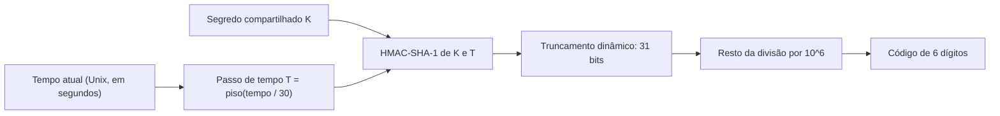
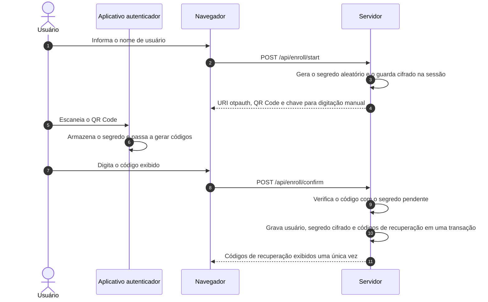
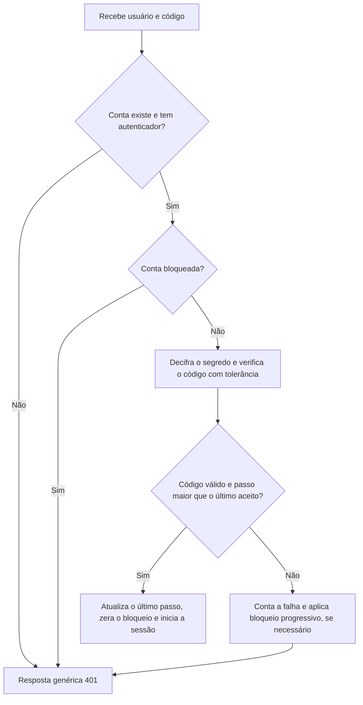
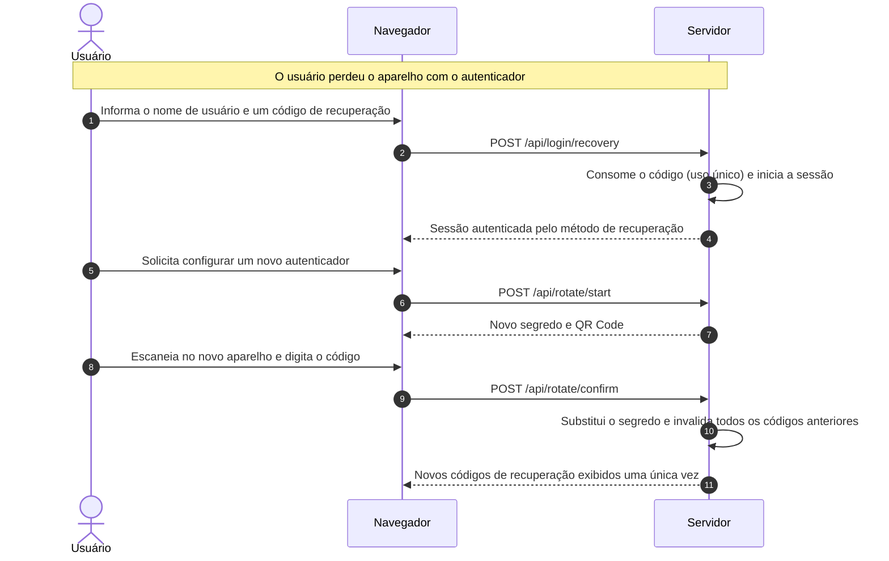

# Guia de Uso 3 — Tokens de Software (TOTP) e Códigos de Recuperação

> Parte do Trabalho de Conclusão de Curso *Investigação de Protocolos de Passwordless Authentication: uma proposta de guia* (UTFPR, Dois Vizinhos).
> Versões das bibliotecas consultadas em 04/11/2026.

## Sumário

1. [Introdução](#1-introdução)
2. [Fundamentação teórica](#2-fundamentação-teórica)
3. [Pré-requisitos e instalação](#3-pré-requisitos-e-instalação)
4. [Visão geral do projeto](#4-visão-geral-do-projeto)
5. [Implementação passo a passo](#5-implementação-passo-a-passo)
6. [Execução e testes](#6-execução-e-testes)
7. [Análise de segurança da implementação](#7-análise-de-segurança-da-implementação)
8. [Limitações e caminho para produção](#8-limitações-e-caminho-para-produção)
9. [Solução de problemas](#9-solução-de-problemas)
10. [Referências](#10-referências)

---

## 1. Introdução

Os **tokens de software** são mecanismos que geram credenciais temporárias por meio de um aplicativo instalado no dispositivo do usuário, geralmente um *smartphone*. O padrão mais difundido é o **TOTP** (*Time-based One-Time Password*, RFC 6238), em que o aplicativo e o servidor compartilham um segredo e, a cada 30 segundos, ambos calculam o mesmo código de seis dígitos .

**Papel deste mecanismo no trabalho.** Diferentemente das passkeys (Guia 1) e da biometria local (Guia 2), o TOTP **não é o método mais forte** do conjunto: depende de um segredo compartilhado e permanece suscetível a *phishing* em tempo real, como já registrado na revisão teórica do trabalho. Sua inclusão justifica-se por outro papel: a **contingência e a recuperação de acesso**. A perda ou a substituição do dispositivo é uma das limitações mais citadas para mecanismos baseados em chaves [Yusop et al. 2025], e o TOTP, somado a **códigos de recuperação**, constitui uma alternativa de baixo custo, amplamente suportada e sem hardware dedicado.

**O que o projeto implementa.** (i) Cadastro do autenticador, com QR Code e confirmação; (ii) login sem senha pela combinação *nome de usuário + código TOTP*; (iii) códigos de recuperação de uso único; (iv) troca do autenticador (aparelho perdido ou substituído); (v) proteções de segurança: segredo cifrado em repouso, proteção contra reutilização de códigos, bloqueio progressivo e limitação de requisições.

**Relação com os guias anteriores.** O projeto é autocontido. Em um sistema real, este mecanismo costuma coexistir com passkeys: as passkeys são o caminho principal e o TOTP com códigos de recuperação é o caminho de contingência (seção 8).

**Premissa de reprodutibilidade.** Nenhuma etapa exige hardware dedicado, conta em serviço de nuvem ou assinatura paga. O leitor pode usar qualquer aplicativo autenticador gratuito ou, sem celular, a ferramenta de apoio do projeto (seção 5.14).

---

## 2. Fundamentação teórica

### 2.1 Senhas de uso único: HOTP e TOTP

Uma senha de uso único (*One-Time Password*, OTP) é válida para uma única autenticação. O **HOTP** (RFC 4226) gera o código a partir de um segredo `K` e de um contador `C`:

```text
HOTP(K, C) = Truncar( HMAC-SHA-1(K, C) ) mod 10^d
```

em que `d` é o número de dígitos (tipicamente 6) e *Truncar* é o **truncamento dinâmico**, que extrai 31 bits do resultado do HMAC. O **TOTP** (RFC 6238) substitui o contador por um **passo de tempo**:

```text
T       = piso( (tempo_atual_Unix - T0) / X )        com T0 = 0 e X = 30 s
TOTP    = HOTP(K, T)
```

Assim, aplicativo e servidor, sem se comunicar, chegam ao mesmo código desde que compartilhem `K` e tenham relógios próximos .



Duas consequências importam para o projeto. Primeiro, a segurança repousa inteiramente no sigilo de `K`: quem o obtém gera códigos válidos indefinidamente. Segundo, o código não carrega **nenhuma informação sobre o destino**: ele é aceito por qualquer verificador que conheça `K`, sem relação com o site em que foi digitado (seção 2.8).

### 2.2 Provisionamento: a URI `otpauth`

O segredo precisa chegar ao aplicativo. Isso é feito por uma URI no formato *Key URI* (criado para o Google Authenticator e adotado pelos demais aplicativos), normalmente transportada em um **QR Code** :

```text
otpauth://totp/{emissor}:{conta}?secret={BASE32}&issuer={emissor}&algorithm=SHA1&digits=6&period=30
```

O segredo é codificado em **Base32**, sem preenchimento. Os parâmetros `algorithm`, `digits` e `period` são opcionais, mas alguns aplicativos ignoram valores diferentes de SHA-1, 6 dígitos e 30 segundos, de modo que esses são os únicos valores recomendados para compatibilidade ampla . O projeto os declara de forma explícita.

> **Ponto de atenção.** A URI **contém o segredo**. O QR Code deve ser gerado **localmente**. Serviços externos de geração de QR Code recebem a URI e, portanto, o segredo (seção 2.11).

### 2.3 Tolerância de relógio e janela de verificação

Os relógios do servidor e do dispositivo nunca coincidem exatamente. O verificador aceita, por isso, códigos de passos vizinhos ao atual. Na versão 13 da biblioteca utilizada, a tolerância é expressa em **segundos** (`epochTolerance`), e 30 s equivalem a aceitar o passo anterior e o seguinte . Na versão 12 a unidade era o número de passos; materiais antigos, portanto, induzem a erro.

A tolerância tem custo de segurança: com `k` passos de cada lado, existem `2k + 1` códigos válidos simultaneamente, e a probabilidade de acerto por **adivinhação** em uma tentativa é:

```text
p = (2k + 1) / 10^6        k = 1  =>  p = 3 / 1.000.000
```

Por esse motivo, a tolerância deve ser a menor possível, e a verificação exige **limitação de tentativas**, discutida a seguir.

**Estimativa ilustrativa do efeito do bloqueio.** Suponha um atacante que conhece o nome de usuário e tenta códigos aleatórios sem parar. Com bloqueio de 15 minutos a cada 5 falhas (sem escalonamento), ele realiza cerca de 480 tentativas por dia (96 janelas de 15 minutos × 5), e a probabilidade de êxito no dia é de aproximadamente `480 × 3 / 10^6 ≈ 0,14%`. Com o **escalonamento** adotado no projeto (15 min, 30 min, 1 h, 2 h, 4 h, 8 h, 16 h...), são cerca de 35 tentativas no primeiro dia, ou `≈ 0,01%`. Trata-se de uma estimativa que assume códigos uniformemente aleatórios e um único atacante, e não substitui uma análise formal.

### 2.4 Armazenamento do segredo

Senhas são armazenadas como *hashes*, pois o servidor só precisa **comparar**. No TOTP, o servidor precisa **recalcular** o código a cada verificação, portanto precisa do segredo em forma **recuperável**. Não é possível aplicar *hash*. A proteção possível é a **cifragem em repouso**, o que torna o banco de dados um alvo mais valioso do que no caso das passkeys, em que o servidor guarda apenas chaves públicas.

| Aspecto | Senha | TOTP | Passkey |
|---|---|---|---|
| O que o servidor guarda | *Hash* da senha | Segredo **recuperável** (cifrado) | Chave pública |
| Efeito de um vazamento do banco | Ataque offline ao *hash* | **Segredos utilizáveis**, se a chave de cifragem também vazar | Nenhum |
| Vinculação ao domínio | Não | **Não** | Sim |

O projeto cifra o segredo com **AES-256-GCM**, cifra autenticada que detecta adulteração, e vincula o texto cifrado ao usuário por meio de **dados autenticados adicionais** (AAD): copiar o valor para outra linha do banco faz a decifragem falhar. As chaves de uso distinto são derivadas de uma chave mestra por **HKDF** (seção 5.5).

### 2.5 Proteção contra reutilização (*replay*)

Dentro da janela de validade, um código capturado (por exemplo, por observação do teclado) poderia ser reutilizado. O RFC 6238 determina que o verificador **não aceite uma segunda tentativa com o mesmo código** . A biblioteca é *stateless* e não registra códigos já usados ; a aplicação deve fazê-lo. O projeto armazena o **último passo de tempo aceito** por usuário e rejeita qualquer passo menor ou igual. A atualização é **atômica** no banco (`UPDATE ... WHERE last_step < ?`), o que impede que duas requisições simultâneas com o mesmo código sejam ambas aceitas.

### 2.6 Códigos de recuperação

Se o usuário perde o aparelho, perde o segredo. Os **códigos de recuperação** são um conjunto de códigos de uso único, gerados no cadastro e exibidos uma única vez. Decisões do projeto:

- **10 códigos** de 10 símbolos de um alfabeto de 32 caracteres (sem I, L, O e U): `5 bits × 10 = 50 bits` de entropia por código. Esse valor é adequado porque o ataque é **apenas online** (sujeito ao bloqueio) e cada código vale uma única vez.
- Gerados com **CSPRNG**, com mapeamento sem viés (256 é múltiplo de 32).
- Armazenados como **HMAC-SHA-256** com chave do servidor. Códigos aleatórios de alta entropia não necessitam de função de derivação lenta; a chave impede o ataque offline mesmo que o banco vaze.
- **Consumo atômico** (`UPDATE ... WHERE used_at IS NULL`).
- **Substituição integral** ao gerar novos códigos ou trocar o autenticador: os anteriores deixam de valer.
- Tolerância à digitação: o código aceita maiúsculas, minúsculas, espaços, hífen e as equivalências de Crockford (O→0, I e L→1).

### 2.7 Fluxos da aplicação

**Cadastro.** O servidor gera o segredo, mantém-no **cifrado** na sessão e nada grava no banco até que o usuário prove, com um primeiro código, que o aplicativo está configurado. Só então usuário, segredo e códigos de recuperação são gravados em **uma única transação**.



**Login.** Qualquer falha produz a **mesma resposta genérica**, de modo que o atacante não distingue usuário inexistente, código errado e conta bloqueada.



**Recuperação e troca do autenticador.** Quem perdeu o aparelho entra com um código de recuperação e configura um novo autenticador. A troca **não exige o código antigo**, pois ele deixou de estar disponível, mas exige **login recente**.



### 2.8 Ameaças e limitações

| Ameaça | Resposta do mecanismo e da implementação | Garantia |
|---|---|---|
| ***Phishing* em tempo real** (site falso repassa o código ao site verdadeiro) | **Não mitigado.** O código não é vinculado à origem; vale em qualquer verificador | **Nenhuma** |
| Adivinhação (força bruta) | Espaço de 10^6 combinações; bloqueio progressivo e limite por IP | Forte, se o limite for mantido |
| *Replay* de um código capturado | Último passo aceito, com atualização atômica | Forte |
| Vazamento do banco de dados | Segredos cifrados com AES-256-GCM; códigos de recuperação em HMAC | Forte, **desde que a chave mestra não vaze junto** |
| Vazamento da chave mestra e do banco | Todos os segredos ficam expostos | Nenhuma |
| Roubo do segredo no dispositivo (*malware*, *backup* na nuvem) | Fora do controle da aplicação | Dependente do dispositivo |
| Enumeração de usuários | Respostas genéricas; (limitação: o cadastro revela nomes existentes) | Parcial |
| Bloqueio abusivo de uma vítima (*DoS* por tentativas inválidas) | O bloqueio por conta torna possível a um atacante travar a conta alheia | **Efeito colateral aceito** (seção 8) |
| Desvio de relógio do usuário | Tolerância de ±30 s; o servidor deve usar NTP | Mitigado |
| Perda do aparelho | Códigos de recuperação e troca do autenticador | Mitigado |

A primeira linha define o papel do TOTP neste trabalho: como método principal, ele é **mais fraco** que as passkeys justamente na ameaça mais frequente na revisão (engenharia social e *phishing*, em 25 dos 81 estudos) [Yusop et al. 2025].

### 2.9 Comparação com as passkeys

| Critério | TOTP | Passkeys |
|---|---|---|
| Base criptográfica | Segredo compartilhado (simétrica) | Par de chaves (assimétrica) |
| Resistência a *phishing* | Não | Sim |
| Segredo no servidor | Sim (cifrado) | Não |
| Experiência do usuário | Digitar um código a cada login | Gesto de verificação no dispositivo |
| Recuperação | Códigos de recuperação | Outras passkeys, provedor de sincronização |
| Suporte no mercado | Muito amplo | Amplo e crescente |
| Dependência de hardware | Nenhuma | Autenticador do dispositivo |

### 2.10 Aspectos legais: LGPD

O TOTP não trata dados biométricos. Os dados pessoais envolvidos são o nome de usuário, os metadados e a trilha de eventos (endereços e horários de tentativas, se registrados), sujeitos às regras gerais da LGPD (Lei nº 13.709/2018), inclusive as de segurança do tratamento e de comunicação de incidentes . A proteção dos segredos descrita neste guia é uma medida técnica relevante nesse contexto.

### 2.11 Tecnologias de terceiros: quando são necessárias

O TOTP **não exige a contratação de serviços de terceiros**. O servidor é próprio e calcula os códigos localmente. Os fornecedores aparecem em papéis auxiliares:

| Tecnologia | Papel | É necessária para este projeto? |
|---|---|---|
| **Aplicativos autenticadores** (por exemplo, Google Authenticator, Microsoft Authenticator, Aegis, Bitwarden, 1Password) | Armazenam o segredo no dispositivo do usuário e geram os códigos. A interface com eles é apenas o QR Code (padrão aberto) | Fazem parte do lado do usuário. **Nenhuma integração** ou contrato com o fornecedor. Atenção: alguns sincronizam os segredos com a conta do usuário na nuvem , o que amplia a superfície de ataque e escapa ao controle do servidor |
| **Serviços externos de geração de QR Code** | Convertem um texto em imagem | **Não, e jamais devem ser usados.** Receberiam a URI e, portanto, o **segredo**. O projeto usa a biblioteca `qrcode` localmente |
| **Provedores de SMS ou e-mail** (por exemplo, serviços de mensagens de provedores de nuvem) | Entregam um código aleatório gerado pelo servidor | **Não.** Seria um OTP por canal externo, e não TOTP. O SMS é vulnerável à troca de chip (*SIM swap*) e a ataques à rede de telefonia, e diretrizes de identidade digital o classificam como canal restrito . Funcionaria assim: o servidor gera o código, o envia pela API do provedor e valida a resposta, com custo por mensagem e dependência do provedor |
| **MFA como serviço com notificação *push*** (soluções proprietárias de gestão de identidade) | O usuário aprova um aviso no celular | **Não.** Proprietário, com dependência de fornecedor, e sujeito a ataques de fadiga de aprovação  |
| **Serviço de gestão de chaves (KMS, HSM, cofre de segredos)** (por exemplo, os oferecidos por provedores de nuvem ou por soluções de código aberto) | Guardam a chave mestra fora da aplicação | **Opcional, para produção.** Funciona por *envelope encryption*: a aplicação guarda apenas uma chave de dados cifrada e pede ao serviço que a decifre na inicialização; a chave mestra nunca sai do serviço. Troca a chave em variável de ambiente (`APP_KEY`) por uma dependência de rede e custo |
| **Sincronização de relógio (NTP)** | O TOTP depende de horários próximos | **Sim, é requisito operacional.** Servidores modernos já sincronizam o relógio; confirme em produção. Não é "contratado" |
| **Hospedagem e HTTPS** | Expor o serviço ao usuário | Apenas para testar em outro dispositivo ou publicar |
| **Bibliotecas de código aberto** (`otplib`, `qrcode`) | Implementam o algoritmo e a geração do QR Code | Sim, como dependências. Ver seção 5.1 |

Em síntese: **o desenvolvedor controla o servidor, o segredo e a política; o usuário e o seu dispositivo provêm o aplicativo que gera os códigos**.

---

## 3. Pré-requisitos e instalação

### 3.1 Software necessário

| Item | Versão | Observação |
|---|---|---|
| **Node.js** | **22.13 ou superior** (LTS) | `node:sqlite` é usado sem *flags* a partir da 22.13 |
| **npm** e **Git** | Recentes | |
| **Navegador** | Qualquer atual | Não há dependência de WebAuthn neste guia |
| **Aplicativo autenticador** | **Opcional** | Qualquer um que aceite QR Code TOTP (gratuitos). Sem celular, use a ferramenta de apoio (seção 5.14) |

### 3.2 Instalação do Node.js

- **Linux ou macOS:** instale o `nvm` pelas instruções oficiais e execute `nvm install 22` e `nvm use 22`.
- **Windows:** use o instalador LTS em nodejs.org ou o `nvm-windows`.

```bash
node -v    # deve exibir v22.13.0 ou superior
npm -v
git --version
```

---

## 4. Visão geral do projeto

### 4.1 Estrutura de arquivos

```text
totp/
├── package.json, tsconfig.json, .env.example, .gitignore, Dockerfile, docker-compose.yml
├── src/
│   ├── server.ts           # ponto de entrada
│   ├── config.ts           # configuração e validação
│   ├── crypto.ts           # HKDF, AES-256-GCM, códigos de recuperação
│   ├── totp.ts             # integração com a otplib e URI otpauth
│   ├── qr.ts               # QR Code gerado localmente
│   ├── lockout.ts          # bloqueio progressivo (funções puras)
│   ├── rateLimit.ts        # limitador por IP
│   ├── auth.ts             # serviço de verificação (TOTP e recuperação)
│   ├── db.ts               # SQLite
│   ├── session.ts          # cadastro pendente, login e logout
│   ├── middleware.ts       # autenticação, login recente, limite
│   ├── validation.ts, http.ts, types.d.ts
│   └── routes/
│       ├── enroll.ts       # cadastro do autenticador
│       ├── login.ts        # login por TOTP ou recuperação
│       └── account.ts      # perfil, eventos, novos códigos, troca
├── public/                 # index.html, styles.css, app.js
├── tools/code.ts           # calculadora de código para testes
└── test/                   # testes automatizados
```

### 4.2 Decisões de projeto

1. **Login por nome de usuário e código TOTP**, sem senha. É um fator único (posse do segredo) e, por isso, adequado a **contingência**, e não a contas de alto risco.
2. **Cadastro em duas etapas**, com segredo pendente **cifrado na sessão** e gravação só após a confirmação.
3. **Segredo cifrado em repouso** (AES-256-GCM, com AAD por usuário) e **chaves derivadas por HKDF** a partir de `APP_KEY`.
4. **Proteção contra reutilização** por último passo aceito, com atualização atômica.
5. **Bloqueio progressivo por conta** (15 min, 30 min, 1 h... até 24 h) e **limite por IP**.
6. **Resposta genérica** a qualquer falha de login.
7. **Códigos de recuperação** com HMAC, uso único e substituição integral.
8. **Troca do autenticador** com exigência de login recente.
9. **Parâmetros padrão** (SHA-1, 6 dígitos, 30 s), para compatibilidade com todos os aplicativos.
10. **QR Code local**, e cabeçalho `Cache-Control: no-store` nas respostas que contêm segredos.

---

## 5. Implementação passo a passo

> Os arquivos idênticos aos dos guias anteriores aparecem recolhidos (clique para expandir).

### 5.1 Criar o projeto e instalar as dependências

```bash
mkdir totp
cd totp
git init
```

Crie o `package.json`:

`package.json`

```json
{
  "name": "guia-totp",
  "version": "1.0.0",
  "description": "Implementação de referência de tokens de software (TOTP, RFC 6238) com códigos de recuperação, em Node.js e TypeScript",
  "private": true,
  "type": "module",
  "license": "MIT",
  "engines": {
    "node": ">=22.13.0"
  },
  "scripts": {
    "dev": "node --env-file-if-exists=.env --import tsx --watch src/server.ts",
    "build": "tsc",
    "start": "node --env-file-if-exists=.env dist/server.js",
    "typecheck": "tsc --noEmit",
    "test": "node --import tsx --test test/*.test.ts",
    "code": "tsx tools/code.ts"
  },
  "dependencies": {
    "express": "^5.1.0",
    "express-session": "^1.18.1",
    "otplib": "^13.5.0",
    "qrcode": "^1.5.4"
  },
  "devDependencies": {
    "@types/express": "^5.0.0",
    "@types/express-session": "^1.18.0",
    "@types/node": "^22.13.0",
    "@types/qrcode": "^1.5.5",
    "tsx": "^4.19.0",
    "typescript": "^5.6.0"
  }
}
```

Instale as dependências. O comando gera o `package-lock.json`, que **deve ser versionado**:

```bash
npm install
```

- **`otplib`** (versão 13): implementa HOTP e TOTP. É escrita em TypeScript, tem licença MIT e utiliza, por padrão, componentes criptográficos auditados (`@noble/hashes` e `@scure/base`). O README do projeto informa que, desde a versão 13, partes do código, dos testes e da documentação foram refinadas com auxílio de IA, com revisão humana. Convém registrar essa informação ao avaliar a dependência. A versão 13 foi uma **reescrita com incompatibilidades** em relação à 12 (por exemplo, não existe mais o objeto `authenticator`, a tolerância passou a ser em segundos e tokens malformados **lançam exceção**) .
- **`qrcode`**: geração do QR Code, localmente.
- **`express`** (versão 5) e **`express-session`**: servidor e sessão.

### 5.2 Configurar o TypeScript e o Git

<details>
<summary>tsconfig.json (idêntico ao Guia 1, seção 5.2)</summary>

```json
{
  "compilerOptions": {
    "target": "ES2022",
    "module": "NodeNext",
    "moduleResolution": "NodeNext",
    "outDir": "dist",
    "rootDir": "src",
    "strict": true,
    "esModuleInterop": true,
    "skipLibCheck": true,
    "forceConsistentCasingInFileNames": true
  },
  "include": ["src"]
}
```

</details>

<details>
<summary>.gitignore (idêntico ao Guia 1, seção 5.2)</summary>

```text
node_modules/
dist/
data/
.env
*.log
```

</details>

### 5.3 Configuração por variáveis de ambiente

`.env.example`

```bash
# Porta local do servidor
PORT=3000

# Origem em que o navegador acessa a aplicação (define também o atributo "secure" do cookie)
ORIGIN=http://localhost:3000

# Nome do emissor exibido no aplicativo autenticador
TOTP_ISSUER=Guia TOTP (TCC)

# Tolerância de relógio, em SEGUNDOS, na verificação do código (30 = aceita o passo anterior e o seguinte)
TOTP_TOLERANCE_SECONDS=30

# Chave mestra da aplicação. Dela são derivadas as chaves de cifragem dos segredos TOTP e de
# autenticação dos códigos de recuperação. Obrigatória em produção (mínimo de 32 caracteres).
# Gere com: node -e "console.log(require('crypto').randomBytes(32).toString('base64'))"
# ATENÇÃO: se esta chave for perdida ou trocada, os segredos cadastrados deixam de ser legíveis.
APP_KEY=

# Obrigatório em produção
SESSION_SECRET=

# Caminho do arquivo SQLite
DB_PATH=./data/totp.db

# Defina como 1 quando houver proxy/túnel HTTPS na frente do servidor
TRUST_PROXY=0
```

```bash
cp .env.example .env      # no Windows (PowerShell): Copy-Item .env.example .env
```

Gere a chave mestra e a de sessão e preencha `APP_KEY` e `SESSION_SECRET`:

```bash
node -e "console.log(require('crypto').randomBytes(32).toString('base64'))"
```

> **Atenção.** Se a `APP_KEY` for perdida ou alterada, **todos os segredos cadastrados deixam de poder ser decifrados** e os usuários precisarão de nova configuração. Em desenvolvimento, na ausência da variável, o servidor usa uma chave fixa **insegura** e emite um aviso.

`src/config.ts` lê e valida os valores. Em produção, a ausência de `APP_KEY` (com ao menos 32 caracteres) ou de `SESSION_SECRET` interrompe a inicialização; a tolerância de relógio é limitada a 90 s:

`src/config.ts`

```ts
const origin = new URL(process.env.ORIGIN ?? 'http://localhost:3000');
const isProduction = process.env.NODE_ENV === 'production';

const DEV_APP_KEY = 'chave-apenas-para-desenvolvimento-nao-use-em-producao';

if (isProduction) {
  if (!process.env.SESSION_SECRET) throw new Error('Defina SESSION_SECRET em produção.');
  if (!process.env.APP_KEY || process.env.APP_KEY.length < 32) {
    throw new Error('Defina APP_KEY em produção, com ao menos 32 caracteres.');
  }
}

const toleranceSeconds = Number(process.env.TOTP_TOLERANCE_SECONDS ?? 30);
if (!Number.isFinite(toleranceSeconds) || toleranceSeconds < 0 || toleranceSeconds > 90) {
  throw new Error('TOTP_TOLERANCE_SECONDS deve estar entre 0 e 90.');
}

export const config = {
  port: Number(process.env.PORT ?? 3000),
  origin: origin.origin,
  issuer: process.env.TOTP_ISSUER ?? 'Guia TOTP (TCC)',
  toleranceSeconds,
  recoveryCodeCount: 10,
  appKey: process.env.APP_KEY || DEV_APP_KEY,
  usingDevKey: !process.env.APP_KEY,
  sessionSecret: process.env.SESSION_SECRET || 'segredo-apenas-para-desenvolvimento',
  dbPath: process.env.DB_PATH ?? './data/totp.db',
  secureCookies: origin.protocol === 'https:',
  trustProxy: process.env.TRUST_PROXY === '1',
  // Limite de requisições de autenticação por endereço IP.
  rateLimit: { max: 30, windowMs: 15 * 60 * 1000 },
  // Tempo máximo desde o login para operações de troca de autenticador.
  recentLoginMs: 10 * 60 * 1000,
} as const;
```

### 5.4 Utilitários

<details>
<summary>src/validation.ts (idêntico ao Guia 1, seção 5.4)</summary>

```ts
const USERNAME_PATTERN = /^[a-z0-9._@-]{3,64}$/;

/** Normaliza e valida o nome de usuário. Retorna null se for inválido. */
export function normalizeUsername(input: unknown): string | null {
  if (typeof input !== 'string') return null;
  const normalized = input.trim().toLowerCase();
  return USERNAME_PATTERN.test(normalized) ? normalized : null;
}
```

</details>

<details>
<summary>src/http.ts (idêntico ao Guia 1, seção 5.4)</summary>

```ts
import type { Response } from 'express';

/**
 * Envia uma resposta de erro JSON e devolve `void`.
 *
 * Os tipos do Express 5 declaram que um handler devolve `void | Promise<void>`.
 * Por isso os handlers não podem fazer `return res.status(...).json(...)`, que
 * devolveria o objeto `Response`. Com este utilitário, o padrão
 * `if (condição) return fail(res, 400, 'mensagem');` é aceito pelo compilador.
 */
export function fail(res: Response, status: number, error: string, code?: string): void {
  res.status(status).json(code ? { error, code } : { error });
}
```

</details>

### 5.5 Criptografia: segredos e códigos de recuperação

`src/crypto.ts` reúne três responsabilidades:

1. **`deriveKeys`**: deriva, por HKDF, uma chave de cifragem e uma chave de autenticação independentes.
2. **`encryptSecret` e `decryptSecret`**: AES-256-GCM com IV aleatório de 12 bytes, *tag* de 16 bytes, prefixo de versão (`v1.`) e AAD. Um valor adulterado, movido para outro usuário ou decifrado com outra chave **lança exceção**.
3. **Códigos de recuperação**: geração, normalização da digitação e HMAC.

`src/crypto.ts`

```ts
import {
  createCipheriv,
  createDecipheriv,
  createHmac,
  hkdfSync,
  randomBytes,
} from 'node:crypto';

/** Chaves derivadas da chave mestra, uma para cada finalidade. */
export interface Keys {
  /** Cifragem dos segredos TOTP (AES-256-GCM). */
  encKey: Buffer;
  /** Autenticação (HMAC) dos códigos de recuperação. */
  macKey: Buffer;
}

/**
 * Deriva subchaves independentes a partir da chave mestra (HKDF-SHA-256).
 * Usar chaves distintas por finalidade evita que o comprometimento de um uso
 * afete o outro.
 */
export function deriveKeys(appKey: string): Keys {
  const ikm = Buffer.from(appKey, 'utf8');
  const salt = Buffer.from('guia-totp-v1', 'utf8');
  return {
    encKey: Buffer.from(hkdfSync('sha256', ikm, salt, 'enc:totp-secret', 32)),
    macKey: Buffer.from(hkdfSync('sha256', ikm, salt, 'mac:recovery-code', 32)),
  };
}

// ---------------------------------------------------------------------------
// Cifragem do segredo TOTP
// ---------------------------------------------------------------------------

const VERSION = 'v1';
const IV_BYTES = 12;
const TAG_BYTES = 16;

/**
 * Cifra o segredo com AES-256-GCM. O formato é "v1.<base64url(iv|tag|texto cifrado)>".
 * O parâmetro `aad` (dados autenticados adicionais) vincula o texto cifrado ao seu
 * contexto (por exemplo, o usuário): copiar o valor para outra linha do banco faz a
 * decifragem falhar. O prefixo de versão permite trocar o esquema no futuro.
 */
export function encryptSecret(plaintext: string, aad: string, key: Buffer): string {
  const iv = randomBytes(IV_BYTES);
  const cipher = createCipheriv('aes-256-gcm', key, iv);
  cipher.setAAD(Buffer.from(aad, 'utf8'));
  const encrypted = Buffer.concat([cipher.update(plaintext, 'utf8'), cipher.final()]);
  const tag = cipher.getAuthTag();
  return `${VERSION}.${Buffer.concat([iv, tag, encrypted]).toString('base64url')}`;
}

/** Decifra e AUTENTICA. Lança exceção se o conteúdo, a chave ou o contexto forem alterados. */
export function decryptSecret(token: string, aad: string, key: Buffer): string {
  const [version, payload] = token.split('.');
  if (version !== VERSION || !payload) throw new Error('Formato de segredo cifrado inválido.');
  const raw = Buffer.from(payload, 'base64url');
  if (raw.length <= IV_BYTES + TAG_BYTES) throw new Error('Segredo cifrado truncado.');
  const iv = raw.subarray(0, IV_BYTES);
  const tag = raw.subarray(IV_BYTES, IV_BYTES + TAG_BYTES);
  const encrypted = raw.subarray(IV_BYTES + TAG_BYTES);
  const decipher = createDecipheriv('aes-256-gcm', key, iv);
  decipher.setAAD(Buffer.from(aad, 'utf8'));
  decipher.setAuthTag(tag);
  return Buffer.concat([decipher.update(encrypted), decipher.final()]).toString('utf8');
}

// ---------------------------------------------------------------------------
// Códigos de recuperação
// ---------------------------------------------------------------------------

// Alfabeto de 32 símbolos (Crockford): sem I, L, O e U, para evitar confusão visual.
const ALPHABET = '0123456789ABCDEFGHJKMNPQRSTVWXYZ';
const CODE_LENGTH = 10; // 10 símbolos x 5 bits = 50 bits de entropia

/** Gera um código aleatório no formato XXXXX-XXXXX. */
export function generateRecoveryCode(): string {
  const bytes = randomBytes(CODE_LENGTH);
  let code = '';
  for (const byte of bytes) {
    // 256 é múltiplo de 32: o mapeamento por máscara não introduz viés.
    code += ALPHABET[byte & 31];
  }
  return `${code.slice(0, 5)}-${code.slice(5)}`;
}

/** Gera `count` códigos distintos. */
export function generateRecoveryCodes(count: number): string[] {
  const codes = new Set<string>();
  while (codes.size < count) codes.add(generateRecoveryCode());
  return [...codes];
}

/**
 * Normaliza a entrada do usuário: ignora maiúsculas, espaços e hífens e aplica as
 * equivalências de Crockford (O→0, I/L→1). Retorna o código canônico de 10 símbolos
 * ou null se o formato for inválido.
 */
export function normalizeRecoveryCode(input: unknown): string | null {
  if (typeof input !== 'string') return null;
  const canonical = input
    .toUpperCase()
    .replace(/[\s-]/g, '')
    .replace(/O/g, '0')
    .replace(/[IL]/g, '1');
  return /^[0-9A-HJKMNP-TV-Z]{10}$/.test(canonical) ? canonical : null;
}

/**
 * Calcula o HMAC-SHA-256 do código canônico com a chave do servidor. O banco guarda
 * apenas esse valor: o código em texto claro é exibido uma única vez ao usuário.
 */
export function hashRecoveryCode(canonicalCode: string, macKey: Buffer): string {
  return createHmac('sha256', macKey).update(canonicalCode).digest('hex');
}

/**
 * Gera um conjunto de códigos: o texto claro (exibido ao usuário uma única vez) e os
 * HMACs correspondentes (o que de fato é gravado no banco).
 */
export function newRecoveryCodeSet(count: number, macKey: Buffer): { plain: string[]; hashes: string[] } {
  const plain = generateRecoveryCodes(count);
  const hashes = plain.map((code) => hashRecoveryCode(normalizeRecoveryCode(code)!, macKey));
  return { plain, hashes };
}
```

### 5.6 TOTP e QR Code

`src/totp.ts` integra a `otplib`. Pontos centrais:

- **`newSecret`**: segredo de 160 bits por CSPRNG, em Base32.
- **`buildOtpauthUri`**: URI com parâmetros explícitos e campos codificados (espaços como `%20`).
- **`verifyToken`**: valida o formato **antes** de chamar a biblioteca, passa `epochTolerance` e `afterTimeStep` e **falha de forma segura**: qualquer erro resulta em "inválido", sem registrar código ou segredo. Há ainda uma conferência redundante de que o passo aceito é maior que o último.

`src/totp.ts`

```ts
import { generateSecret, verify } from 'otplib';

/**
 * Parâmetros do TOTP. São os valores padrão do RFC 6238 e os únicos aceitos de forma
 * confiável por todos os aplicativos autenticadores (alguns ignoram valores diferentes).
 */
export const TOTP_PARAMS = { algorithm: 'SHA1', digits: 6, period: 30 } as const;

/** Gera um segredo aleatório (CSPRNG), em Base32 sem preenchimento. A otplib usa 20 bytes (160 bits). */
export function newSecret(): string {
  return generateSecret();
}

/**
 * Monta a URI "otpauth://" lida pelos aplicativos autenticadores (formato "Key URI").
 * Os parâmetros são explicitados mesmo quando coincidem com os padrões.
 * ATENÇÃO: a URI contém o segredo. Nunca a envie a serviços externos de geração de QR Code.
 */
export function buildOtpauthUri(opts: { issuer: string; account: string; secret: string }): string {
  const issuer = encodeURIComponent(opts.issuer);
  const label = `${issuer}:${encodeURIComponent(opts.account)}`;
  const { algorithm, digits, period } = TOTP_PARAMS;
  return `otpauth://totp/${label}?secret=${opts.secret}&issuer=${issuer}&algorithm=${algorithm}&digits=${digits}&period=${period}`;
}

/** Remove espaços e hifens digitados pelo usuário (ex.: "123 456"). */
export function normalizeToken(input: unknown): string | null {
  if (typeof input !== 'string') return null;
  const token = input.replace(/[\s-]/g, '');
  return token.length > 0 ? token : null;
}

export interface TokenCheck {
  valid: boolean;
  /** Passo de tempo (time step) em que o código foi aceito; null se inválido. */
  step: number | null;
}

/**
 * Verifica um código TOTP com:
 *  - tolerância de relógio (em segundos);
 *  - proteção contra reutilização: rejeita passos de tempo <= `lastStep`
 *    (RFC 6238, seção 5.2: o verificador não deve aceitar o mesmo código duas vezes).
 *
 * Falha de forma segura: qualquer entrada malformada ou erro da biblioteca resulta em
 * "inválido". Na versão 13 da otplib, tokens malformados LANÇAM exceção (na v12 retornavam false).
 */
export async function verifyToken(args: {
  secret: string;
  token: string;
  lastStep: number;
  toleranceSeconds: number;
  nowMs?: number;
}): Promise<TokenCheck> {
  const invalid: TokenCheck = { valid: false, step: null };
  if (!/^\d{6}$/.test(args.token)) return invalid;

  try {
    // Forma mínima do resultado que a aplicação consome.
    const result = (await verify({
      secret: args.secret,
      token: args.token,
      epochTolerance: args.toleranceSeconds,
      afterTimeStep: args.lastStep,
      ...(args.nowMs === undefined ? {} : { epoch: Math.floor(args.nowMs / 1000) }),
    })) as unknown as { valid: boolean; timeStep?: number };

    if (result.valid && typeof result.timeStep === 'number' && result.timeStep > args.lastStep) {
      return { valid: true, step: result.timeStep };
    }
    return invalid;
  } catch (error) {
    // Não registra o código nem o segredo, apenas o tipo do erro.
    console.warn('[totp] erro na verificação:', (error as Error).name);
    return invalid;
  }
}
```

`src/qr.ts` gera o QR Code como imagem *data URL*, sem qualquer serviço externo:

`src/qr.ts`

```ts
import QRCode from 'qrcode';

/**
 * Gera o QR Code localmente, como imagem em data URL. A URI otpauth contém o segredo,
 * por isso a geração NUNCA deve ser delegada a serviços externos.
 */
export function qrDataUrl(text: string): Promise<string> {
  return QRCode.toDataURL(text, { errorCorrectionLevel: 'M', margin: 2, width: 240 });
}
```

### 5.7 Bloqueio progressivo e limite de requisições

`src/lockout.ts` contém funções **puras** (sem acesso a banco ou relógio), o que as torna totalmente testáveis:

`src/lockout.ts`

```ts
/** Estado de bloqueio de uma conta por tentativas consecutivas inválidas. */
export interface LockState {
  /** Falhas consecutivas desde o último bloqueio ou sucesso. */
  failedAttempts: number;
  /** Quantos bloqueios já ocorreram desde o último sucesso (escalonamento). */
  lockCount: number;
  /** Instante (ms) até o qual a conta permanece bloqueada. */
  lockedUntil: number;
}

export const MAX_FAILURES = 5;
const BASE_LOCK_MS = 15 * 60 * 1000; // 15 minutos
const MAX_LOCK_MS = 24 * 60 * 60 * 1000; // 24 horas

export const INITIAL_LOCK_STATE: LockState = { failedAttempts: 0, lockCount: 0, lockedUntil: 0 };

export function isLocked(state: LockState, now: number): boolean {
  return state.lockedUntil > now;
}

/** Duração do n-ésimo bloqueio: 15 min, 30 min, 1 h, 2 h... limitada a 24 h. */
export function lockDurationMs(lockCount: number): number {
  return Math.min(BASE_LOCK_MS * 2 ** Math.max(0, lockCount - 1), MAX_LOCK_MS);
}

/** Aplica uma falha. Ao atingir o limite, inicia um bloqueio cada vez mais longo. */
export function applyFailure(state: LockState, now: number): LockState {
  const failedAttempts = state.failedAttempts + 1;
  if (failedAttempts < MAX_FAILURES) return { ...state, failedAttempts };
  const lockCount = state.lockCount + 1;
  return { failedAttempts: 0, lockCount, lockedUntil: now + lockDurationMs(lockCount) };
}
```

`src/rateLimit.ts` limita as requisições por endereço IP, complementando o bloqueio por conta, que não contém tentativas distribuídas entre muitos nomes de usuário:

`src/rateLimit.ts`

```ts
/**
 * Limitador de janela fixa, em memória, por chave (por exemplo, endereço IP).
 * Complementa o bloqueio por conta: contém tentativas distribuídas entre muitos
 * nomes de usuário. Em produção com várias instâncias, use um armazenamento compartilhado.
 */
export class RateLimiter {
  private hits = new Map<string, { count: number; resetAt: number }>();
  private max: number;
  private windowMs: number;

  constructor(max: number, windowMs: number) {
    this.max = max;
    this.windowMs = windowMs;
  }

  /** Registra uma tentativa. Retorna true se ainda está dentro do limite. */
  take(key: string, now = Date.now()): boolean {
    if (this.hits.size > 10_000) this.prune(now);
    const entry = this.hits.get(key);
    if (!entry || entry.resetAt <= now) {
      this.hits.set(key, { count: 1, resetAt: now + this.windowMs });
      return true;
    }
    entry.count += 1;
    return entry.count <= this.max;
  }

  private prune(now: number): void {
    for (const [key, entry] of this.hits) {
      if (entry.resetAt <= now) this.hits.delete(key);
    }
  }
}
```

### 5.8 Persistência

`src/db.ts` define quatro tabelas: `users`, `totp` (segredo cifrado, último passo e estado de bloqueio), `recovery_codes` (apenas HMAC) e `events`. Duas operações são **atômicas por desenho**: `advanceLastStep` (proteção contra reutilização) e `consumeRecoveryCode` (uso único). O método `transaction` agrupa operações que devem ocorrer juntas.

`src/db.ts`

```ts
import { DatabaseSync } from 'node:sqlite';
import { mkdirSync } from 'node:fs';
import { dirname } from 'node:path';
import type { LockState } from './lockout.js';

export interface User {
  id: string;
  username: string;
  createdAt: string;
}

export interface TotpRecord {
  userId: string;
  /** Segredo TOTP cifrado (AES-256-GCM). */
  secretEnc: string;
  /** Último passo de tempo aceito (proteção contra reutilização). */
  lastStep: number;
  lock: LockState;
  enrolledAt: string;
}

export type EventType =
  | 'enroll'
  | 'login_totp'
  | 'login_recovery'
  | 'login_failed'
  | 'locked'
  | 'rotate'
  | 'recovery_regenerated';

export interface AuthEvent {
  id: number;
  type: EventType;
  detail: string | null;
  createdAt: string;
}

type Row = Record<string, unknown>;

const SCHEMA = `
  CREATE TABLE IF NOT EXISTS users (
    id         TEXT PRIMARY KEY,
    username   TEXT NOT NULL UNIQUE COLLATE NOCASE,
    created_at TEXT NOT NULL DEFAULT (datetime('now'))
  );

  CREATE TABLE IF NOT EXISTS totp (
    user_id         TEXT PRIMARY KEY REFERENCES users(id) ON DELETE CASCADE,
    secret_enc      TEXT NOT NULL,
    last_step       INTEGER NOT NULL DEFAULT 0,
    failed_attempts INTEGER NOT NULL DEFAULT 0,
    lock_count      INTEGER NOT NULL DEFAULT 0,
    locked_until    INTEGER NOT NULL DEFAULT 0,
    enrolled_at     TEXT NOT NULL DEFAULT (datetime('now'))
  );

  CREATE TABLE IF NOT EXISTS recovery_codes (
    id        INTEGER PRIMARY KEY AUTOINCREMENT,
    user_id   TEXT NOT NULL REFERENCES users(id) ON DELETE CASCADE,
    code_hash TEXT NOT NULL,
    used_at   TEXT,
    UNIQUE (user_id, code_hash)
  );

  CREATE TABLE IF NOT EXISTS events (
    id         INTEGER PRIMARY KEY AUTOINCREMENT,
    user_id    TEXT NOT NULL REFERENCES users(id) ON DELETE CASCADE,
    type       TEXT NOT NULL,
    detail     TEXT,
    created_at TEXT NOT NULL DEFAULT (datetime('now'))
  );

  CREATE INDEX IF NOT EXISTS idx_events_user ON events(user_id, id);
`;

function toUser(row: Row): User {
  return {
    id: row.id as string,
    username: row.username as string,
    createdAt: row.created_at as string,
  };
}

function toTotp(row: Row): TotpRecord {
  return {
    userId: row.user_id as string,
    secretEnc: row.secret_enc as string,
    lastStep: Number(row.last_step),
    lock: {
      failedAttempts: Number(row.failed_attempts),
      lockCount: Number(row.lock_count),
      lockedUntil: Number(row.locked_until),
    },
    enrolledAt: row.enrolled_at as string,
  };
}

export class Store {
  private db: DatabaseSync;

  constructor(path: string) {
    if (path !== ':memory:') {
      mkdirSync(dirname(path), { recursive: true });
    }
    this.db = new DatabaseSync(path);
    this.db.exec('PRAGMA foreign_keys = ON');
    this.db.exec(SCHEMA);
  }

  /** Executa `fn` de forma atômica: confirma se terminar, desfaz se lançar exceção. Não aninhável. */
  transaction<T>(fn: () => T): T {
    this.db.exec('BEGIN IMMEDIATE');
    try {
      const result = fn();
      this.db.exec('COMMIT');
      return result;
    } catch (error) {
      this.db.exec('ROLLBACK');
      throw error;
    }
  }

  // --- usuários -----------------------------------------------------------

  createUser(id: string, username: string): User {
    this.db.prepare('INSERT INTO users (id, username) VALUES (?, ?)').run(id, username);
    return this.getUserById(id)!;
  }

  getUserById(id: string): User | undefined {
    const row = this.db.prepare('SELECT * FROM users WHERE id = ?').get(id) as Row | undefined;
    return row ? toUser(row) : undefined;
  }

  getUserByUsername(username: string): User | undefined {
    const row = this.db
      .prepare('SELECT * FROM users WHERE username = ?')
      .get(username) as Row | undefined;
    return row ? toUser(row) : undefined;
  }

  // --- segredo TOTP ---------------------------------------------------------

  /** Cria ou SUBSTITUI o segredo do usuário (troca de autenticador) e zera o bloqueio. */
  upsertTotp(userId: string, secretEnc: string, lastStep: number): void {
    this.db
      .prepare(
        `INSERT INTO totp (user_id, secret_enc, last_step)
         VALUES (?, ?, ?)
         ON CONFLICT (user_id) DO UPDATE SET
           secret_enc = excluded.secret_enc,
           last_step = excluded.last_step,
           failed_attempts = 0, lock_count = 0, locked_until = 0,
           enrolled_at = datetime('now')`,
      )
      .run(userId, secretEnc, lastStep);
  }

  getTotp(userId: string): TotpRecord | undefined {
    const row = this.db.prepare('SELECT * FROM totp WHERE user_id = ?').get(userId) as
      | Row
      | undefined;
    return row ? toTotp(row) : undefined;
  }

  /**
   * Avança o último passo aceito de forma ATÔMICA: só atualiza se `step` for maior que o
   * valor atual. Se duas requisições com o mesmo código chegarem ao mesmo tempo, apenas uma
   * obtém `true`. Isso fecha a condição de corrida da proteção contra reutilização.
   */
  advanceLastStep(userId: string, step: number): boolean {
    const result = this.db
      .prepare('UPDATE totp SET last_step = ? WHERE user_id = ? AND last_step < ?')
      .run(step, userId, step);
    return Number(result.changes) > 0;
  }

  saveLockState(userId: string, lock: LockState): void {
    this.db
      .prepare(
        'UPDATE totp SET failed_attempts = ?, lock_count = ?, locked_until = ? WHERE user_id = ?',
      )
      .run(lock.failedAttempts, lock.lockCount, lock.lockedUntil, userId);
  }

  resetLock(userId: string): void {
    this.saveLockState(userId, { failedAttempts: 0, lockCount: 0, lockedUntil: 0 });
  }

  // --- códigos de recuperação -------------------------------------------------

  /** Substitui TODOS os códigos do usuário (os anteriores deixam de valer). Chamar dentro de `transaction`. */
  replaceRecoveryCodes(userId: string, hashes: string[]): void {
    this.db.prepare('DELETE FROM recovery_codes WHERE user_id = ?').run(userId);
    const insert = this.db.prepare('INSERT INTO recovery_codes (user_id, code_hash) VALUES (?, ?)');
    for (const hash of hashes) insert.run(userId, hash);
  }

  /** Consome um código de forma atômica: retorna true apenas na primeira utilização. */
  consumeRecoveryCode(userId: string, hash: string): boolean {
    const result = this.db
      .prepare(
        `UPDATE recovery_codes SET used_at = datetime('now')
          WHERE user_id = ? AND code_hash = ? AND used_at IS NULL`,
      )
      .run(userId, hash);
    return Number(result.changes) > 0;
  }

  countUnusedRecoveryCodes(userId: string): number {
    const row = this.db
      .prepare('SELECT COUNT(*) AS n FROM recovery_codes WHERE user_id = ? AND used_at IS NULL')
      .get(userId) as Row;
    return Number(row.n);
  }

  // --- eventos ------------------------------------------------------------------

  addEvent(userId: string, type: EventType, detail: string | null = null): void {
    this.db
      .prepare('INSERT INTO events (user_id, type, detail) VALUES (?, ?, ?)')
      .run(userId, type, detail);
  }

  /** Eventos mais recentes primeiro. */
  listEvents(userId: string, limit = 20): AuthEvent[] {
    const rows = this.db
      .prepare('SELECT * FROM events WHERE user_id = ? ORDER BY id DESC LIMIT ?')
      .all(userId, limit) as Row[];
    return rows.map((row) => ({
      id: Number(row.id),
      type: row.type as EventType,
      detail: (row.detail as string | null) ?? null,
      createdAt: row.created_at as string,
    }));
  }
}
```

### 5.9 Sessão, tipos e *middleware*

Tipos da sessão (o segredo pendente é sempre armazenado cifrado):

`src/types.d.ts`

```ts
import 'express-session';

declare module 'express-session' {
  interface SessionData {
    /** Identificador do usuário autenticado. */
    userId?: string;
    /** Instante (ms) em que a sessão foi autenticada. */
    authAt?: number;
    /** Método do login: indica, por exemplo, se o usuário entrou com código de recuperação. */
    authMethod?: 'enrollment' | 'totp' | 'recovery';
    /** Cadastro ou troca de autenticador em andamento (ainda não confirmado). */
    pendingEnrollment?: {
      kind: 'new' | 'rotate';
      userId: string;
      username: string;
      /** Segredo pendente, SEMPRE cifrado: nunca fica em texto claro no armazenamento da sessão. */
      secretEnc: string;
      attempts: number;
      expiresAt: number;
    };
  }
}
```

`src/session.ts` gerencia o cadastro pendente (validade de 10 minutos e no máximo 5 tentativas), o login com regeneração do identificador de sessão e o logout:

`src/session.ts`

```ts
import type { Request } from 'express';

const PENDING_TTL_MS = 10 * 60 * 1000; // 10 minutos para escanear o QR e confirmar
const MAX_PENDING_ATTEMPTS = 5;

type Pending = NonNullable<Request['session']['pendingEnrollment']>;
export type AuthMethod = NonNullable<Request['session']['authMethod']>;

/** Inicia um cadastro (ou troca) pendente, com o segredo já cifrado. */
export function startPending(
  req: Request,
  pending: Omit<Pending, 'attempts' | 'expiresAt'>,
): void {
  req.session.pendingEnrollment = {
    ...pending,
    attempts: 0,
    expiresAt: Date.now() + PENDING_TTL_MS,
  };
}

/** Retorna o cadastro pendente do tipo pedido, se existir e não tiver expirado. */
export function getPending(req: Request, kind: Pending['kind']): Pending | null {
  const pending = req.session.pendingEnrollment;
  if (!pending || pending.kind !== kind) return null;
  if (pending.expiresAt < Date.now()) {
    delete req.session.pendingEnrollment;
    return null;
  }
  return pending;
}

/** Conta uma tentativa inválida. Retorna true se o limite foi atingido (e o pendente descartado). */
export function registerPendingFailure(req: Request): boolean {
  const pending = req.session.pendingEnrollment;
  if (!pending) return true;
  pending.attempts += 1;
  if (pending.attempts >= MAX_PENDING_ATTEMPTS) {
    delete req.session.pendingEnrollment;
    return true;
  }
  return false;
}

export function clearPending(req: Request): void {
  delete req.session.pendingEnrollment;
}

/** Inicia a sessão autenticada, regenerando o identificador (evita session fixation). */
export function loginSession(req: Request, userId: string, method: AuthMethod): Promise<void> {
  return new Promise((resolve, reject) => {
    req.session.regenerate((err) => {
      if (err) return reject(err);
      req.session.userId = userId;
      req.session.authAt = Date.now();
      req.session.authMethod = method;
      req.session.save((saveErr) => (saveErr ? reject(saveErr) : resolve()));
    });
  });
}

export function logoutSession(req: Request): Promise<void> {
  return new Promise((resolve, reject) => {
    req.session.destroy((err) => (err ? reject(err) : resolve()));
  });
}
```

`src/middleware.ts` oferece `requireAuth`, `requireRecentLogin` (para a troca do autenticador) e o limitador por IP:

`src/middleware.ts`

```ts
import type { NextFunction, Request, Response } from 'express';
import { fail } from './http.js';
import type { RateLimiter } from './rateLimit.js';

export function isRecent(authAt: number | undefined, maxAgeMs: number, now = Date.now()): boolean {
  if (typeof authAt !== 'number') return false;
  const age = now - authAt;
  return age >= 0 && age <= maxAgeMs;
}

export function requireAuth(req: Request, res: Response, next: NextFunction): void {
  if (!req.session.userId) return fail(res, 401, 'Não autenticado.', 'AUTH_REQUIRED');
  next();
}

/** Exige que o login tenha ocorrido há pouco tempo (operações sensíveis, como trocar o autenticador). */
export function requireRecentLogin(maxAgeMs: number) {
  return (req: Request, res: Response, next: NextFunction): void => {
    if (!req.session.userId) return fail(res, 401, 'Não autenticado.', 'AUTH_REQUIRED');
    if (!isRecent(req.session.authAt, maxAgeMs)) {
      return fail(res, 403, 'Faça login novamente para realizar esta operação.', 'RECENT_LOGIN_REQUIRED');
    }
    next();
  };
}

/** Limita as requisições por endereço IP. */
export function rateLimit(limiter: RateLimiter) {
  return (req: Request, res: Response, next: NextFunction): void => {
    const key = req.ip ?? 'desconhecido';
    if (!limiter.take(key)) {
      return fail(res, 429, 'Muitas requisições. Tente novamente mais tarde.', 'RATE_LIMITED');
    }
    next();
  };
}
```

### 5.10 Serviço de verificação

`src/auth.ts` concentra a lógica comum ao login e às operações sensíveis: verificação de TOTP e de código de recuperação, com bloqueio, contabilização de falhas e registro de eventos. Há três resultados possíveis: `ok`, `invalid` e `locked` (neste caso, o código **nem é avaliado**).

`src/auth.ts`

```ts
import type { Store } from './db.js';
import { decryptSecret, hashRecoveryCode, normalizeRecoveryCode } from './crypto.js';
import type { Keys } from './crypto.js';
import { applyFailure, isLocked } from './lockout.js';
import type { LockState } from './lockout.js';
import { verifyToken } from './totp.js';

export interface AuthDeps {
  store: Store;
  keys: Keys;
  toleranceSeconds: number;
}

/**
 * 'ok'      : credencial aceita
 * 'invalid' : credencial recusada (a falha foi contabilizada)
 * 'locked'  : conta bloqueada; a credencial NEM foi avaliada
 */
export type CheckResult = 'ok' | 'invalid' | 'locked';

/** Contabiliza uma falha, persiste o novo estado e registra os eventos. */
function registerFailure(deps: AuthDeps, userId: string, lock: LockState, now: number): CheckResult {
  const next = applyFailure(lock, now);
  deps.store.saveLockState(userId, next);
  deps.store.addEvent(userId, 'login_failed', `falhas consecutivas: ${next.failedAttempts}`);
  if (next.lockedUntil > now) {
    deps.store.addEvent(userId, 'locked', `bloqueio ${next.lockCount} até ${new Date(next.lockedUntil).toISOString()}`);
  }
  return 'invalid';
}

/** Verifica um código TOTP do usuário, com bloqueio, tolerância e proteção contra reutilização. */
export async function checkTotp(
  deps: AuthDeps,
  userId: string,
  token: string,
  now = Date.now(),
): Promise<CheckResult> {
  const record = deps.store.getTotp(userId);
  if (!record) return 'invalid';
  if (isLocked(record.lock, now)) {
    deps.store.addEvent(userId, 'login_failed', 'conta bloqueada');
    return 'locked';
  }

  const secret = decryptSecret(record.secretEnc, `totp:${userId}`, deps.keys.encKey);
  const check = await verifyToken({
    secret,
    token,
    lastStep: record.lastStep,
    toleranceSeconds: deps.toleranceSeconds,
    nowMs: now,
  });

  // A atualização condicional do passo impede que duas requisições simultâneas
  // com o mesmo código sejam ambas aceitas.
  if (check.valid && check.step !== null && deps.store.advanceLastStep(userId, check.step)) {
    deps.store.resetLock(userId);
    return 'ok';
  }
  return registerFailure(deps, userId, record.lock, now);
}

/** Verifica e CONSOME um código de recuperação (uso único). */
export function checkRecoveryCode(
  deps: AuthDeps,
  userId: string,
  input: unknown,
  now = Date.now(),
): CheckResult {
  const record = deps.store.getTotp(userId);
  if (!record) return 'invalid';
  if (isLocked(record.lock, now)) {
    deps.store.addEvent(userId, 'login_failed', 'conta bloqueada');
    return 'locked';
  }

  const code = normalizeRecoveryCode(input);
  if (code && deps.store.consumeRecoveryCode(userId, hashRecoveryCode(code, deps.keys.macKey))) {
    deps.store.resetLock(userId);
    return 'ok';
  }
  return registerFailure(deps, userId, record.lock, now);
}
```

### 5.11 Rotas

`src/routes/enroll.ts` implementa o cadastro em duas etapas. Observe que nada é gravado até a confirmação, que o código de confirmação **já conta como usado** (para não ser reaproveitado no login) e que usuário, segredo e códigos são gravados em **uma única transação**:

`src/routes/enroll.ts`

```ts
import { Router } from 'express';
import type { RequestHandler } from 'express';
import { randomBytes } from 'node:crypto';
import { config } from '../config.js';
import type { Store } from '../db.js';
import { decryptSecret, encryptSecret, newRecoveryCodeSet } from '../crypto.js';
import type { Keys } from '../crypto.js';
import { fail } from '../http.js';
import { qrDataUrl } from '../qr.js';
import {
  clearPending,
  getPending,
  loginSession,
  registerPendingFailure,
  startPending,
} from '../session.js';
import { TOTP_PARAMS, buildOtpauthUri, newSecret, normalizeToken, verifyToken } from '../totp.js';
import { normalizeUsername } from '../validation.js';

interface Deps {
  store: Store;
  keys: Keys;
  limiter: RequestHandler;
}

export function enrollRouter({ store, keys, limiter }: Deps): Router {
  const router = Router();

  // Etapa 1: gera o segredo e o QR Code. Nada é gravado no banco até a confirmação.
  router.post('/start', limiter, async (req, res) => {
    const username = normalizeUsername(req.body?.username);
    if (!username) {
      return fail(res, 400, 'Nome de usuário inválido (3 a 64 caracteres: letras, números, . _ @ -).');
    }
    if (store.getUserByUsername(username)) {
      return fail(res, 409, 'Nome de usuário indisponível.');
    }

    const userId = randomBytes(16).toString('base64url');
    const secret = newSecret();
    startPending(req, {
      kind: 'new',
      userId,
      username,
      secretEnc: encryptSecret(secret, `pending:${userId}`, keys.encKey),
    });

    const uri = buildOtpauthUri({ issuer: config.issuer, account: username, secret });
    res.json({
      otpauthUri: uri,
      qrDataUrl: await qrDataUrl(uri),
      secret, // para digitação manual, caso o usuário não consiga escanear
      issuer: config.issuer,
      ...TOTP_PARAMS,
    });
  });

  // Etapa 2: o usuário prova que o aplicativo está configurado, informando o primeiro código.
  router.post('/confirm', limiter, async (req, res) => {
    const pending = getPending(req, 'new');
    if (!pending) return fail(res, 400, 'Cadastro ausente ou expirado. Reinicie o cadastro.');

    const token = normalizeToken(req.body?.code);
    const secret = decryptSecret(pending.secretEnc, `pending:${pending.userId}`, keys.encKey);
    const check = token
      ? await verifyToken({ secret, token, lastStep: 0, toleranceSeconds: config.toleranceSeconds })
      : { valid: false, step: null };

    if (!check.valid || check.step === null) {
      const exceeded = registerPendingFailure(req);
      return fail(
        res,
        400,
        exceeded
          ? 'Muitas tentativas inválidas. Reinicie o cadastro.'
          : 'Código inválido. Confira o horário do dispositivo e tente o código atual.',
      );
    }

    const { plain, hashes } = newRecoveryCodeSet(config.recoveryCodeCount, keys.macKey);
    try {
      // Usuário, segredo e códigos de recuperação são gravados juntos, ou nenhum deles.
      store.transaction(() => {
        store.createUser(pending.userId, pending.username);
        // O código de confirmação já conta como usado: não pode ser reaproveitado no login.
        store.upsertTotp(pending.userId, encryptSecret(secret, `totp:${pending.userId}`, keys.encKey), check.step!);
        store.replaceRecoveryCodes(pending.userId, hashes);
        store.addEvent(pending.userId, 'enroll', 'autenticador confirmado');
      });
    } catch {
      return fail(res, 409, 'Nome de usuário indisponível.');
    }

    clearPending(req);
    await loginSession(req, pending.userId, 'enrollment');
    // Esta é a ÚNICA vez em que os códigos de recuperação são exibidos.
    res.json({ username: pending.username, recoveryCodes: plain });
  });

  return router;
}
```

`src/routes/login.ts` implementa o login por TOTP e por código de recuperação, com a **mesma mensagem** para qualquer falha:

`src/routes/login.ts`

```ts
import { Router } from 'express';
import type { RequestHandler } from 'express';
import { checkRecoveryCode, checkTotp } from '../auth.js';
import type { AuthDeps } from '../auth.js';
import { fail } from '../http.js';
import { loginSession } from '../session.js';
import { normalizeToken } from '../totp.js';
import { normalizeUsername } from '../validation.js';

// Mensagem ÚNICA para qualquer falha (usuário inexistente, código errado ou conta bloqueada):
// não revela se a conta existe nem se está bloqueada.
const GENERIC_ERROR = 'Credenciais inválidas ou conta temporariamente bloqueada.';

export function loginRouter(deps: AuthDeps, limiter: RequestHandler): Router {
  const router = Router();
  const { store } = deps;

  router.post('/totp', limiter, async (req, res) => {
    const username = normalizeUsername(req.body?.username);
    const token = normalizeToken(req.body?.code);
    const user = username ? store.getUserByUsername(username) : undefined;
    if (!user || !token) return fail(res, 401, GENERIC_ERROR);

    const result = await checkTotp(deps, user.id, token);
    if (result !== 'ok') return fail(res, 401, GENERIC_ERROR);

    store.addEvent(user.id, 'login_totp');
    await loginSession(req, user.id, 'totp');
    res.json({ ok: true, username: user.username });
  });

  router.post('/recovery', limiter, async (req, res) => {
    const username = normalizeUsername(req.body?.username);
    const user = username ? store.getUserByUsername(username) : undefined;
    if (!user) return fail(res, 401, GENERIC_ERROR);

    const result = checkRecoveryCode(deps, user.id, req.body?.code);
    if (result !== 'ok') return fail(res, 401, GENERIC_ERROR);

    store.addEvent(user.id, 'login_recovery', 'código de recuperação consumido');
    await loginSession(req, user.id, 'recovery');
    res.json({
      ok: true,
      username: user.username,
      remainingRecoveryCodes: store.countUnusedRecoveryCodes(user.id),
    });
  });

  return router;
}
```

`src/routes/account.ts` expõe o perfil, a trilha de eventos, o logout, a geração de novos códigos (que exige um código TOTP válido) e a troca do autenticador (que exige login recente e invalida o segredo e todos os códigos anteriores):

`src/routes/account.ts`

```ts
import { Router } from 'express';
import type { RequestHandler } from 'express';
import { checkTotp } from '../auth.js';
import type { AuthDeps } from '../auth.js';
import { config } from '../config.js';
import { decryptSecret, encryptSecret, newRecoveryCodeSet } from '../crypto.js';
import { fail } from '../http.js';
import { requireAuth, requireRecentLogin } from '../middleware.js';
import { qrDataUrl } from '../qr.js';
import {
  clearPending,
  getPending,
  logoutSession,
  registerPendingFailure,
  startPending,
} from '../session.js';
import { TOTP_PARAMS, buildOtpauthUri, newSecret, normalizeToken, verifyToken } from '../totp.js';

export function accountRouter(deps: AuthDeps, limiter: RequestHandler): Router {
  const router = Router();
  const { store, keys } = deps;

  router.get('/me', (req, res) => {
    const user = req.session.userId ? store.getUserById(req.session.userId) : undefined;
    if (!user) {
      res.json({ authenticated: false });
      return;
    }
    res.json({
      authenticated: true,
      username: user.username,
      authMethod: req.session.authMethod,
      remainingRecoveryCodes: store.countUnusedRecoveryCodes(user.id),
      // Quem entrou com código de recuperação provavelmente perdeu o autenticador.
      shouldRotate: req.session.authMethod === 'recovery',
    });
  });

  router.get('/events', requireAuth, (req, res) => {
    res.json({ events: store.listEvents(req.session.userId!) });
  });

  router.post('/logout', async (req, res) => {
    await logoutSession(req);
    res.clearCookie('sid');
    res.json({ ok: true });
  });

  // Gera novos códigos de recuperação. Exige um código TOTP válido (prova de posse do autenticador).
  router.post('/recovery/regenerate', requireAuth, limiter, async (req, res) => {
    const userId = req.session.userId!;
    const token = normalizeToken(req.body?.code);
    if (!token) return fail(res, 400, 'Informe o código atual do aplicativo autenticador.');

    const result = await checkTotp(deps, userId, token);
    if (result !== 'ok') return fail(res, 401, 'Código inválido ou conta temporariamente bloqueada.');

    const { plain, hashes } = newRecoveryCodeSet(config.recoveryCodeCount, keys.macKey);
    store.transaction(() => {
      store.replaceRecoveryCodes(userId, hashes);
      store.addEvent(userId, 'recovery_regenerated', 'códigos anteriores invalidados');
    });
    res.json({ recoveryCodes: plain });
  });

  // Troca do autenticador (aparelho perdido ou substituído). Não exige o código antigo,
  // pois o usuário pode ter entrado justamente com um código de recuperação.
  router.post('/rotate/start', requireRecentLogin(config.recentLoginMs), limiter, async (req, res) => {
    const user = store.getUserById(req.session.userId!);
    if (!user) return fail(res, 401, 'Sessão inválida.');

    const secret = newSecret();
    startPending(req, {
      kind: 'rotate',
      userId: user.id,
      username: user.username,
      secretEnc: encryptSecret(secret, `pending:${user.id}`, keys.encKey),
    });
    const uri = buildOtpauthUri({ issuer: config.issuer, account: user.username, secret });
    res.json({ otpauthUri: uri, qrDataUrl: await qrDataUrl(uri), secret, issuer: config.issuer, ...TOTP_PARAMS });
  });

  router.post('/rotate/confirm', requireRecentLogin(config.recentLoginMs), limiter, async (req, res) => {
    const pending = getPending(req, 'rotate');
    if (!pending || pending.userId !== req.session.userId) {
      return fail(res, 400, 'Troca ausente ou expirada. Reinicie o processo.');
    }

    const token = normalizeToken(req.body?.code);
    const secret = decryptSecret(pending.secretEnc, `pending:${pending.userId}`, keys.encKey);
    const check = token
      ? await verifyToken({ secret, token, lastStep: 0, toleranceSeconds: config.toleranceSeconds })
      : { valid: false, step: null };

    if (!check.valid || check.step === null) {
      const exceeded = registerPendingFailure(req);
      return fail(res, 400, exceeded ? 'Muitas tentativas inválidas. Reinicie a troca.' : 'Código inválido.');
    }

    const { plain, hashes } = newRecoveryCodeSet(config.recoveryCodeCount, keys.macKey);
    store.transaction(() => {
      // O segredo antigo e TODOS os códigos de recuperação anteriores deixam de valer.
      store.upsertTotp(pending.userId, encryptSecret(secret, `totp:${pending.userId}`, keys.encKey), check.step!);
      store.replaceRecoveryCodes(pending.userId, hashes);
      store.addEvent(pending.userId, 'rotate', 'autenticador substituído');
    });
    clearPending(req);
    req.session.authMethod = 'totp';
    res.json({ recoveryCodes: plain });
  });

  return router;
}
```

### 5.12 Servidor Express

`src/server.ts`

```ts
import express from 'express';
import type { NextFunction, Request, Response } from 'express';
import session from 'express-session';
import path from 'node:path';
import { config } from './config.js';
import { deriveKeys } from './crypto.js';
import { Store } from './db.js';
import { rateLimit } from './middleware.js';
import { RateLimiter } from './rateLimit.js';
import { accountRouter } from './routes/account.js';
import { enrollRouter } from './routes/enroll.js';
import { loginRouter } from './routes/login.js';

const root = path.resolve(import.meta.dirname, '..');

if (config.usingDevKey) {
  console.warn('[aviso] APP_KEY não definida: usando chave de desenvolvimento (INSEGURA). Defina APP_KEY no .env.');
}

const store = new Store(config.dbPath);
const keys = deriveKeys(config.appKey);
const limiter = rateLimit(new RateLimiter(config.rateLimit.max, config.rateLimit.windowMs));
const deps = { store, keys, toleranceSeconds: config.toleranceSeconds };

const app = express();
app.disable('x-powered-by');
if (config.trustProxy) app.set('trust proxy', 1);

// "img-src data:" é necessário apenas para exibir o QR Code (gerado localmente).
app.use((_req, res, next) => {
  res.setHeader('Content-Security-Policy', "default-src 'self'; img-src 'self' data:; frame-ancestors 'none'");
  res.setHeader('X-Content-Type-Options', 'nosniff');
  res.setHeader('Referrer-Policy', 'no-referrer');
  // Respostas com segredos e códigos de recuperação não devem ser armazenadas em cache.
  res.setHeader('Cache-Control', 'no-store');
  next();
});

app.use(express.json({ limit: '100kb' }));

// ATENÇÃO: o armazenamento de sessão padrão (memória) serve apenas para demonstração.
app.use(
  session({
    name: 'sid',
    secret: config.sessionSecret,
    resave: false,
    saveUninitialized: false,
    cookie: {
      httpOnly: true,
      sameSite: 'lax',
      secure: config.secureCookies,
      maxAge: 8 * 60 * 60 * 1000,
    },
  }),
);

app.use('/api/enroll', enrollRouter({ store, keys, limiter }));
app.use('/api/login', loginRouter(deps, limiter));
app.use('/api', accountRouter(deps, limiter));

app.use(express.static(path.join(root, 'public')));

app.use((err: Error, _req: Request, res: Response, _next: NextFunction) => {
  console.error('[erro]', err);
  res.status(500).json({ error: 'Erro interno do servidor.' });
});

app.listen(config.port, () => {
  console.log(`Servidor em ${config.origin} (tolerância: ±${config.toleranceSeconds} s)`);
});
```

Observações: a política de segurança de conteúdo libera `img-src data:` **apenas** para exibir o QR Code; o cabeçalho `Cache-Control: no-store` evita que respostas com segredos e códigos de recuperação sejam armazenadas em cache; e as demais escolhas são as do Guia 1.

### 5.13 Interface

`public/index.html` conduz o usuário pelas etapas (QR Code, confirmação, exibição **única** dos códigos de recuperação, login, troca e trilha de eventos):

`public/index.html`

```html
<!doctype html>
<html lang="pt-BR">
<head>
  <meta charset="utf-8">
  <meta name="viewport" content="width=device-width, initial-scale=1">
  <title>Guia de TOTP — Implementação de referência</title>
  <link rel="stylesheet" href="/styles.css">
</head>
<body>
  <main>
    <h1>Tokens de software (TOTP)</h1>
    <p class="lead">Implementação de referência do TCC — código temporário de 6 dígitos gerado por um aplicativo autenticador, com códigos de recuperação.</p>

    <p class="alert">Aviso didático: o TOTP <strong>não resiste a phishing em tempo real</strong>. Aqui ele atua como mecanismo de contingência e recuperação, não como o método mais forte.</p>

    <section id="guest">
      <h2>1. Cadastrar autenticador</h2>

      <div id="enroll-step1">
        <label for="reg-username">Nome de usuário</label>
        <input id="reg-username" type="text" autocomplete="username" placeholder="ex.: camila">
        <button id="btn-enroll-start" type="button">Gerar QR Code</button>
      </div>

      <div id="enroll-step2" class="panel" hidden>
        <p>Escaneie o QR Code com um aplicativo autenticador (Google Authenticator, Microsoft Authenticator, Aegis, Bitwarden, 1Password, entre outros) e informe o código exibido.</p>
        
        <p class="hint">Sem câmera? Digite a chave manualmente: <code id="enroll-secret"></code></p>
        <label for="enroll-code">Código atual do aplicativo</label>
        <input id="enroll-code" type="text" inputmode="numeric" autocomplete="one-time-code" maxlength="7" placeholder="000000">
        <button id="btn-enroll-confirm" type="button">Confirmar</button>
      </div>

      <div id="enroll-step3" class="panel" hidden>
        <h3>Códigos de recuperação</h3>
        <p><strong>Guarde-os agora, em local seguro.</strong> Eles não serão exibidos novamente. Cada código vale uma única vez e permite entrar caso você perca o aplicativo.</p>
        <pre id="enroll-codes"></pre>
        <label><input id="enroll-saved" type="checkbox"> Guardei os códigos de recuperação</label>
        <button id="btn-enroll-done" type="button" disabled>Continuar</button>
      </div>

      <h2>2. Entrar</h2>
      <label for="login-username">Nome de usuário</label>
      <input id="login-username" type="text" autocomplete="username">
      <label for="login-code" id="login-code-label">Código do aplicativo autenticador</label>
      <input id="login-code" type="text" inputmode="numeric" autocomplete="one-time-code" placeholder="000000">
      <button id="btn-login" type="button">Entrar</button>
      <button id="btn-toggle-recovery" type="button" class="secondary">Usar código de recuperação</button>
    </section>

    <section id="account" hidden>
      <h2>Sessão autenticada</h2>
      <p>Usuário: <strong id="who"></strong> — entrou com: <strong id="method"></strong></p>
      <p>Códigos de recuperação restantes: <strong id="recovery-left"></strong></p>
      <p id="rotate-hint" class="alert" hidden>Você entrou com um código de recuperação. Se perdeu o aparelho, configure um novo autenticador abaixo.</p>

      <div class="panel">
        <h3>Trocar o autenticador</h3>
        <button id="btn-rotate-start" type="button">Configurar novo autenticador</button>
        <div id="rotate-step2" hidden>
          
          <p class="hint">Chave manual: <code id="rotate-secret"></code></p>
          <label for="rotate-code">Código do novo aplicativo</label>
          <input id="rotate-code" type="text" inputmode="numeric" autocomplete="one-time-code" maxlength="7" placeholder="000000">
          <button id="btn-rotate-confirm" type="button">Confirmar troca</button>
        </div>
      </div>

      <div class="panel">
        <h3>Gerar novos códigos de recuperação</h3>
        <p class="hint">Exige um código atual do aplicativo. Os códigos anteriores deixam de valer.</p>
        <label for="regen-code">Código atual do aplicativo</label>
        <input id="regen-code" type="text" inputmode="numeric" autocomplete="one-time-code" maxlength="7" placeholder="000000">
        <button id="btn-regen" type="button">Gerar novos códigos</button>
      </div>

      <div id="codes-panel" class="panel" hidden>
        <h3>Novos códigos de recuperação</h3>
        <p><strong>Guarde-os agora.</strong> Não serão exibidos novamente.</p>
        <pre id="codes-view"></pre>
      </div>

      <button id="btn-logout" type="button" class="secondary">Sair</button>

      <h3>Trilha de eventos</h3>
      <table>
        <thead><tr><th>Quando</th><th>Evento</th><th>Detalhe</th></tr></thead>
        <tbody id="events"></tbody>
      </table>
    </section>

    <p id="status" role="status" aria-live="polite"></p>

    <h3>Registro das etapas</h3>
    <div id="log" class="log"></div>
  </main>

  <script src="/app.js"></script>
</body>
</html>
```

`public/styles.css`:

<details>
<summary>public/styles.css</summary>

```css
:root { color-scheme: light dark; --accent: #0b6e4f; --border: #8884; }
* { box-sizing: border-box; }
body { margin: 0; font: 16px/1.5 system-ui, sans-serif; }
main { max-width: 40rem; margin: 2rem auto; padding: 0 1rem; }
h1 { margin-bottom: .25rem; }
.lead, .hint { opacity: .75; margin-top: 0; }
label { display: block; margin: .75rem 0 .25rem; font-weight: 600; }
input { width: 100%; padding: .6rem; border: 1px solid var(--border); border-radius: .4rem; font: inherit; background: transparent; color: inherit; }
button { margin: .75rem .5rem .75rem 0; padding: .6rem 1rem; border: 0; border-radius: .4rem; background: var(--accent); color: #fff; font: inherit; cursor: pointer; }
button.secondary { background: transparent; color: inherit; border: 1px solid var(--border); }
button:disabled { opacity: .5; cursor: progress; }
ul { padding-left: 1.2rem; }
li { margin: .4rem 0; }
.alert { padding: .75rem; border: 1px solid #c33; border-radius: .4rem; }
#status { min-height: 1.5rem; font-weight: 600; }
#status.error { color: #c33; }
#status.ok { color: var(--accent); }
.log { font: .85rem/1.4 ui-monospace, monospace; max-height: 14rem; overflow: auto; padding: .5rem; border: 1px solid var(--border); border-radius: .4rem; }
table { width: 100%; border-collapse: collapse; font-size: .9rem; }
th, td { text-align: left; padding: .35rem .5rem; border-bottom: 1px solid var(--border); }
.panel { padding: .75rem 1rem; border: 1px solid var(--border); border-radius: .5rem; margin: 1rem 0; }
.badge { display: inline-block; padding: .05rem .5rem; border-radius: 1rem; border: 1px solid var(--border); font-size: .8rem; }
select { padding: .5rem; font: inherit; background: transparent; color: inherit; border: 1px solid var(--border); border-radius: .4rem; }
code, pre { font-family: ui-monospace, monospace; }
pre { padding: .75rem; border: 1px solid var(--border); border-radius: .4rem; line-height: 1.8; user-select: all; }
img { display: block; margin: .5rem 0; background: #fff; border-radius: .4rem; }
```

</details>

`public/app.js` executa o lado do navegador. Os textos dinâmicos são inseridos com `textContent`; o segredo e o QR Code são removidos da página assim que a etapa termina; e os códigos de recuperação só são mantidos em tela até o usuário confirmar que os guardou.

`public/app.js`

```javascript
const $ = (id) => document.getElementById(id);

const EVENT_LABELS = {
  enroll: 'Cadastro do autenticador',
  login_totp: 'Login com código TOTP',
  login_recovery: 'Login com código de recuperação',
  login_failed: 'Tentativa inválida',
  locked: 'Conta bloqueada',
  rotate: 'Troca do autenticador',
  recovery_regenerated: 'Novos códigos de recuperação',
};

let recoveryMode = false;

function log(message) {
  const line = document.createElement('div');
  line.textContent = `[${new Date().toLocaleTimeString()}] ${message}`;
  $('log').prepend(line);
}

function setStatus(message, kind = '') {
  const el = $('status');
  el.textContent = message; // textContent evita injeção de HTML
  el.className = kind;
}

async function api(path, method = 'GET', body) {
  const response = await fetch(path, {
    method,
    credentials: 'same-origin',
    headers: body ? { 'Content-Type': 'application/json' } : undefined,
    body: body ? JSON.stringify(body) : undefined,
  });
  const data = await response.json().catch(() => ({}));
  if (!response.ok) {
    const error = new Error(data.error || `Erro HTTP ${response.status}`);
    error.code = data.code;
    throw error;
  }
  return data;
}

async function run(button, task) {
  button.disabled = true;
  try {
    await task();
  } catch (error) {
    log(`Falha: ${error.message}`);
    setStatus(error.message, 'error');
  } finally {
    button.disabled = false;
  }
}

// ---- Cadastro -------------------------------------------------------------

async function enrollStart() {
  log('Cadastro: solicitando segredo e QR Code ao servidor');
  const data = await api('/api/enroll/start', 'POST', { username: $('reg-username').value });
  $('enroll-qr').src = data.qrDataUrl;
  $('enroll-secret').textContent = data.secret;
  $('enroll-step1').hidden = true;
  $('enroll-step2').hidden = false;
  setStatus('');
  log('Cadastro: escaneie o QR Code e informe o código exibido no aplicativo');
}

async function enrollConfirm() {
  log('Cadastro: enviando o primeiro código para confirmação');
  const data = await api('/api/enroll/confirm', 'POST', { code: $('enroll-code').value });
  $('enroll-secret').textContent = '';
  $('enroll-qr').removeAttribute('src');
  $('enroll-step2').hidden = true;
  $('enroll-codes').textContent = data.recoveryCodes.join('\n');
  $('enroll-step3').hidden = false;
  setStatus('Autenticador confirmado. Guarde os códigos de recuperação.', 'ok');
  log('Cadastro concluído; códigos de recuperação exibidos uma única vez');
}

function enrollDone() {
  $('enroll-codes').textContent = '';
  $('enroll-step3').hidden = true;
  $('enroll-step1').hidden = false;
  $('enroll-saved').checked = false;
  $('btn-enroll-done').disabled = true;
  return refresh();
}

// ---- Login ----------------------------------------------------------------

function toggleRecovery() {
  recoveryMode = !recoveryMode;
  $('login-code-label').textContent = recoveryMode ? 'Código de recuperação (XXXXX-XXXXX)' : 'Código do aplicativo autenticador';
  $('login-code').placeholder = recoveryMode ? 'XXXXX-XXXXX' : '000000';
  $('login-code').value = '';
  $('btn-toggle-recovery').textContent = recoveryMode ? 'Usar código do aplicativo' : 'Usar código de recuperação';
}

async function login() {
  const path = recoveryMode ? '/api/login/recovery' : '/api/login/totp';
  log(recoveryMode ? 'Login: enviando código de recuperação' : 'Login: enviando código TOTP');
  const data = await api(path, 'POST', { username: $('login-username').value, code: $('login-code').value });
  $('login-code').value = '';
  log(`Login aceito para ${data.username}`);
  setStatus('Autenticado com sucesso.', 'ok');
  await refresh();
}

// ---- Conta ----------------------------------------------------------------

function showCodes(codes) {
  $('codes-view').textContent = codes.join('\n');
  $('codes-panel').hidden = false;
}

async function regenerate() {
  const data = await api('/api/recovery/regenerate', 'POST', { code: $('regen-code').value });
  $('regen-code').value = '';
  showCodes(data.recoveryCodes);
  log('Novos códigos de recuperação gerados; os anteriores foram invalidados');
  setStatus('Novos códigos gerados.', 'ok');
  await refresh();
}

async function rotateStart() {
  const data = await api('/api/rotate/start', 'POST', {});
  $('rotate-qr').src = data.qrDataUrl;
  $('rotate-secret').textContent = data.secret;
  $('rotate-step2').hidden = false;
  log('Troca: escaneie o QR Code com o novo aplicativo e informe o código');
}

async function rotateConfirm() {
  const data = await api('/api/rotate/confirm', 'POST', { code: $('rotate-code').value });
  $('rotate-code').value = '';
  $('rotate-secret').textContent = '';
  $('rotate-qr').removeAttribute('src');
  $('rotate-step2').hidden = true;
  showCodes(data.recoveryCodes);
  log('Autenticador substituído; segredo e códigos anteriores invalidados');
  setStatus('Autenticador substituído.', 'ok');
  await refresh();
}

async function refresh() {
  const me = await api('/api/me');
  $('guest').hidden = me.authenticated;
  $('account').hidden = !me.authenticated;
  if (!me.authenticated) {
    $('codes-panel').hidden = true;
    $('codes-view').textContent = '';
    return;
  }

  $('who').textContent = me.username;
  $('method').textContent = { enrollment: 'cadastro', totp: 'código TOTP', recovery: 'código de recuperação' }[me.authMethod] ?? '—';
  $('recovery-left').textContent = String(me.remainingRecoveryCodes);
  $('rotate-hint').hidden = !me.shouldRotate;

  const { events } = await api('/api/events');
  const body = $('events');
  body.replaceChildren();
  for (const event of events) {
    const row = document.createElement('tr');
    for (const text of [event.createdAt, EVENT_LABELS[event.type] ?? event.type, event.detail ?? '']) {
      const cell = document.createElement('td');
      cell.textContent = text;
      row.append(cell);
    }
    body.append(row);
  }
}

$('btn-enroll-start').addEventListener('click', (e) => run(e.currentTarget, enrollStart));
$('btn-enroll-confirm').addEventListener('click', (e) => run(e.currentTarget, enrollConfirm));
$('enroll-saved').addEventListener('change', (e) => {
  $('btn-enroll-done').disabled = !e.currentTarget.checked;
});
$('btn-enroll-done').addEventListener('click', (e) => run(e.currentTarget, enrollDone));
$('btn-login').addEventListener('click', (e) => run(e.currentTarget, login));
$('btn-toggle-recovery').addEventListener('click', toggleRecovery);
$('btn-regen').addEventListener('click', (e) => run(e.currentTarget, regenerate));
$('btn-rotate-start').addEventListener('click', (e) => run(e.currentTarget, rotateStart));
$('btn-rotate-confirm').addEventListener('click', (e) => run(e.currentTarget, rotateConfirm));
$('btn-logout').addEventListener('click', (e) =>
  run(e.currentTarget, async () => {
    await api('/api/logout', 'POST');
    log('Sessão encerrada');
    setStatus('');
    await refresh();
  }),
);

refresh().catch((error) => setStatus(error.message, 'error'));
```

### 5.14 Ferramenta de apoio aos testes

`tools/code.ts` calcula o código TOTP de um segredo, como faria um aplicativo. Permite **testar sem celular** e **simular desvio de relógio** com `--offset`:

`tools/code.ts`

```ts
import { generate } from 'otplib';

/**
 * Ferramenta de APOIO AOS TESTES: calcula o código TOTP de um segredo Base32,
 * como faria um aplicativo autenticador. Permite testar sem celular e simular
 * desvio de relógio com --offset (em segundos).
 *
 * Uso:
 *   npm run code -- <SEGREDO_BASE32>
 *   npm run code -- <SEGREDO_BASE32> --offset=-30   (código do passo anterior)
 *   npm run code -- <SEGREDO_BASE32> --offset=-60   (fora da tolerância padrão)
 */
const args = process.argv.slice(2);
const secret = args.find((arg) => !arg.startsWith('--'))?.replace(/\s+/g, '').toUpperCase();
const offsetArg = args.find((arg) => arg.startsWith('--offset='));
const offset = offsetArg ? Number(offsetArg.split('=')[1]) : 0;

if (!secret || !Number.isFinite(offset)) {
  console.error('Uso: npm run code -- <SEGREDO_BASE32> [--offset=-30]');
  process.exit(1);
}

const now = Math.floor(Date.now() / 1000);
const token = await generate({ secret, epoch: now + offset });
const remaining = 30 - (now % 30);
const note = offset ? `; calculado com deslocamento de ${offset} s` : '';
console.log(`Código: ${token}  (o passo atual termina em ${remaining} s${note})`);
```

```bash
npm run code -- JBSWY3DPEHPK3PXP                # código do passo atual
npm run code -- JBSWY3DPEHPK3PXP --offset=-30   # código do passo anterior
```

### 5.15 Testes automatizados

A suíte cobre: cifragem (ida e volta, adulteração, AAD, chave errada), códigos de recuperação, bloqueio progressivo, limitador, URI otpauth, verificação TOTP (tolerância, *replay*, entradas malformadas), banco de dados (atomicidade) e o serviço de verificação (bloqueio, expiração, escalonamento, integridade). O arquivo `rfc6238.test.ts` confere a **biblioteca instalada** com os vetores de teste do RFC 6238.

<details>
<summary>test/crypto.test.ts</summary>

```ts
import { test } from 'node:test';
import assert from 'node:assert/strict';
import {
  decryptSecret,
  deriveKeys,
  encryptSecret,
  generateRecoveryCode,
  generateRecoveryCodes,
  hashRecoveryCode,
  newRecoveryCodeSet,
  normalizeRecoveryCode,
} from '../src/crypto.js';

const keys = deriveKeys('chave-de-teste-com-mais-de-32-caracteres!!');

test('as subchaves derivadas são distintas entre si e determinísticas', () => {
  assert.notDeepEqual(keys.encKey, keys.macKey);
  assert.equal(keys.encKey.length, 32);
  assert.deepEqual(deriveKeys('chave-de-teste-com-mais-de-32-caracteres!!').encKey, keys.encKey);
  assert.notDeepEqual(deriveKeys('outra-chave-de-teste-com-32-caracteres!!').encKey, keys.encKey);
});

test('cifra e decifra o segredo (ida e volta)', () => {
  const encrypted = encryptSecret('JBSWY3DPEHPK3PXP', 'totp:user-1', keys.encKey);
  assert.match(encrypted, /^v1\./);
  assert.ok(!encrypted.includes('JBSWY3DPEHPK3PXP'));
  assert.equal(decryptSecret(encrypted, 'totp:user-1', keys.encKey), 'JBSWY3DPEHPK3PXP');
});

test('a mesma entrada gera textos cifrados diferentes (IV aleatório)', () => {
  const a = encryptSecret('JBSWY3DPEHPK3PXP', 'totp:user-1', keys.encKey);
  const b = encryptSecret('JBSWY3DPEHPK3PXP', 'totp:user-1', keys.encKey);
  assert.notEqual(a, b);
});

test('detecta adulteração do texto cifrado', () => {
  const encrypted = encryptSecret('JBSWY3DPEHPK3PXP', 'totp:user-1', keys.encKey);
  const [version, payload] = encrypted.split('.');
  const raw = Buffer.from(payload, 'base64url');
  raw[raw.length - 1] ^= 0x01; // altera um bit
  assert.throws(() => decryptSecret(`${version}.${raw.toString('base64url')}`, 'totp:user-1', keys.encKey));
});

test('o segredo cifrado não pode ser movido para outro usuário (AAD)', () => {
  const encrypted = encryptSecret('JBSWY3DPEHPK3PXP', 'totp:user-1', keys.encKey);
  assert.throws(() => decryptSecret(encrypted, 'totp:user-2', keys.encKey));
});

test('chave incorreta e formatos inválidos são recusados', () => {
  const encrypted = encryptSecret('JBSWY3DPEHPK3PXP', 'totp:user-1', keys.encKey);
  assert.throws(() => decryptSecret(encrypted, 'totp:user-1', deriveKeys('x'.repeat(40)).encKey));
  assert.throws(() => decryptSecret('v2.abc', 'totp:user-1', keys.encKey));
  assert.throws(() => decryptSecret('v1.', 'totp:user-1', keys.encKey));
  assert.throws(() => decryptSecret('v1.curto', 'totp:user-1', keys.encKey));
});

test('códigos de recuperação: formato, unicidade e alfabeto', () => {
  const code = generateRecoveryCode();
  assert.match(code, /^[0-9A-HJKMNP-TV-Z]{5}-[0-9A-HJKMNP-TV-Z]{5}$/);
  const codes = generateRecoveryCodes(10);
  assert.equal(new Set(codes).size, 10);
});

test('normaliza a digitação do usuário (maiúsculas, hífen, espaços, O/I/L)', () => {
  assert.equal(normalizeRecoveryCode('abcde-fghjk'), 'ABCDEFGHJK');
  assert.equal(normalizeRecoveryCode(' abcde fghjk '), 'ABCDEFGHJK');
  assert.equal(normalizeRecoveryCode('OOOOO-IIIII'), '0000011111');
  assert.equal(normalizeRecoveryCode('curto'), null);
  assert.equal(normalizeRecoveryCode('ABCDE-FGHJK-M'), null);
  assert.equal(normalizeRecoveryCode('ABCDE-FGHJU'), null); // "U" não pertence ao alfabeto
  assert.equal(normalizeRecoveryCode(12345), null);
});

test('o HMAC do código é determinístico, depende da chave e não revela o código', () => {
  const h1 = hashRecoveryCode('ABCDEFGHJK', keys.macKey);
  assert.equal(h1, hashRecoveryCode('ABCDEFGHJK', keys.macKey));
  assert.notEqual(h1, hashRecoveryCode('ABCDEFGHJM', keys.macKey));
  assert.notEqual(h1, hashRecoveryCode('ABCDEFGHJK', deriveKeys('x'.repeat(40)).macKey));
  assert.match(h1, /^[0-9a-f]{64}$/);
});

test('o conjunto gerado casa texto claro e HMAC', () => {
  const { plain, hashes } = newRecoveryCodeSet(10, keys.macKey);
  assert.equal(plain.length, 10);
  assert.equal(hashes.length, 10);
  plain.forEach((code, i) => {
    assert.equal(hashes[i], hashRecoveryCode(normalizeRecoveryCode(code)!, keys.macKey));
  });
});
```

</details>

<details>
<summary>test/lockout.test.ts</summary>

```ts
import { test } from 'node:test';
import assert from 'node:assert/strict';
import {
  INITIAL_LOCK_STATE,
  MAX_FAILURES,
  applyFailure,
  isLocked,
  lockDurationMs,
} from '../src/lockout.js';

const MIN = 60 * 1000;

test('o bloqueio escalona: 15 min, 30 min, 1 h... limitado a 24 h', () => {
  assert.equal(lockDurationMs(1), 15 * MIN);
  assert.equal(lockDurationMs(2), 30 * MIN);
  assert.equal(lockDurationMs(3), 60 * MIN);
  assert.equal(lockDurationMs(4), 120 * MIN);
  assert.equal(lockDurationMs(20), 24 * 60 * MIN);
});

test('as falhas só bloqueiam ao atingir o limite', () => {
  let state = INITIAL_LOCK_STATE;
  for (let i = 1; i < MAX_FAILURES; i++) {
    state = applyFailure(state, 1000);
    assert.equal(isLocked(state, 1000), false);
    assert.equal(state.failedAttempts, i);
  }
  state = applyFailure(state, 1000);
  assert.equal(isLocked(state, 1000), true);
  assert.equal(state.lockedUntil, 1000 + 15 * MIN);
  assert.equal(state.failedAttempts, 0); // o contador zera ao iniciar o bloqueio
  assert.equal(state.lockCount, 1);
});

test('o bloqueio expira no instante previsto', () => {
  let state = INITIAL_LOCK_STATE;
  for (let i = 0; i < MAX_FAILURES; i++) state = applyFailure(state, 0);
  assert.equal(isLocked(state, 15 * MIN - 1), true);
  assert.equal(isLocked(state, 15 * MIN), false);
});

test('um segundo bloqueio dura mais que o primeiro', () => {
  let state = INITIAL_LOCK_STATE;
  for (let i = 0; i < MAX_FAILURES; i++) state = applyFailure(state, 0);
  const t1 = 16 * MIN;
  for (let i = 0; i < MAX_FAILURES; i++) state = applyFailure(state, t1);
  assert.equal(state.lockCount, 2);
  assert.equal(state.lockedUntil, t1 + 30 * MIN);
});

test('applyFailure não altera o estado recebido (função pura)', () => {
  const before = { failedAttempts: 2, lockCount: 0, lockedUntil: 0 };
  applyFailure(before, 0);
  assert.deepEqual(before, { failedAttempts: 2, lockCount: 0, lockedUntil: 0 });
});
```

</details>

<details>
<summary>test/rateLimit.test.ts</summary>

```ts
import { test } from 'node:test';
import assert from 'node:assert/strict';
import { RateLimiter } from '../src/rateLimit.js';
import { isRecent } from '../src/middleware.js';

test('permite até o limite e bloqueia o excedente dentro da janela', () => {
  const limiter = new RateLimiter(3, 1000);
  assert.equal(limiter.take('a', 0), true);
  assert.equal(limiter.take('a', 1), true);
  assert.equal(limiter.take('a', 2), true);
  assert.equal(limiter.take('a', 3), false);
});

test('a janela reinicia após expirar', () => {
  const limiter = new RateLimiter(1, 1000);
  assert.equal(limiter.take('a', 0), true);
  assert.equal(limiter.take('a', 999), false);
  assert.equal(limiter.take('a', 1000), true);
});

test('as chaves são independentes', () => {
  const limiter = new RateLimiter(1, 1000);
  assert.equal(limiter.take('a', 0), true);
  assert.equal(limiter.take('b', 0), true);
  assert.equal(limiter.take('a', 1), false);
});

test('isRecent: login recente para operações sensíveis', () => {
  const now = 1_000_000;
  assert.equal(isRecent(undefined, 60_000, now), false);
  assert.equal(isRecent(now - 59_000, 60_000, now), true);
  assert.equal(isRecent(now - 61_000, 60_000, now), false);
  assert.equal(isRecent(now + 1_000, 60_000, now), false);
});
```

</details>

<details>
<summary>test/totp.test.ts</summary>

```ts
import { test } from 'node:test';
import assert from 'node:assert/strict';
import { generate, generateSecret } from 'otplib';
import { buildOtpauthUri, newSecret, normalizeToken, verifyToken } from '../src/totp.js';

// Instante com 15 s decorridos no passo de tempo: longe das fronteiras entre passos.
const NOW_S = 1_700_000_025;
const NOW_MS = NOW_S * 1000;
const STEP = Math.floor(NOW_S / 30);

const secret = generateSecret();

test('o segredo gerado é Base32 e tem ao menos 128 bits', () => {
  const s = newSecret();
  assert.match(s, /^[A-Z2-7]+$/);
  assert.ok(s.length >= 26); // 16 bytes em Base32 sem preenchimento = 26 caracteres
});

test('a URI otpauth traz os parâmetros explícitos e codifica os campos', () => {
  const uri = buildOtpauthUri({ issuer: 'Guia TOTP (TCC)', account: 'camila@exemplo.com', secret: 'JBSWY3DPEHPK3PXP' });
  const url = new URL(uri);
  assert.equal(url.protocol, 'otpauth:');
  assert.equal(url.host, 'totp');
  assert.equal(decodeURIComponent(url.pathname), '/Guia TOTP (TCC):camila@exemplo.com');
  assert.equal(url.searchParams.get('secret'), 'JBSWY3DPEHPK3PXP');
  assert.equal(url.searchParams.get('issuer'), 'Guia TOTP (TCC)');
  assert.equal(url.searchParams.get('algorithm'), 'SHA1');
  assert.equal(url.searchParams.get('digits'), '6');
  assert.equal(url.searchParams.get('period'), '30');
  assert.ok(!uri.includes('+')); // espaços como %20, não "+"
});

test('normalizeToken remove espaços e hifens', () => {
  assert.equal(normalizeToken('123 456'), '123456');
  assert.equal(normalizeToken(' 123-456 '), '123456');
  assert.equal(normalizeToken(''), null);
  assert.equal(normalizeToken(123456), null);
});

test('aceita o código do passo atual e informa o passo', async () => {
  const token = await generate({ secret, epoch: NOW_S });
  const result = await verifyToken({ secret, token, lastStep: 0, toleranceSeconds: 30, nowMs: NOW_MS });
  assert.deepEqual(result, { valid: true, step: STEP });
});

test('aceita o código do passo anterior dentro da tolerância de relógio', async () => {
  const token = await generate({ secret, epoch: NOW_S - 30 });
  const result = await verifyToken({ secret, token, lastStep: 0, toleranceSeconds: 30, nowMs: NOW_MS });
  assert.deepEqual(result, { valid: true, step: STEP - 1 });
});

test('recusa o código de dois passos atrás', async () => {
  const token = await generate({ secret, epoch: NOW_S - 60 });
  const result = await verifyToken({ secret, token, lastStep: 0, toleranceSeconds: 30, nowMs: NOW_MS });
  assert.equal(result.valid, false);
});

test('sem tolerância, o passo anterior é recusado', async () => {
  const token = await generate({ secret, epoch: NOW_S - 30 });
  const result = await verifyToken({ secret, token, lastStep: 0, toleranceSeconds: 0, nowMs: NOW_MS });
  assert.equal(result.valid, false);
});

test('proteção contra reutilização: o mesmo passo não é aceito duas vezes', async () => {
  const token = await generate({ secret, epoch: NOW_S });
  const first = await verifyToken({ secret, token, lastStep: 0, toleranceSeconds: 30, nowMs: NOW_MS });
  assert.equal(first.valid, true);
  const replay = await verifyToken({ secret, token, lastStep: first.step!, toleranceSeconds: 30, nowMs: NOW_MS });
  assert.equal(replay.valid, false);
});

test('um passo anterior ao último aceito também é recusado', async () => {
  const older = await generate({ secret, epoch: NOW_S - 30 });
  const result = await verifyToken({ secret, token: older, lastStep: STEP, toleranceSeconds: 30, nowMs: NOW_MS });
  assert.equal(result.valid, false);
});

test('entradas malformadas resultam em "inválido", sem lançar exceção', async () => {
  for (const token of ['abcdef', '12345', '1234567', '', '12 3456', '١٢٣٤٥٦']) {
    const result = await verifyToken({ secret, token, lastStep: 0, toleranceSeconds: 30, nowMs: NOW_MS });
    assert.equal(result.valid, false, `deveria recusar "${token}"`);
  }
});

test('segredo diferente não valida o código', async () => {
  const token = await generate({ secret: generateSecret(), epoch: NOW_S });
  const result = await verifyToken({ secret, token, lastStep: 0, toleranceSeconds: 30, nowMs: NOW_MS });
  // Probabilidade de colisão: ~3 em 1.000.000. Se ocorrer, repita o teste.
  assert.equal(result.valid, false);
});
```

</details>

<details>
<summary>test/rfc6238.test.ts</summary>

```ts
import { test } from 'node:test';
import assert from 'node:assert/strict';
import { generate } from 'otplib';

/**
 * Teste de CONFORMIDADE da biblioteca com os vetores de teste do RFC 6238 (Apêndice B),
 * para HMAC-SHA-1, segredo ASCII "12345678901234567890" e códigos de 8 dígitos.
 * Garante que a versão instalada da otplib implementa o algoritmo corretamente.
 */
const SECRET = new TextEncoder().encode('12345678901234567890');

const VECTORS: Array<[number, string]> = [
  [59, '94287082'],
  [1111111109, '07081804'],
  [1111111111, '14050471'],
  [1234567890, '89005924'],
  [2000000000, '69279037'],
  [20000000000, '65353130'],
];

for (const [epoch, expected] of VECTORS) {
  test(`RFC 6238, SHA-1, T = ${epoch} s => ${expected}`, async () => {
    const token = await generate({ secret: SECRET, epoch, digits: 8, algorithm: 'sha1', period: 30 });
    assert.equal(token, expected);
  });
}
```

</details>

<details>
<summary>test/store.test.ts</summary>

```ts
import { test } from 'node:test';
import assert from 'node:assert/strict';
import { Store } from '../src/db.js';

function storeWithUser() {
  const store = new Store(':memory:');
  store.createUser('u1', 'camila');
  return store;
}

test('usuários: busca sem diferenciar maiúsculas e nome único', () => {
  const store = storeWithUser();
  assert.equal(store.getUserByUsername('CAMILA')?.id, 'u1');
  assert.throws(() => store.createUser('u2', 'Camila'));
});

test('segredo: grava, lê e substitui, zerando o bloqueio', () => {
  const store = storeWithUser();
  store.upsertTotp('u1', 'v1.segredo-a', 10);
  store.saveLockState('u1', { failedAttempts: 3, lockCount: 2, lockedUntil: 999 });
  assert.equal(store.getTotp('u1')?.secretEnc, 'v1.segredo-a');
  assert.deepEqual(store.getTotp('u1')?.lock, { failedAttempts: 3, lockCount: 2, lockedUntil: 999 });

  store.upsertTotp('u1', 'v1.segredo-b', 0);
  const record = store.getTotp('u1')!;
  assert.equal(record.secretEnc, 'v1.segredo-b');
  assert.equal(record.lastStep, 0);
  assert.deepEqual(record.lock, { failedAttempts: 0, lockCount: 0, lockedUntil: 0 });
});

test('advanceLastStep só avança: é a base da proteção contra reutilização', () => {
  const store = storeWithUser();
  store.upsertTotp('u1', 'v1.x', 100);
  assert.equal(store.advanceLastStep('u1', 100), false); // mesmo passo
  assert.equal(store.advanceLastStep('u1', 99), false); // passo anterior
  assert.equal(store.advanceLastStep('u1', 101), true);
  assert.equal(store.advanceLastStep('u1', 101), false); // segunda tentativa com o mesmo passo
  assert.equal(store.getTotp('u1')?.lastStep, 101);
});

test('códigos de recuperação: uso único e substituição integral', () => {
  const store = storeWithUser();
  store.transaction(() => store.replaceRecoveryCodes('u1', ['h1', 'h2', 'h3']));
  assert.equal(store.countUnusedRecoveryCodes('u1'), 3);
  assert.equal(store.consumeRecoveryCode('u1', 'h1'), true);
  assert.equal(store.consumeRecoveryCode('u1', 'h1'), false); // já usado
  assert.equal(store.consumeRecoveryCode('u1', 'inexistente'), false);
  assert.equal(store.countUnusedRecoveryCodes('u1'), 2);

  store.transaction(() => store.replaceRecoveryCodes('u1', ['n1']));
  assert.equal(store.countUnusedRecoveryCodes('u1'), 1);
  assert.equal(store.consumeRecoveryCode('u1', 'h2'), false); // código antigo invalidado
});

test('o código de um usuário não vale para outro', () => {
  const store = storeWithUser();
  store.createUser('u2', 'outra');
  store.transaction(() => store.replaceRecoveryCodes('u1', ['h1']));
  assert.equal(store.consumeRecoveryCode('u2', 'h1'), false);
});

test('transação: desfaz tudo se ocorrer erro', () => {
  const store = new Store(':memory:');
  assert.throws(() =>
    store.transaction(() => {
      store.createUser('u1', 'camila');
      store.createUser('u2', 'camila'); // viola a unicidade
    }),
  );
  assert.equal(store.getUserByUsername('camila'), undefined); // nada foi gravado
});

test('eventos: ordem decrescente, limite e isolamento por usuário', () => {
  const store = storeWithUser();
  store.createUser('u2', 'outra');
  store.addEvent('u1', 'enroll');
  store.addEvent('u1', 'login_failed', 'falhas consecutivas: 1');
  store.addEvent('u1', 'login_totp');
  store.addEvent('u2', 'enroll');
  const events = store.listEvents('u1');
  assert.deepEqual(events.map((e) => e.type), ['login_totp', 'login_failed', 'enroll']);
  assert.equal(events[1].detail, 'falhas consecutivas: 1');
  assert.equal(store.listEvents('u1', 2).length, 2);
  assert.equal(store.listEvents('u2').length, 1);
});

test('integridade referencial: segredo exige usuário existente', () => {
  const store = new Store(':memory:');
  assert.throws(() => store.upsertTotp('inexistente', 'v1.x', 0));
});
```

</details>

<details>
<summary>test/auth.test.ts</summary>

```ts
import { test } from 'node:test';
import assert from 'node:assert/strict';
import { generate, generateSecret } from 'otplib';
import { checkRecoveryCode, checkTotp } from '../src/auth.js';
import type { AuthDeps } from '../src/auth.js';
import { deriveKeys, encryptSecret, hashRecoveryCode, normalizeRecoveryCode } from '../src/crypto.js';
import { Store } from '../src/db.js';

const NOW_S = 1_700_000_025; // 15 s dentro de um passo
const NOW_MS = NOW_S * 1000;
const MIN = 60 * 1000;
const keys = deriveKeys('chave-de-teste-com-mais-de-32-caracteres!!');

function setup(codes: string[] = []) {
  const store = new Store(':memory:');
  const secret = generateSecret();
  store.createUser('u1', 'camila');
  store.upsertTotp('u1', encryptSecret(secret, 'totp:u1', keys.encKey), 0);
  store.transaction(() =>
    store.replaceRecoveryCodes('u1', codes.map((c) => hashRecoveryCode(normalizeRecoveryCode(c)!, keys.macKey))),
  );
  const deps: AuthDeps = { store, keys, toleranceSeconds: 30 };
  return { store, secret, deps };
}

/** Um código que certamente NÃO é válido nos passos aceitos neste instante. */
async function wrongToken(secret: string, epochS: number): Promise<string> {
  const valid = new Set([
    await generate({ secret, epoch: epochS - 30 }),
    await generate({ secret, epoch: epochS }),
    await generate({ secret, epoch: epochS + 30 }),
  ]);
  for (let i = 0; i < 1000; i++) {
    const candidate = String(i).padStart(6, '0');
    if (!valid.has(candidate)) return candidate;
  }
  throw new Error('inalcançável');
}

test('aceita o código correto e recusa a reutilização do mesmo código', async () => {
  const { deps, secret } = setup();
  const token = await generate({ secret, epoch: NOW_S });
  assert.equal(await checkTotp(deps, 'u1', token, NOW_MS), 'ok');
  assert.equal(await checkTotp(deps, 'u1', token, NOW_MS), 'invalid'); // replay
});

test('um código de passo posterior ao último aceito é aceito', async () => {
  const { deps, secret } = setup();
  const first = await generate({ secret, epoch: NOW_S });
  assert.equal(await checkTotp(deps, 'u1', first, NOW_MS), 'ok');
  const next = await generate({ secret, epoch: NOW_S + 30 });
  assert.equal(await checkTotp(deps, 'u1', next, NOW_MS + 30_000), 'ok');
});

test('cinco códigos inválidos bloqueiam a conta; o código correto não é avaliado', async () => {
  const { deps, store, secret } = setup();
  const bad = await wrongToken(secret, NOW_S);
  for (let i = 0; i < 5; i++) assert.equal(await checkTotp(deps, 'u1', bad, NOW_MS), 'invalid');

  const good = await generate({ secret, epoch: NOW_S });
  assert.equal(await checkTotp(deps, 'u1', good, NOW_MS), 'locked');
  assert.ok(store.listEvents('u1').some((e) => e.type === 'locked'));
});

test('após o bloqueio expirar, o código correto volta a funcionar e o estado é zerado', async () => {
  const { deps, store, secret } = setup();
  const bad = await wrongToken(secret, NOW_S);
  for (let i = 0; i < 5; i++) await checkTotp(deps, 'u1', bad, NOW_MS);

  const later = NOW_MS + 15 * MIN + 1000;
  const good = await generate({ secret, epoch: Math.floor(later / 1000) });
  assert.equal(await checkTotp(deps, 'u1', good, later), 'ok');
  assert.deepEqual(store.getTotp('u1')?.lock, { failedAttempts: 0, lockCount: 0, lockedUntil: 0 });
});

test('o segundo bloqueio é mais longo que o primeiro', async () => {
  const { deps, store, secret } = setup();
  const bad = await wrongToken(secret, NOW_S);
  for (let i = 0; i < 5; i++) await checkTotp(deps, 'u1', bad, NOW_MS);
  const t2 = NOW_MS + 16 * MIN;
  const bad2 = await wrongToken(secret, Math.floor(t2 / 1000));
  for (let i = 0; i < 5; i++) await checkTotp(deps, 'u1', bad2, t2);
  assert.equal(store.getTotp('u1')?.lock.lockedUntil, t2 + 30 * MIN);
});

test('um sucesso zera as falhas consecutivas', async () => {
  const { deps, secret } = setup();
  const bad = await wrongToken(secret, NOW_S);
  for (let i = 0; i < 4; i++) await checkTotp(deps, 'u1', bad, NOW_MS);
  const good = await generate({ secret, epoch: NOW_S });
  assert.equal(await checkTotp(deps, 'u1', good, NOW_MS), 'ok');
  for (let i = 0; i < 4; i++) assert.equal(await checkTotp(deps, 'u1', bad, NOW_MS), 'invalid'); // não bloqueia
});

test('usuário sem autenticador cadastrado é tratado como inválido', async () => {
  const { deps } = setup();
  assert.equal(await checkTotp(deps, 'inexistente', '123456', NOW_MS), 'invalid');
});

test('um segredo cifrado para outro usuário é detectado (falha de integridade)', async () => {
  const { deps, store } = setup();
  store.createUser('u2', 'outra');
  // Copia o segredo cifrado do usuário u1 para u2: o AAD não confere.
  store.upsertTotp('u2', store.getTotp('u1')!.secretEnc, 0);
  await assert.rejects(() => checkTotp(deps, 'u2', '123456', NOW_MS));
});

test('código de recuperação: aceita a digitação flexível e vale uma única vez', () => {
  const { deps } = setup(['ABCDE-FGHJK', 'MNPQR-STVWX']);
  assert.equal(checkRecoveryCode(deps, 'u1', 'abcde fghjk', NOW_MS), 'ok');
  assert.equal(checkRecoveryCode(deps, 'u1', 'ABCDE-FGHJK', NOW_MS), 'invalid'); // já usado
  assert.equal(checkRecoveryCode(deps, 'u1', 'MNPQR-STVWX', NOW_MS), 'ok');
});

test('código de recuperação inválido ou malformado conta como falha e pode bloquear', () => {
  const { deps } = setup(['ABCDE-FGHJK']);
  for (const wrong of ['00000-00000', 'curto', 123, undefined, 'ABCDE-FGHJK-X']) {
    assert.equal(checkRecoveryCode(deps, 'u1', wrong, NOW_MS), 'invalid');
  }
  assert.equal(checkRecoveryCode(deps, 'u1', 'ABCDE-FGHJK', NOW_MS), 'locked'); // 5 falhas => bloqueada
});
```

</details>

```bash
npm test
```

> **O que estes testes não cobrem.** Não exercitam as rotas HTTP nem a interface. Esse fluxo é validado manualmente na seção 6.

### 5.16 Execução em contêiner (opcional)

<details>
<summary>Dockerfile (idêntico ao Guia 1, seção 5.13)</summary>

```dockerfile
FROM node:22-slim
WORKDIR /app

# Requer package-lock.json (gerado por "npm install" e versionado no repositório).
COPY package.json package-lock.json ./
RUN npm ci

COPY tsconfig.json ./
COPY src ./src
COPY public ./public
RUN npm run build && npm prune --omit=dev

ENV NODE_ENV=production
EXPOSE 3000
CMD ["node", "dist/server.js"]
```

</details>

<details>
<summary>docker-compose.yml</summary>

```yaml
services:
  totp:
    build: .
    ports:
      - "${PORT:-3000}:3000"
    environment:
      PORT: "3000"
      ORIGIN: "${ORIGIN:-http://localhost:3000}"
      TOTP_ISSUER: "${TOTP_ISSUER:-Guia TOTP (TCC)}"
      TOTP_TOLERANCE_SECONDS: "${TOTP_TOLERANCE_SECONDS:-30}"
      APP_KEY: "${APP_KEY:?Defina APP_KEY no arquivo .env}"
      SESSION_SECRET: "${SESSION_SECRET:?Defina SESSION_SECRET no arquivo .env}"
      DB_PATH: "/data/totp.db"
      TRUST_PROXY: "${TRUST_PROXY:-0}"
    volumes:
      - ./data:/data
```

</details>

---

## 6. Execução e testes

### 6.1 Iniciar a aplicação

```bash
npm run typecheck     # verifica os tipos
npm test              # testes automatizados (inclui os vetores do RFC 6238)
npm run dev           # inicia o servidor
```

Acesse `http://localhost:3000`. Os testes manuais usam um aplicativo autenticador **ou** a ferramenta de apoio. Ao cadastrar, a página exibe a **chave para digitação manual**: copie-a para usar com `npm run code -- <CHAVE>`.

### 6.2 Cadastro e login

| # | Procedimento | Resultado esperado |
|---|---|---|
| 1 | Informe `camila` e clique em **Gerar QR Code** | QR Code e chave manual exibidos |
| 2 | Digite um código **errado** e confirme (repita até 5 vezes) | Erro a cada tentativa; na 5ª, o cadastro pendente é descartado e é preciso reiniciar |
| 3 | Reinicie; escaneie o QR (ou use `npm run code`) e confirme com o código **correto** | Cadastro concluído; **10 códigos de recuperação** exibidos uma única vez |
| 4 | Marque "Guardei" e continue; saia da sessão | Retorno à tela inicial |
| 5 | **Aguarde o aplicativo exibir um novo código** e entre com `camila` | Login aceito; evento "Login com código TOTP". O código usado na confirmação **não pode ser reaproveitado** |
| 6 | **Reutilização:** saia e, dentro dos mesmos 30 s, tente entrar com **o mesmo código** | **Recusado** (proteção contra *replay*) |
| 7 | **Relógio adiantado:** `npm run code -- <CHAVE> --offset=30` e use o código rapidamente | **Aceito** (passo seguinte, dentro da tolerância de ±30 s) |
| 8 | **Fora da tolerância:** `npm run code -- <CHAVE> --offset=90` e use o código | **Recusado** |
| 9 | **Passo anterior ao último aceito:** `npm run code -- <CHAVE> --offset=-30` e use o código | **Recusado**, não por tolerância, mas porque a regra de reutilização só aceita passos **maiores** que o último aceito |

### 6.3 Bloqueio progressivo

| # | Procedimento | Resultado esperado |
|---|---|---|
| 10 | Informe 5 códigos errados seguidos para `camila` | Todos recusados com a **mesma** mensagem genérica |
| 11 | Em seguida, informe o código **correto** | **Recusado**: a conta está bloqueada e o código nem é avaliado. A mensagem é idêntica à de código errado |
| 12 | Desbloqueie (comando abaixo), entre e consulte a trilha de eventos | Eventos "Tentativa inválida" e "Conta bloqueada" |
| 13 | Tente entrar com um usuário **inexistente** | Mesma mensagem genérica (não revela se a conta existe) |

Para não esperar 15 minutos, **desbloqueie** a conta pelo banco:

```bash
node -e "const { DatabaseSync } = require('node:sqlite'); const db = new DatabaseSync('data/totp.db'); console.log(db.prepare('UPDATE totp SET failed_attempts = 0, lock_count = 0, locked_until = 0').run().changes, 'conta(s) desbloqueada(s)')"
```

### 6.4 Recuperação e troca do autenticador

| # | Procedimento | Resultado esperado |
|---|---|---|
| 14 | Saia. Entre com `camila` usando **um código de recuperação** | Login aceito; o contador de códigos restantes cai para 9; aviso para configurar novo autenticador |
| 15 | Saia e tente usar **o mesmo código de recuperação** de novo | **Recusado** (uso único) |
| 16 | Use **outro código**, digitado em minúsculas e sem hífen | **Aceito** (digitação flexível) |
| 17 | Em **Trocar o autenticador**, gere o novo QR e confirme com o código do **novo** segredo | Troca concluída; **novos 10 códigos** exibidos |
| 18 | Saia e tente entrar com um código do segredo **antigo** | **Recusado** |
| 19 | Tente entrar com um código de recuperação **antigo** | **Recusado** (todos foram invalidados) |
| 20 | Entre com o novo autenticador. Em **Gerar novos códigos**, informe um código TOTP correto (aguarde um novo código, se necessário) | Novos códigos; os anteriores deixam de valer |
| 21 | Repita o item 20 com um código TOTP **errado** | Recusado |

### 6.5 Teste de não vinculação à origem

Este teste mostra, na prática, a limitação central do TOTP: **o código não está preso ao site em que foi digitado**. Obtenha um código válido (aplicativo ou `npm run code`) e, **em até 30 segundos**, use-o a partir de **um cliente completamente diferente do navegador**:

```bash
node -e "fetch('http://localhost:3000/api/login/totp',{method:'POST',headers:{'Content-Type':'application/json'},body:JSON.stringify({username:'camila',code:process.argv[1]})}).then(async r=>console.log(r.status, await r.text()))" 123456
```

Substitua `123456` pelo código obtido. **Esperado:** `200`, com o login aceito. Qualquer parte que receba o código dentro da janela (por exemplo, um site falso que o repasse) consegue autenticar-se. Compare com as passkeys (Guia 1, seção 6.2), cuja credencial só funciona na origem para a qual foi criada.

### 6.6 Inspecionar o banco de dados

Confirme que o segredo **não está em texto claro** e que os códigos de recuperação são apenas HMACs:

```bash
node -e "const { DatabaseSync } = require('node:sqlite'); const db = new DatabaseSync('data/totp.db'); console.log(db.prepare('SELECT user_id, substr(secret_enc,1,12) AS inicio_segredo_cifrado, length(secret_enc) AS tamanho, last_step, failed_attempts, lock_count, locked_until FROM totp').all()); console.log(db.prepare('SELECT user_id, substr(code_hash,1,12) AS inicio_hmac, used_at FROM recovery_codes').all())"
```

**Esperado:** o campo cifrado começa com `v1.` e não contém a chave Base32 digitada no cadastro; cada código de recuperação aparece como um valor hexadecimal, e `used_at` é preenchido nos códigos já consumidos; `last_step` avança a cada login.

### 6.7 Resultados esperados (síntese)

| Verificação | Resultado esperado |
|---|---|
| Código correto, uma vez | Aceito |
| Mesmo código, segunda vez | Recusado |
| Passo seguinte (+30 s, relógio adiantado) | Aceito |
| Fora da tolerância (+90 s) | Recusado |
| Passo anterior ao último aceito (−30 s) | Recusado (monotonicidade do último passo) |
| 5 falhas seguidas | Conta bloqueada; respostas idênticas às de erro comum |
| Código de recuperação | Aceito uma única vez |
| Troca do autenticador | Segredo e códigos anteriores invalidados |
| Código usado de outro cliente | **Aceito** (limitação do mecanismo) |
| Banco de dados | Segredo cifrado; códigos de recuperação em HMAC |

---

## 7. Análise de segurança da implementação

| Decisão de implementação | Ameaça ou risco tratado |
|---|---|
| Segredo de 160 bits por CSPRNG | Segredos previsíveis |
| AES-256-GCM com AAD por usuário e chaves derivadas por HKDF | Vazamento do banco; adulteração; troca de segredos entre usuários |
| Último passo aceito, com atualização atômica | *Replay* e condição de corrida entre requisições simultâneas |
| Validação do formato antes da biblioteca e falha segura | Exceções por entradas malformadas na v13; aceitação indevida |
| Tolerância mínima (±30 s) | Aumento do espaço de códigos válidos |
| Bloqueio progressivo por conta e limite por IP | Força bruta e tentativas distribuídas |
| Resposta genérica a qualquer falha; código não avaliado quando bloqueada | Enumeração de usuários e *oracle* de informações |
| Segredo pendente cifrado na sessão; gravação só após a confirmação | Exposição do segredo no armazenamento de sessão; contas órfãs |
| Código de confirmação marcado como usado | Reaproveitamento do primeiro código no login |
| HMAC dos códigos de recuperação, uso único e substituição integral | Vazamento do banco e reutilização de códigos |
| Troca do autenticador com login recente | Troca indevida a partir de uma sessão antiga |
| Geração de novos códigos exige TOTP válido | Uso de uma sessão aberta para obter códigos |
| QR Code local; `Cache-Control: no-store` | Vazamento do segredo a terceiros e por cache |
| Regeneração do ID de sessão; cookie `httpOnly`, `sameSite=lax` | Fixação e roubo de sessão |
| `textContent`, CSP, consultas parametrizadas | XSS e injeção de SQL |

A análise é **qualitativa** e não substitui testes de penetração. **Não há mitigação** para *phishing* em tempo real (seção 2.8).

---

## 8. Limitações e caminho para produção

1. ***Phishing* em tempo real.** Não há mitigação possível no mecanismo. Prefira passkeys como método principal e use o TOTP como contingência.
2. **O elo mais fraco define a segurança.** Ao oferecer TOTP ou códigos de recuperação como alternativa a passkeys, o atacante escolherá o caminho mais fraco. Para reduzir o risco, considere atrasos, notificação ao usuário por outro canal e limites adicionais no caminho de contingência.
3. **Gestão da `APP_KEY`.** A perda da chave torna os segredos ilegíveis. Em produção, guarde a chave em um serviço de gestão de chaves ou cofre de segredos e planeje a **rotação**: o prefixo `v1.` do formato cifrado permite introduzir novas versões e recifrar os registros gradualmente.
4. **Bloqueio como vetor de negação de serviço.** Um atacante que conheça o nome de usuário pode manter a conta bloqueada. Alternativas: limitar também por IP e dispositivo, notificar o usuário e oferecer desbloqueio por verificação adicional.
5. **Diferença de tempo para usuários inexistentes.** O login de um usuário existente executa decifragem e verificação, o que consome mais tempo que o de um inexistente. Para neutralizar essa enumeração por tempo, execute uma verificação fictícia no caso de usuário inexistente.
6. **Limitador em memória.** Perde o estado ao reiniciar e não é compartilhado entre instâncias. Use armazenamento compartilhado.
7. **Sessões em memória.** O armazenamento padrão do `express-session` não serve para produção. O segredo pendente já é gravado cifrado, mas o armazenamento persistente deve ser protegido.
8. **Enumeração no cadastro.** A resposta 409 revela nomes existentes (ver Guia 1, seção 8).
9. **Relógio.** Mantenha o servidor sincronizado por NTP. Alterações indevidas de horário comprometem a verificação e a proteção contra *replay*.
10. **SHA-1.** O HMAC-SHA-1 continua considerado adequado para HOTP e TOTP, ao contrário do uso de SHA-1 em assinaturas , e é o único algoritmo suportado de forma universal pelos aplicativos.
11. **Exposição do segredo na tela.** A página exibe o QR Code e a chave manual durante o cadastro. Em produção, avalie proteções adicionais (por exemplo, exibir a chave sob demanda).
12. **Sincronização em nuvem pelos aplicativos.** Fora do controle do servidor (seção 2.11).
13. **Compatibilidade.** Foram adotados apenas os parâmetros padrão. Aplicativos específicos podem comportar-se de modo diferente.
14. **LGPD.** Ver seção 2.10.

---

## 9. Solução de problemas

| Sintoma | Causa provável | Solução |
|---|---|---|
| O código do aplicativo nunca é aceito | Relógio do celular ou do servidor desajustado; chave digitada com erro | Ative o horário automático no celular e confirme o relógio do servidor; confira a chave. Teste com `npm run code -- <CHAVE>` |
| `ERR_UNKNOWN_BUILTIN_MODULE: node:sqlite` | Node.js desatualizado | Atualize para 22.13 ou superior |
| Aviso `ExperimentalWarning: SQLite is an experimental feature` | `node:sqlite` ainda é experimental | Esperado; não impede a execução |
| `authenticator` não existe em `otplib` | Material baseado na versão 12 | Use a API funcional da versão 13 (`generateSecret`, `verify`, `generate`) |
| Tolerância "parece" não ter efeito ou ser enorme | Na v13, `epochTolerance` está em **segundos**, e não em passos | Use 30 para ±1 passo |
| Exceção `TokenFormatError` ou `TokenLengthError` | Na v13, entradas malformadas lançam exceção | Já tratado em `verifyToken`; mantenha a validação prévia do formato |
| `SecretTooShortError` | Segredo com menos de 16 bytes | Use `generateSecret()` (20 bytes) |
| Erro "Unsupported state or unable to authenticate data" ao entrar | A `APP_KEY` mudou, ou o registro foi alterado ou copiado de outro usuário | Restaure a chave correta ou refaça o cadastro do autenticador |
| QR Code não aparece | CSP sem `img-src data:`, ou a requisição `start` falhou | Confira o cabeçalho em `server.ts` e o console do navegador |
| Erro de tipos em `import QRCode from 'qrcode'` | Falta `@types/qrcode` | Execute `npm install` e confira as dependências de desenvolvimento |
| Erro `TS2769` ou `TS2345` em *handlers* | Retorno de `res.json()` em *handlers* do Express 5 | Use `fail()` ou `res.json(...); return;` |
| Conta bloqueada durante os testes | Bloqueio progressivo ativo | Desbloqueie pelo banco (seção 6.3) |
| Cookie de sessão não é gravado atrás de túnel | Proxy HTTPS sem `trust proxy` | Defina `TRUST_PROXY=1` |
| `npm ci` falha no Docker | Falta `package-lock.json` | Execute `npm install` e versione o arquivo |

---

## 10. Referências

> Completar no formato exigido pela instituição. Fontes primárias sugeridas:

- M'Raihi, D. et al. *RFC 4226: HOTP: An HMAC-Based One-Time Password Algorithm*. IETF, 2005.
- M'Raihi, D. et al. *RFC 6238: TOTP: Time-Based One-Time Password Algorithm*. IETF, 2011.
- Google Authenticator. *Key Uri Format*.
- NIST. *SP 800-63B: Digital Identity Guidelines, Authentication and Lifecycle Management*.
- otplib. Documentação, guia de migração e código-fonte (v13). https://otplib.yeojz.dev
- Yusop, M. I. M. et al. (2025). Advancing passwordless authentication: a systematic review of methods, challenges, and future directions for secure user identity. *IEEE Access*, 13:13919–13943.
- Stallings, W. and Brown, L. (2018). *Computer Security: Principles and Practice*. Pearson, 4. ed.
- Brasil. Lei nº 13.709, de 14 de agosto de 2018 (LGPD).
