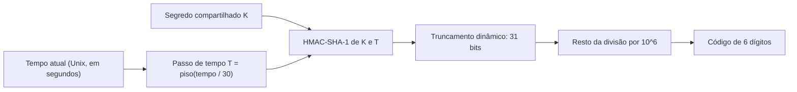
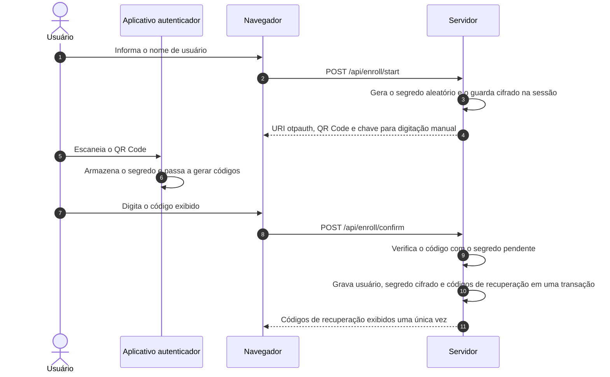
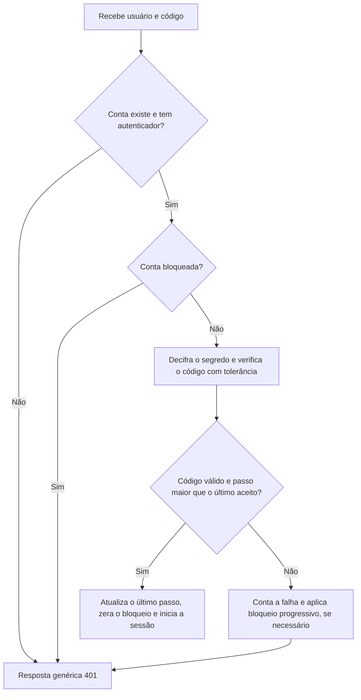
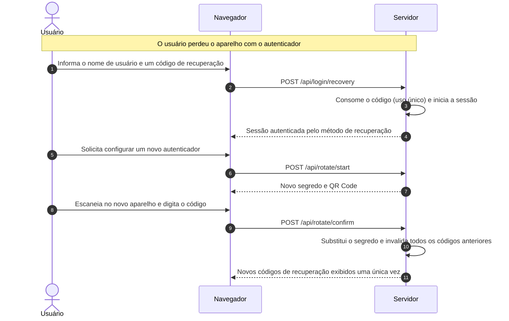

# Tokens de software (TOTP) e códigos de recuperação: projeto de referência

Aplicação web de exemplo que implementa **login com código TOTP**, o código de seis dígitos que muda a cada 30 segundos em aplicativos autenticadores, além de **códigos de recuperação** para quando o aparelho é perdido. Escrita em Node.js e TypeScript, serve de base de estudo para quem quer entender como esse mecanismo funciona por dentro.

> Parte do TCC *Guia de Implementação para Mecanismos de Autenticação sem Senha* (UTFPR, Dois Vizinhos).

## O papel do TOTP

O TOTP **não é o método mais forte** do conjunto. Ele depende de um segredo compartilhado entre o aplicativo e o servidor e **não resiste a phishing em tempo real**: o código vale em qualquer site que o receba. Por isso, neste repositório ele aparece como **contingência e recuperação de acesso**, e não como método principal. Em um sistema real, o caminho principal seriam as [passkeys](../passkeys/README.md), e o TOTP com códigos de recuperação ficaria como alternativa.

## O que o projeto faz

- Cadastra o autenticador do usuário, mostrando um **QR Code** (ou uma chave para digitar) e confirmando com um primeiro código.
- Faz login com **nome de usuário + código TOTP**, sem senha.
- Gera **10 códigos de recuperação** de uso único.
- Permite **trocar o autenticador** (aparelho perdido ou substituído) e gerar novos códigos.
- Protege o segredo e as tentativas: segredo cifrado no banco, código que não pode ser reutilizado, bloqueio progressivo e limite de requisições.

## Como funciona, em resumo

No cadastro, o servidor gera um **segredo** aleatório e o entrega ao aplicativo por QR Code. A partir daí, aplicativo e servidor calculam o mesmo código a cada 30 segundos, usando o segredo e o relógio, sem se comunicar.



| Conceito | O que significa |
|---|---|
| **Passo de tempo** | Intervalo de 30 segundos. Cada passo gera um código diferente |
| **Tolerância de relógio** | O servidor aceita também o passo anterior e o seguinte (±30 s), porque os relógios nunca coincidem exatamente |
| **Último passo aceito** | O servidor guarda o último passo usado e recusa passos iguais ou menores, o que impede reaproveitar um código |
| **Bloqueio progressivo** | Após 5 falhas seguidas a conta é bloqueada por 15 min, depois 30 min, 1 h, e assim por diante até 24 h |
| **Código de recuperação** | Código de uso único, gerado no cadastro, que permite entrar sem o aparelho |
| **`APP_KEY`** | Chave mestra da aplicação, da qual derivam as chaves que cifram os segredos e protegem os códigos de recuperação |

Três pontos que o projeto demonstra:

1. **O servidor precisa guardar o segredo** (cifrado), porque recalcula o código a cada login. Por isso o banco é um alvo mais valioso do que no caso das passkeys, em que só há chaves públicas.
2. **O código não está preso ao site.** Quem o receber dentro da janela de 30 segundos consegue entrar, e é por isso que o TOTP não resiste a phishing.
3. **Qualquer falha de login recebe a mesma resposta**, para que o atacante não distinga usuário inexistente, código errado e conta bloqueada.

## Fluxos

### Cadastro

O segredo fica cifrado na sessão e **nada é gravado no banco** até o usuário provar, com um primeiro código, que o aplicativo está configurado. Só então usuário, segredo e códigos de recuperação são gravados em uma única transação.



### Login



### Recuperação e troca do autenticador

Quem perdeu o aparelho entra com um código de recuperação e configura um novo autenticador. A troca **não exige o código antigo**, mas exige **login recente**.



## O que é necessário

Nenhuma etapa exige hardware dedicado, conta em nuvem ou serviço pago. O servidor é seu e calcula os códigos localmente. O QR Code é gerado dentro da aplicação, **nunca por um serviço externo**, que passaria a conhecer o segredo.

| Item | Versão | Observação |
|---|---|---|
| **Node.js** | 22.13 ou superior | Exigido pelo módulo `node:sqlite` |
| **npm** | Vem com o Node.js | |
| **Git** | Qualquer versão recente | |
| **Aplicativo autenticador** | Qualquer um gratuito | Opcional. Sem celular, use a ferramenta de apoio do projeto (veja "Como testar") |

Confira a versão do Node.js com `node -v`. O relógio do servidor deve estar sincronizado (NTP), porque o TOTP depende do horário.

## Estrutura de pastas

```text
totp/
├── package.json, tsconfig.json, .env.example, .gitignore, Dockerfile, docker-compose.yml
├── src/
│   ├── server.ts           # ponto de entrada
│   ├── config.ts           # configuração e validação
│   ├── crypto.ts           # HKDF, AES-256-GCM, códigos de recuperação
│   ├── totp.ts             # integração com a otplib e URI otpauth
│   ├── qr.ts               # QR Code gerado localmente
│   ├── lockout.ts          # bloqueio progressivo (funções puras)
│   ├── rateLimit.ts        # limitador por IP
│   ├── auth.ts             # serviço de verificação (TOTP e recuperação)
│   ├── db.ts               # SQLite
│   ├── session.ts          # cadastro pendente, login e logout
│   ├── middleware.ts       # autenticação, login recente, limite
│   ├── validation.ts, http.ts, types.d.ts
│   └── routes/
│       ├── enroll.ts       # cadastro do autenticador
│       ├── login.ts        # login por TOTP ou recuperação
│       └── account.ts      # perfil, eventos, novos códigos, troca
├── public/                 # index.html, styles.css, app.js
├── tools/code.ts           # calculadora de código para testes
└── test/                   # testes automatizados
```

## Como rodar

```bash
git clone <URL-DO-REPOSITORIO>
cd <repositorio>/totp

npm install
cp .env.example .env      # no Windows (PowerShell): Copy-Item .env.example .env
npm run dev
```

Acesse **http://localhost:3000**. Em ambiente local, os valores padrão do `.env` funcionam. Se `APP_KEY` estiver vazia, o servidor usa uma chave fixa **insegura** e emite um aviso.

Outros comandos:

```bash
npm run typecheck   # verifica os tipos
npm test            # testes automatizados (inclui os vetores de teste do RFC 6238)
```

### Configuração (`.env`)

| Variável | Padrão | Para que serve |
|---|---|---|
| `PORT` | `3000` | Porta do servidor |
| `ORIGIN` | `http://localhost:3000` | Endereço em que o navegador acessa a aplicação. Também define o atributo `secure` do cookie |
| `TOTP_ISSUER` | `Guia TOTP (TCC)` | Nome do emissor exibido no aplicativo autenticador |
| `TOTP_TOLERANCE_SECONDS` | `30` | Tolerância de relógio, em segundos (de 0 a 90). 30 aceita o passo anterior e o seguinte |
| `APP_KEY` | (vazio) | Chave mestra. **Obrigatória em produção** (mínimo de 32 caracteres) |
| `SESSION_SECRET` | (vazio) | Segredo da sessão. **Obrigatório em produção** |
| `DB_PATH` | `./data/totp.db` | Arquivo do banco SQLite |
| `TRUST_PROXY` | `0` | Use `1` quando houver túnel ou proxy HTTPS na frente do servidor |

Para gerar `APP_KEY` e `SESSION_SECRET`:

```bash
node -e "console.log(require('crypto').randomBytes(32).toString('base64'))"
```

> **Atenção:** se a `APP_KEY` for perdida ou trocada, os segredos já cadastrados deixam de poder ser decifrados, e os usuários precisarão configurar o autenticador de novo.

### Docker (opcional)

Executa a aplicação sem instalar o Node.js. Exige o `package-lock.json` (gerado pelo `npm install`) e **`APP_KEY` e `SESSION_SECRET` definidos no `.env`**.

```bash
docker compose up --build
```

## Como testar

Os testes usam um aplicativo autenticador **ou** a ferramenta de apoio `tools/code.ts`, que calcula o código de um segredo como faria o aplicativo, sem precisar de celular. Ao cadastrar, a página exibe a **chave para digitação manual** (Base32); copie-a e use:

```bash
npm run code -- <CHAVE>                    # código do passo atual
npm run code -- <CHAVE> --offset=30        # código de 30 s à frente (relógio adiantado)
npm run code -- <CHAVE> --offset=-30       # código do passo anterior
```

### Cadastro e login

| Procedimento | Resultado esperado |
|---|---|
| Informe um nome de usuário e gere o QR Code | QR Code e chave manual exibidos |
| Confirme o cadastro com um código **errado**, 5 vezes | Erro a cada tentativa; na 5ª, o cadastro pendente é descartado |
| Confirme com o código **correto** | Cadastro concluído; **10 códigos de recuperação** exibidos uma única vez |
| Saia e entre com um **novo** código | Login aceito |
| Tente entrar de novo com **o mesmo código**, dentro dos 30 s | Recusado (proteção contra reutilização) |
| Use `--offset=30` | Aceito (dentro da tolerância) |
| Use `--offset=90` | Recusado (fora da tolerância) |
| Use `--offset=-30` depois de um login | Recusado, porque só são aceitos passos maiores que o último |

### Bloqueio progressivo

| Procedimento | Resultado esperado |
|---|---|
| Informe 5 códigos errados seguidos | Todos recusados com a **mesma** mensagem genérica |
| Informe em seguida o código **correto** | Recusado: a conta está bloqueada e o código nem é avaliado |
| Tente entrar com um usuário **inexistente** | Mesma mensagem genérica |

Para não esperar os 15 minutos de bloqueio, zere os campos `failed_attempts`, `lock_count` e `locked_until` da tabela `totp` no arquivo `data/totp.db`.

### Recuperação e troca do autenticador

| Procedimento | Resultado esperado |
|---|---|
| Entre usando **um código de recuperação** | Login aceito; restam 9 códigos; aviso para configurar novo autenticador |
| Use **o mesmo código de recuperação** de novo | Recusado (uso único) |
| Use **outro código**, em minúsculas e sem hífen | Aceito (digitação flexível) |
| Em **Trocar o autenticador**, gere o novo QR e confirme com o código do **novo** segredo | Troca concluída; **novos 10 códigos** exibidos |
| Entre com um código do segredo **antigo** ou com um código de recuperação **antigo** | Recusado nos dois casos |
| Em **Gerar novos códigos**, informe um código TOTP correto | Novos códigos; os anteriores deixam de valer |
| Repita com um código TOTP **errado** | Recusado |

### Teste de não vinculação à origem

Mostra a limitação central do TOTP. Obtenha um código válido e, **em até 30 segundos**, use-o a partir de um cliente que não seja o navegador:

```bash
curl -X POST http://localhost:3000/api/login/totp \
  -H "Content-Type: application/json" \
  -d '{"username":"camila","code":"123456"}'
```

Substitua o usuário e o código pelos seus. O login é **aceito**: o código não está preso ao site em que foi digitado. Compare com as passkeys, cuja credencial só funciona no domínio para o qual foi criada.

### Resultados esperados (resumo)

| Verificação | Resultado esperado |
|---|---|
| Código correto, uma vez | Aceito |
| Mesmo código, segunda vez | Recusado |
| +30 s (relógio adiantado) | Aceito |
| +90 s (fora da tolerância) | Recusado |
| −30 s (passo anterior ao último aceito) | Recusado |
| 5 falhas seguidas | Conta bloqueada; resposta idêntica à de erro comum |
| Código de recuperação | Aceito uma única vez |
| Troca do autenticador | Segredo e códigos anteriores invalidados |
| Código usado de outro cliente | **Aceito** (limitação do mecanismo) |
| Banco de dados (`data/totp.db`) | Segredo **cifrado** (começa com `v1.`) e códigos de recuperação apenas como HMAC |

## Decisões de projeto

- **Login por usuário e código TOTP**, sem senha. É um fator único, adequado a contingência e não a contas de alto risco.
- **Cadastro em duas etapas**, com o segredo pendente cifrado na sessão e gravado só após a confirmação.
- **Segredo cifrado em repouso** (AES-256-GCM, vinculado ao usuário), com chaves derivadas da `APP_KEY`.
- **Proteção contra reutilização** pelo último passo aceito.
- **Bloqueio progressivo por conta** e limite de requisições por IP.
- **Resposta genérica** a qualquer falha de login.
- **Códigos de recuperação** armazenados como HMAC, de uso único e substituídos integralmente a cada nova geração ou troca de autenticador.
- **Troca do autenticador** só com login recente.
- **Parâmetros padrão** (SHA-1, 6 dígitos, 30 s), para funcionar com todos os aplicativos.
- **QR Code gerado localmente**, com cabeçalho `Cache-Control: no-store` nas respostas que contêm segredos.

## Limitações e uso em produção

O projeto é uma referência didática e **não está pronto para produção**. Antes de usá-lo em um sistema real, considere:

- **Phishing em tempo real não tem mitigação.** Prefira passkeys como método principal.
- **O elo mais fraco define a segurança.** Se o TOTP ou os códigos de recuperação forem alternativa a passkeys, o atacante escolherá o caminho mais fraco. Considere atrasos e aviso ao usuário por outro canal.
- **Guarde a `APP_KEY` em um cofre de segredos** e planeje a rotação. Se ela vazar junto com o banco, todos os segredos ficam expostos.
- **O bloqueio por conta permite negação de serviço:** quem souber o nome de usuário pode manter a conta bloqueada.
- **Diferença de tempo de resposta** entre usuários existentes e inexistentes permite enumeração. Faça uma verificação fictícia para usuário inexistente.
- **Sessões e limitador de requisições em memória.** Use armazenamento persistente e compartilhado.
- **Enumeração no cadastro.** A resposta 409 revela nomes já existentes.
- **Segredo visível na tela** durante o cadastro. Considere exibir a chave sob demanda.
- **Aplicativos podem sincronizar os segredos na nuvem**, o que escapa ao controle do servidor.
- **LGPD.** O TOTP não trata dados biométricos, mas nome de usuário, metadados e eventos continuam sujeitos à lei.

## Problemas comuns

| Sintoma | Causa provável | Solução |
|---|---|---|
| O código do aplicativo nunca é aceito | Relógio do celular ou do servidor desajustado, ou chave digitada com erro | Ative o horário automático no celular, confira o relógio do servidor e teste com `npm run code -- <CHAVE>` |
| `ERR_UNKNOWN_BUILTIN_MODULE: node:sqlite` | Node.js desatualizado | Atualize para 22.13 ou superior |
| Aviso `ExperimentalWarning: SQLite is an experimental feature` | O módulo `node:sqlite` ainda é experimental | Esperado; não impede a execução |
| "Unsupported state or unable to authenticate data" ao entrar | A `APP_KEY` mudou, ou o registro foi alterado ou copiado de outro usuário | Restaure a chave correta ou refaça o cadastro do autenticador |
| O QR Code não aparece | A política de segurança de conteúdo bloqueia imagens `data:`, ou a requisição de início do cadastro falhou | Confira o console do navegador e o cabeçalho de segurança configurado em `server.ts` |
| Conta bloqueada durante os testes | Bloqueio progressivo ativo | Zere os campos de bloqueio no banco, como descrito em "Bloqueio progressivo" |
| Cookie de sessão não é gravado atrás de um túnel | Proxy HTTPS sem `trust proxy` | Defina `TRUST_PROXY=1` |
| `npm ci` falha no Docker | Falta o `package-lock.json` | Execute `npm install` e versione o arquivo |

## Referências

- M'Raihi, D. et al. *RFC 4226: HOTP: An HMAC-Based One-Time Password Algorithm*. IETF, 2005. https://www.rfc-editor.org/info/rfc4226
- M'Raihi, D. et al. *RFC 6238: TOTP: Time-Based One-Time Password Algorithm*. IETF, 2011.
- Google Authenticator. *Key Uri Format*. https://github.com/google/google-authenticator/wiki/Key-Uri-Format
- NIST. *SP 800-63B: Digital Identity Guidelines, Authentication and Lifecycle Management*.
- otplib. Documentação e código-fonte (v13). https://otplib.yeojz.dev